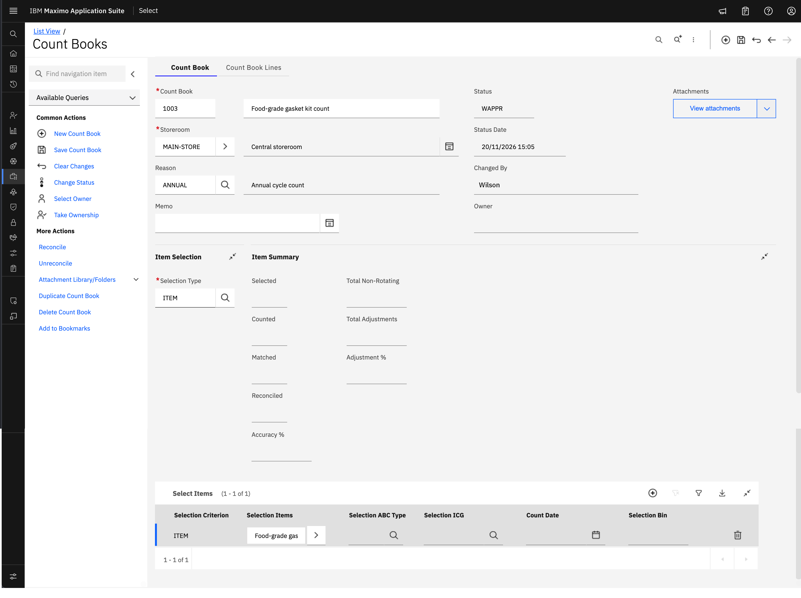

---
search:
  boost: 2
  keywords: count stock physical inventory cycle count count books inventory counting reconcile tolerance recount variance full physical count
---

# How do I count stock?

A count compares what is on the shelf with the balance in the system. Counting on a regular schedule catches errors early, before they delay work.

## When should I perform physical inventory?

Choose the type of count that fits the situation:

### Table 1: Types of physical inventory

| Type | Use it when | Benefits |
| :--- | :--- | :--- |
| **Full physical count** | An annual audit is required, you find major discrepancies, you implement the system, you reorganize the storeroom, or responsibility changes | Confirms every item in the storeroom |
| **Cycle counting** | You want regular partial counts | Less disruptive, continuous accuracy, catches errors early, maintains reliability, and spreads the workload |

---

## How often should I count?

Count the items that matter most more often, and count everything on a fixed schedule.

### Table 2: Sample cycle count schedule

| Items | How often |
| :--- | :--- |
| High-value items | Weekly |
| Fast-moving items | Monthly |
| All items | Quarterly |
| Random spot checks | As needed |

Count systematically:

- Follow the schedule.
- Use count books.
- Verify before you adjust.
- Document your findings.
- Analyze patterns.

---

## How do I use count books?

Count books group items logically, schedule counts, assign counters, track completion, record results, and show variances. The system can generate count books, assign them to users, track progress, record counts, calculate differences, and create adjustments.

You create count books in the Count Books desktop application. You count items in the Inventory Counting mobile app in IBM Maximo Mobile. In Inventory Counting, you can:

- Count the items in a count book.
- Count items that are not in a count book.
- Count items and rotating assets.
- Set tolerances that allow for small differences between the system balance and the physical count.
- See alerts for differences that need a recount.
- Count in batches as part of a cycle count.

You reconcile counts in the Inventory application. Under **Inventory Adjustments**, selecting **Reconcile Balances** reconciles the balances. After you reconcile, the **Reconciled?** checkbox on the inventory balance shows whether the count is reconciled.

{ style="width: 100%; max-width: 900px; display: block; margin: 16px auto;" }

Figure 1: A count book in the Count Books application

---

## Count checklist

Use this checklist to confirm that a count is complete:

### Table 3: Count checklist

| Check | Item | What to verify |
| :--- | :--- | :--- |
| [ ] | Count scheduled | The count follows the cycle count schedule or the reason for a full count is recorded |
| [ ] | Count book ready | The items are grouped in a count book and assigned to a counter |
| [ ] | Counts recorded | Every item in the count book has a counted quantity |
| [ ] | Variances reviewed | Differences outside the tolerance are recounted before you adjust |
| [ ] | Count reconciled | The **Reconciled?** checkbox on the inventory balance shows the count is reconciled |
| [ ] | Findings documented | Notes record what you found and any patterns you noticed |

---

## Related topics

- [What happens if stock is incorrect?](stock-incorrect.md)
- [How do I track stock levels?](track-stock-levels.md)
- [How do I get a new part into inventory?](get-part-into-inventory.md)
- [What apps are in IBM Maximo Mobile?](../../start-fast/basics/other-mobile-apps.md)

---

## Still stuck?

If this page did not answer your question:

- **Browse all Q&A:** [Get answers](../../get-answers/index.md)
- **In the product:** Click the help icon (?) in the top right
- **For a specific field:** Click the field name or press Alt+F1
