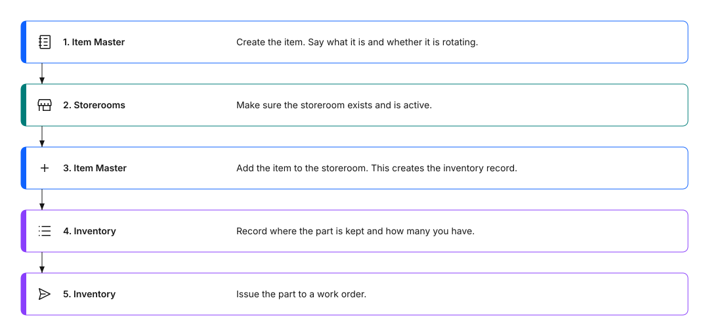

---
search:
  boost: 2
  keywords: item master storeroom inventory add item to storeroom issue unit order unit bin balance physical count set up new part stock a part inventory record
---

# How do I get a new part into inventory?

To stock a part, you work in three applications in order: Item Master, Storerooms, and Inventory. You describe the part once, add it to a storeroom, and then manage how much of it you have.

For example, to stock a food-grade gasket kit for Filler FL-02, you create the item, add it to Main storeroom, and record the starting balance.

## 💡 Tips for success

- Describe each part once in Item Master. Add it to as many storerooms as you need.
- Decide the issue unit before you add the item to a storeroom. It is the unit you use when you take the part out, such as each.
- If you buy a part in a different unit than you issue it, set up the conversion between the two first. For example, you might buy gaskets by the box and issue them one at a time.
- Make sure the storeroom exists before you add items to it.

## Quick reference

Figure 1 illustrates the five sequential steps required to get a new part into inventory and ready for work orders:

1. **Item Master**: create the item record, specify what it is, and indicate whether it is rotating.
2. **Storerooms**: verify that the target storeroom exists and is active.
3. **Item Master**: add the item to the storeroom, which creates the inventory record.
4. **Inventory**: record the physical location such as the bin and enter the quantity on hand.
5. **Inventory**: issue the stocked part to an approved work order.

Figure 1: The steps to get a new part into inventory

### Table 1: From a new part to a balance you can issue

| Order | Application | What you do there |
|-------|-------------|-------------------|
| 1 | **Item Master** | Create the item. Say what it is and whether it is rotating. |
| 2 | **Storerooms** | Make sure the storeroom exists and is active. |
| 3 | **Item Master** | Add the item to the storeroom. This creates the inventory record. |
| 4 | **Inventory** | Record where the part is kept and how many you have. |
| 5 | **Inventory** | Issue the part to a work order. |

To find any of these applications, use the **Find navigation item** field at the top of the menu and search for the application name.

## What is the difference between an item and an inventory record?

An item describes the part. An inventory record describes the part in one storeroom, including how many you have and where they are.

If the same gasket kit is in three storerooms, you have one item and three inventory records. Each record has its own balance.

## How do I create the item?

In Item Master, you describe the part, including whether it is rotating and the units you order and issue it in. Mark rebuildable parts, such as motors, as rotating. For more about the choice, see [How do I plan my storeroom and inventory strategy?](../setup-control/plan-your-storeroom-strategy.md)

## How do I add the item to a storeroom?

From Item Master, use the **Add Items To Storeroom** action. Choose the storeroom, then give the item the details it needs in that storeroom. You can add the item to one storeroom or to several. The issue unit is required because the system needs it to track the balance. You can set up the rest, such as the bin and starting balance, now or later in Inventory.

Adding the item to a storeroom creates its inventory record.

`[SME confirmation required: Confirm the details Select asks for when you add an item to a storeroom, and which of them are required.]`

## How do I set the balance and bin?

In Inventory, open the record for the item and storeroom, and record where the part is kept and how many you have. For example, if you counted 10 gasket kits on the shelf, record 10 as the starting balance.

Record a physical count to check the system against the shelf. If they do not match, see [What happens if stock is incorrect?](stock-incorrect.md)

## What if I cannot issue the part?

Check that the part has a balance in the storeroom. For other causes, see [Why can't I issue materials to a work order?](why-cant-issue-materials.md)

## What to do next

- [How do I issue parts to a job?](issue-parts.md): Take the part out of the storeroom for a work order.
- [How do I track stock levels?](track-stock-levels.md): Watch your balances and reorder needs.
- [How do I plan my storeroom and inventory strategy?](../setup-control/plan-your-storeroom-strategy.md): Decide how to organize storerooms and items before you load them.

---

## Related topics

- [What happens if stock is incorrect?](stock-incorrect.md)
- [Why can't I issue materials to a work order?](why-cant-issue-materials.md)
- [Inventory clerk: Issue a part](../../start-fast/first-task/inventory-clerk-first-task.md)
- [How do I decide: location, asset, or spare part?](../setup-control/decide-location-asset-spare-part.md)
