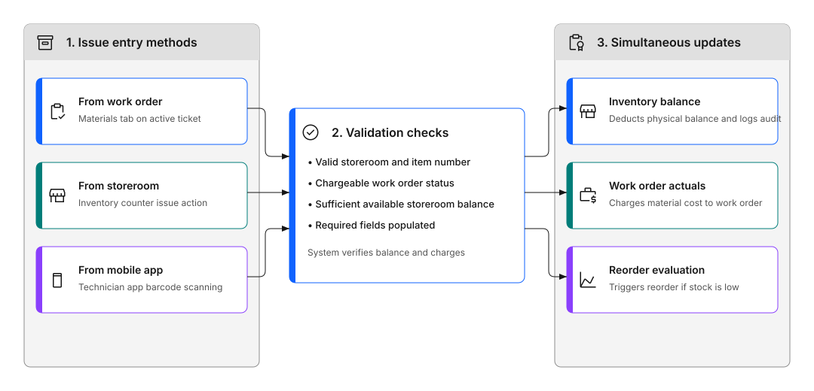
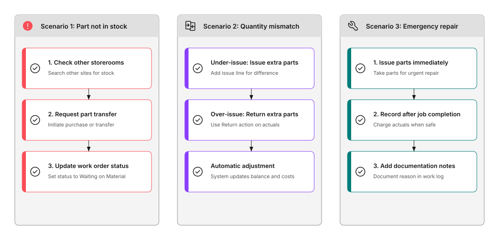

---
search:
  boost: 2
  keywords: issue parts materials items stock spare parts inventory
---

# How do I issue parts to a job?

Take parts from the storeroom and assign them to a work order.

## Quick reference

### Table 1: Issue methods

| Method | When to use |
|--------|-------------|
| **From work order** | Most common, when you're working on a job |
| **From storeroom** | When managing inventory directly |
| **Mobile app** | When working in the field |

Figure 1 illustrates the end-to-end parts issue and material transaction workflow across three main stages:

- **1. Issue entry methods**: Technicians or inventory clerks initiate an issue through one of three paths: from an active work order on the Materials tab, directly at the storeroom counter using the Inventory issue action, or in the field using barcode scanning in the Technician mobile app.
- **2. Validation checks**: The system validates the transaction by confirming a valid storeroom and item number, verifying that the work order is in a chargeable status, checking that sufficient available storeroom balance exists, and confirming all required accounting fields are populated.
- **3. Simultaneous updates**: Upon successful validation, the system executes three updates simultaneously: deducting the physical balance from the storeroom and logging an audit transaction, charging actual material costs directly to the work order, and evaluating reorder thresholds to trigger inventory replenishment if stock drops below minimum levels.

Figure 1: Parts issue and material transaction workflow

---

### 💡 Tips: Best practices for issuing parts

**Before you start work:**

- Check the job plan for required materials
- Verify parts are in stock
- Reserve parts if needed for later
- Request parts that aren't available

**During the job:**

- Issue parts as you use them
- Record actual quantities used
- Return unused parts promptly
- Note if you used different parts than planned

**After completing work:**

- Verify all materials are recorded
- Return any unused parts
- Add notes about part usage
- Close the work order

## Why issue parts properly?

When you issue parts correctly, the system:

- Updates inventory levels automatically
- Records costs to the work order
- Tracks what materials were used
- Helps with reordering decisions

This ensures accurate inventory counts and a complete record of what each job cost.

---

## When should I issue parts?

Issue parts when:

- You're starting a job and need materials
- You use parts during a repair
- You want costs recorded to the work order

---

## How do I issue parts?

### Method 1: Issue from work order

This is the most common way to issue parts.

**What to do:**

1. Open your assigned work order.
2. Go to the Materials or Actuals tab.
3. Click to add a material.
4. Search for the item by number or description.
5. Select the correct item.
6. Enter how many you need.
7. Choose the storeroom location.
8. Click **Issue**.

The system checks if parts are available, deducts from inventory, adds cost to the work order, and records the transaction.

!!! warning "TODO: Add visual content"
     A video showing how to issue parts from a work order would be useful here.

### Method 2: Issue from storeroom

Use this when managing inventory directly.

**What to do:**

1. Open the Inventory application.
2. Search for the item you need.
3. Open the inventory record.
4. Click **Issue Current Item**.
5. Enter the work order number.
6. Specify quantity.
7. Confirm the issue.

The system updates inventory balance, shows the material on the work order, and records the cost.

Inventory clerks can also use the Issues and Transfers app on the desktop or in IBM Maximo Mobile. Use it to issue items that are reserved for approved work orders, issue items that are not reserved, and transfer items between storerooms or between bins.

### Method 3: Use mobile app

On mobile devices:

- Open your work order
- Add materials as you use them
- Scan barcodes if available
- Changes sync automatically

!!! warning "TODO: Add visual content"
     A screenshot showing the mobile parts issue screen would be useful here.

---

## What happens when I issue parts?

The system automatically:

- Reduces inventory: storeroom balance goes down
- Records cost: material cost is added to the work order
- Tracks usage: creates transaction history
- Updates reorder: triggers reorder if below minimum
- Logs who and when: records who issued and when

---

## Common scenarios

### Part not in stock

If the part you need isn't available:

1. Check other storeroom locations.
2. Request a purchase.
3. Use an alternate part if approved.
4. Update work order status to "Waiting on Parts".

### Used wrong quantity

If you issued too many or too few parts:

1. Issue additional parts if you need more.
2. Return unused parts to storeroom.
3. System adjusts inventory and costs.
4. Add notes explaining the change.

### Emergency issue

For urgent repairs:

1. Issue parts immediately.
2. Add to work order as soon as possible.
3. Don't skip recording: it affects inventory.
4. Explain urgency in notes.

Figure 2 outlines the sequential resolution workflows for three common parts issue scenarios:

- **Scenario 1 (Part not in stock)**: First check other storerooms across plant sites for available stock, then initiate a purchase requisition or storeroom transfer, and finally update the work order status to Waiting on Material.
- **Scenario 2 (Quantity mismatch)**: For an under-issue where additional parts are needed, create an extra issue line for the difference. For an over-issue where too many parts were taken, use the Return action on the actuals tab to return extra parts to the storeroom. The system automatically adjusts storeroom balance and work order cost.
- **Scenario 3 (Emergency repair)**: For urgent breakdowns, issue parts immediately to perform the repair, record the material actuals on the work order once the equipment is safe, and add explanatory documentation notes to the work log.

Figure 2: Decision tree for handling common parts issue scenarios

---

## How do I return unused parts?

If you have leftover parts:

**What to do:**

1. Go to the work order.
2. Find the issued material.
3. Click **Return** action.
4. Enter quantity to return.

The system increases inventory balance, adjusts cost on work order, and records the transaction.

---

## Why accurate parts tracking matters

**For your organization:**

- Correct inventory counts
- Accurate cost tracking
- Better reorder planning
- Reliable stock levels

**For you:**

- Parts are available when needed
- No delays waiting for materials
- Clear record of what was used
- Easier to find parts next time

---

Issuing parts accurately keeps inventory reliable for everyone and makes it easier to plan future work.

## Continue building your skills

### When an issue fails

Learn what to check when the system won't let you issue a part to a work order.

[Why can't I issue materials to a work order?](why-cant-issue-materials.md)

### Know what you have

Monitor stock levels so you can see what's running low before it causes a delay.

[How do I track stock levels?](track-stock-levels.md)

### Fix a discrepancy

When the system and the shelf don't match, learn how to investigate and correct it.

[What happens if stock is incorrect?](stock-incorrect.md)

---

## Related topics

- [How do I track stock levels?](track-stock-levels.md)
- [What happens if stock is incorrect?](stock-incorrect.md)
- [How do I complete a job?](../complete-work/complete-job.md)
- [What if I can't complete a task?](../complete-work/cant-complete-task.md)
- [What apps are in IBM Maximo Mobile?](../../start-fast/basics/other-mobile-apps.md)
