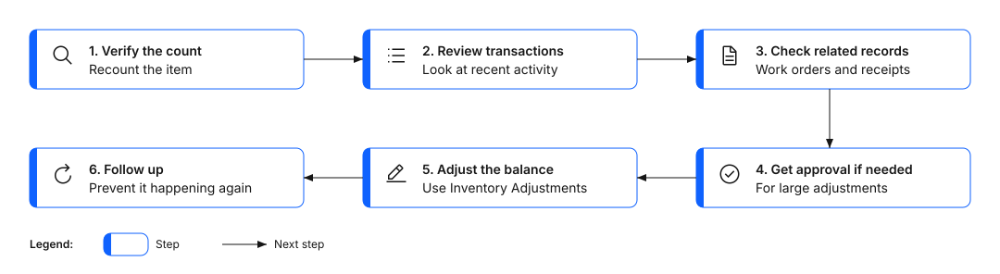
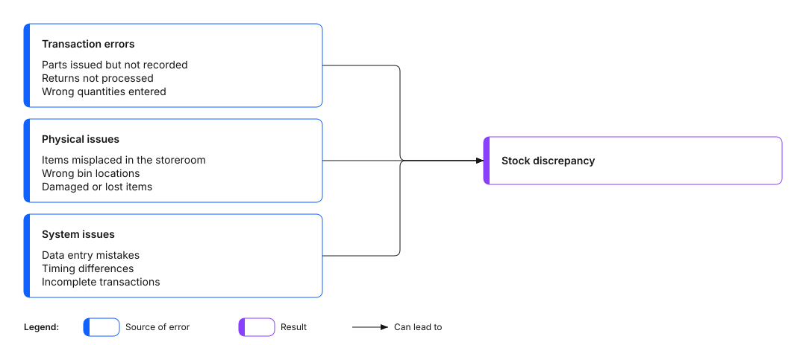
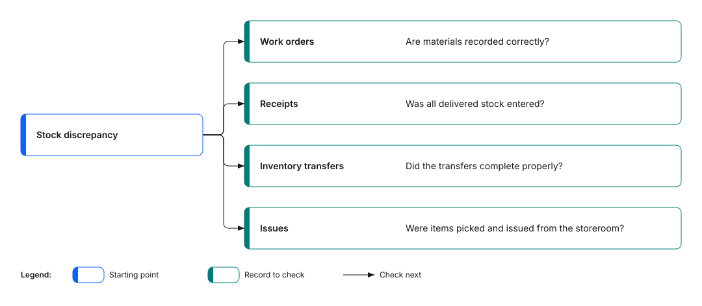
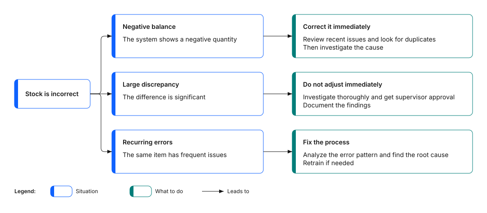

# What happens if stock is incorrect?

When physical inventory doesn't match system records, you need to investigate and correct it.

## Quick reference

Figure 1 outlines the sequential six-step inventory correction process:

1. **Verify the count**: recount the item to confirm physical quantities.
2. **Review transactions**: look at recent activity for missed entries.
3. **Check related records**: inspect work orders and receipts.
4. **Get approval if needed**: obtain supervisor sign-off for large adjustments.
5. **Adjust the balance**: update records by using Inventory Adjustments.
6. **Follow up**: resolve underlying causes to prevent recurrence.

Figure 1: The inventory correction process

Looking to plan or run a count? See [How do I count stock?](count-stock.md).

---

## Why fix inventory errors quickly?

Inventory discrepancies can cause stockouts, excess inventory, and inaccurate costs.

Fixing errors quickly ensures:

- Accurate records
- No work delays
- Reliable stock levels
- Correct cost tracking

Regular counting and prompt adjustments keep your inventory data trustworthy.

---

## What causes inventory errors?

### Table 1: Common causes of stock discrepancies

| Common cause | Examples |
| :--- | :--- |
| **Transaction errors** | Parts issued but not recorded, returns not processed, wrong quantities entered, duplicate transactions, missing receipts |
| **Physical issues** | Items misplaced in the storeroom, wrong bin locations, damaged or lost items, theft or shrinkage, items in the wrong storeroom |
| **System issues** | Data entry mistakes, timing differences, incomplete transactions, system errors, integration problems |

Figure 2 shows how transaction errors, physical issues, and system issues each lead to a stock discrepancy.

Figure 2: Common sources of inventory errors

---

## How do I identify discrepancies?

### Table 2: Where you notice a discrepancy

| Where | What you see |
| :--- | :--- |
| **During work** | An item shows in stock but you can't find it; the physical count doesn't match the system; a bin is empty but the system shows a quantity; the wrong item is in a labeled bin; unexpected items are in the storeroom |
| **Through cycle counts** | Quantity differences, location errors, missing items, extra items, condition issues |
| **From reports** | Negative balances, which are physically impossible; unusually high balances; no movement for long periods; frequent adjustments; cost variances |

For more about counts, see [How do I count stock?](count-stock.md).

!!! warning "TODO: Add visual content"
     A screenshot showing an inventory discrepancy report would be useful here.

---

## How do I investigate discrepancies?

### Step 1: Verify the physical count

Before adjusting the system:

**Recount the item:**

- Check all bins for this item
- Look in nearby locations
- Verify item number matches
- Check for similar items

**Check for reserved items:**

- Items in pick lists
- Parts allocated to work orders
- Items being transferred
- Staged materials

**Look for recent transactions:**

- Issues not yet processed
- Returns in progress
- Receipts being entered
- Transfers pending

### Step 2: Review transaction history

Check recent activity:

- **Issue transactions**: Were parts recorded?
- **Receipts**: Did everything get entered?
- **Returns**: Were returns processed?
- **Transfers**: Did transfers complete?
- **Adjustments**: Previous corrections made?

Look for patterns:

- Repeated errors with same item
- Specific user or storeroom
- Particular transaction type
- Time of day issues occur

### Step 3: Check related records

### Table 3: Related records to check

| Record | What to verify |
| :--- | :--- |
| **Work orders** | Materials recorded correctly against work tasks |
| **Receipts** | All delivered stock entered into the system |
| **Inventory transfers** | Transfers completed properly across locations |
| **Issues** | Items picked and issued from the storeroom |

Figure 3 maps the four related records to check when a stock discrepancy is identified.

Figure 3: Related records to check when stock is incorrect

---

## How do I correct inventory?

### Make adjustments

Once you've verified the error:

**What to do:**

1. Open the Inventory application.
2. Find the item.
3. Go to the storeroom with error.
4. Use **Inventory Adjustments**.
5. Enter correct physical quantity.
6. System calculates difference.
7. Add reason for adjustment.
8. Include detailed notes.

The system updates balance, adjusts cost, records transaction, and creates audit trail.

!!! warning "TODO: Add visual content"
     A video showing how to adjust inventory would be useful here.

---

## Types of adjustments

### Table 4: Types of adjustments

| Adjustment | Use it when |
| :--- | :--- |
| **Increase quantity** | You found items that were not recorded, a receipt was missed, a return was not processed, or a transfer was not completed |
| **Decrease quantity** | Items were issued but not recorded, items are damaged or lost, items were stolen or lost to shrinkage, or items moved to another location |
| **Move location** | The wrong bin was recorded, you are reorganizing the storeroom, you are consolidating locations, or you are correcting bin assignments |
| **Correct cost** | The wrong price was entered, the cost method changed, the vendor price was corrected, or currency needs adjusting |

---

## Adjustment best practices

### Table 5: Adjustment best practices

| Practice | What to do |
| :--- | :--- |
| **Always document** | Record what you found, what you expected, why the error occurred, who discovered it, when it was found, and the corrective action taken |
| **Get approval if needed** | Get approval for large adjustments, high-value items, frequent corrections, and unusual circumstances |
| **Follow up** | Prevent recurrence, train if needed, improve processes, and monitor for patterns |

---

## Handling specific scenarios

### Negative balance

If system shows negative quantity:

1. This shouldn't happen physically.
2. Indicates transaction error.
3. Review recent issues.
4. Check for duplicate transactions.
5. Correct immediately.
6. Investigate cause.

### Large discrepancy

For significant differences:

1. Don't adjust immediately.
2. Investigate thoroughly.
3. Get supervisor approval.
4. Document extensively.
5. Implement prevention.
6. Monitor closely.

### Recurring errors

If same item has frequent issues:

1. Analyze error pattern.
2. Identify root cause.
3. Fix process problem.
4. Retrain if needed.
5. Consider item changes.
6. Monitor improvement.

Figure 4 outlines the decision paths and corrective actions for three inventory discrepancy situations:

- **Negative balance**: when the system shows a negative quantity, correct it immediately by reviewing recent issues and looking for duplicate entries, then investigate the root cause.
- **Large discrepancy**: when the difference is significant, do not adjust immediately; investigate thoroughly, obtain supervisor approval, and document the findings.
- **Recurring errors**: when the same item has frequent issues, fix the process by analyzing the error pattern, identifying the root cause, and retraining staff if needed.

Figure 4: How to handle different types of inventory error

---

## How do I prevent inventory errors?

### Table 6: Good practices to prevent errors

| When | Good practices |
| :--- | :--- |
| **At issue time** | Record transactions immediately, verify quantities, check item numbers, confirm locations, and complete transactions fully |
| **At receipt time** | Count carefully, match to the purchase order, verify item numbers, put items in the correct location, and record promptly |
| **During returns** | Process immediately, verify condition, return to the correct bin, update the system, and note any issues |
| **Daily** | Record transactions immediately, verify before confirming, return items promptly, keep the storeroom organized, and report issues quickly |
| **Weekly** | Review high-value items, check reorder items, spot check locations, investigate variances, and update procedures |
| **Monthly** | Analyze error patterns, review adjustment reports, conduct cycle counts, train as needed, and improve processes |
| **Storeroom organization** | Use clear bin labels, a logical layout, separated similar items, regular housekeeping, and defined locations |
| **Access control** | Allow authorized personnel only, provide proper training, keep clear procedures, assign accountability, and apply security measures |

For how to schedule counts, see [How do I count stock?](count-stock.md).

---

## What's the impact of inventory errors?

### Table 7: Impact of inventory errors

| Area | Effects |
| :--- | :--- |
| **Stockouts** | Work delays, emergency orders, higher costs, service issues |
| **Excess inventory** | Wasted space, tied-up cash, obsolescence risk, carrying costs |
| **Direct costs** | Incorrect work order costs, wrong inventory valuation, budget variances, financial reporting errors |
| **Indirect costs** | Time investigating, emergency purchases, lost productivity, customer dissatisfaction |
| **Planning** | Wrong reorder quantities, incorrect stock levels, bad purchasing decisions, inefficient operations |

---

## Stock correction checklist

Use this checklist to confirm that a stock correction is complete:

### Table 8: Stock correction checklist

| Check | Item | What to verify |
| :--- | :--- | :--- |
| [ ] | Count verified | You rechecked all bins and nearby locations and confirmed the item number |
| [ ] | Reserved items checked | Pick lists, work order allocations, transfers, and staged materials are accounted for |
| [ ] | Transactions reviewed | Recent issues, receipts, returns, transfers, and earlier adjustments are checked |
| [ ] | Related records checked | Work orders, receipts, inventory transfers, and issues are correct |
| [ ] | Approval obtained | A supervisor approved any large, high-value, or unusual adjustment |
| [ ] | Adjustment made | Inventory Adjustments shows the correct physical quantity, a reason, and detailed notes |
| [ ] | Cause followed up | You acted on the cause so the error does not recur |

---

## Continue building your skills

### Understand what your numbers mean

Learn which inventory metrics matter and how to use them to keep parts available when work demands them.

[What metrics matter?](../monitor-respond/what-metrics-matter.md)

---

## Related topics

- [How do I count stock?](count-stock.md)
- [How do I track stock levels?](track-stock-levels.md)
- [How do I issue parts to a job?](issue-parts.md)
- [How do I complete a job?](../complete-work/complete-job.md)
- [What if I can't complete a task?](../complete-work/cant-complete-task.md)

---

## Still stuck?

If this page did not answer your question:

- **Browse all Q&A:** [Get answers](../../get-answers/index.md)
- **In the product:** Click the help icon (?) in the top right
- **For a specific field:** Click the field name or press Alt+F1
