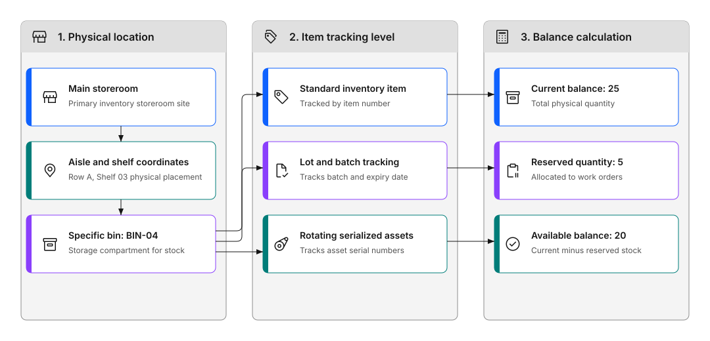
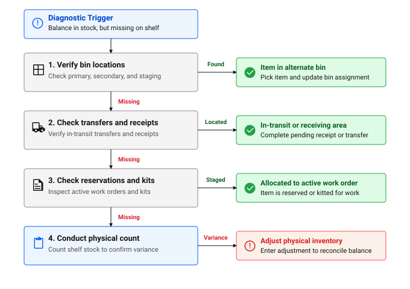

# How do I track stock levels?

Monitor what's in your storerooms so you know what's available, what needs reordering, and where items are located.

## Quick reference

### Table 1: Stock balance types

| Balance type | What it means |
|--------------|---------------|
| **Current balance** | Total quantity in storeroom (includes reserved items) |
| **Available balance** | What you can actually use (current minus reserved) |
| **Reserved quantity** | Parts allocated to work orders |
| **Reorder point** | Minimum level before reordering |

!!! warning "TODO: Add visual content"
     A dashboard showing key inventory metrics would be useful here.

---

## 💡 Tips for success

**Regular monitoring:**

- Check stock levels daily
- Review reorder needs weekly
- Analyze usage monthly
- Audit inventory quarterly

**Maintain accuracy:**

- Issue parts promptly
- Return unused items
- Perform cycle counts
- Investigate discrepancies

**Optimize levels:**

- Adjust reorder points based on usage
- Reduce slow-moving inventory
- Increase stock of critical items
- Balance cost versus availability

**Use reports:**

- Stock status reports
- Reorder reports
- Usage analysis
- Cost reports
- ABC analysis: prioritize high-value items

## Why track stock levels?

Good inventory tracking prevents stockouts and ensures parts are available when you need them.

When you track stock levels, you can:

- Know what's available right now
- See what needs reordering
- Find where items are located
- Control costs
- Optimize storeroom space

The system tracks quantities, costs, and locations automatically as items move in and out.

---

## What can I track?

The Inventory application shows:

**Current balance**
How many items are in stock.

**Location**
Which storeroom and bin.

**Cost**
Current value of inventory.

**Reorder status**
Items below minimum levels.

**Reserved items**
Parts allocated to work orders.

**Usage history**
How items are being consumed.

---

## How do I view inventory levels?

### Check a specific item

**What to do:**

1. Open the Inventory application.
2. Search by item number or description.
3. Select the item.
4. View the information you need:
   - Current quantity on hand
   - Available balance: not reserved
   - Cost information
   - Reorder point and minimum stock level

If the item is in multiple storerooms, you can view all locations on one screen and compare quantities across sites.

!!! warning "TODO: Add visual content"
     A screenshot showing the inventory balance view would be useful here.

### Check storeroom contents

**What to do:**

1. Open the Storerooms application.
2. Select your storeroom.
3. View all items stocked there:
   - Current quantities
   - Items below reorder point
   - Reserved quantities
   - Items in pick lists

### View by bin or lot

For detailed tracking:

- **Bin level**: See exactly where items are stored
- **Lot level**: Track specific batches
- **Condition**: Monitor item condition changes
- **Rotating assets**: Track individual asset items

Figure 1 illustrates the storeroom inventory hierarchy across three connected columns representing physical location, item tracking levels, and real-time balance calculations:

- **Physical location**: Navigates from Main storeroom as the primary inventory site, down through aisle and shelf coordinates such as Row A, Shelf 03, to a specific storage compartment, BIN-04.
- **Item tracking level**: From the physical bin, items branch into three tracking modes: standard inventory items tracked by item number, lot and batch tracking recording batch numbers and expiration dates, and rotating serialized assets tracking unique serial numbers.
- **Balance calculation**: Tracks inventory availability across records, where a current physical balance of 25 items minus a reserved quantity of 5 items allocated to work orders yields an available balance of 20 items ready for issue.

Figure 1: Storeroom hierarchy for bin, lot, and rotating asset tracking

---

## How do I understand inventory balances?

### Key balance types

**Current balance**

- Total quantity in storeroom
- Includes reserved items
- Shows what you physically have

**Available balance**

- Current balance minus reserved
- What you can actually use
- Updates as items are reserved

**Reserved quantity**

- Parts allocated to work orders
- Not available for other use
- Released when work order closes

Reservations are either hard or soft. A **hard reservation** immediately reduces available balance and requires sufficient stock to exist. If stock is insufficient, the reservation cannot be created and work order approval may fail. A **soft reservation** records demand without locking stock. If your storeroom uses hard reservations and a critical spare such as a nozzle seal for Filler FL-02 runs out, technicians will not be able to reserve it at approval time, causing delays. Check which reservation type is configured for critical items.

**Picked quantity**

- Items in active pick lists
- Being prepared for issue
- Not yet issued to work order

---

## How do I monitor reorder needs?

### Reorder point system

The system tracks:

### Table 2: Reorder settings and when each is required

| Setting | Required when |
|---|---|
| **Reorder point** | You want the system to flag items for reordering automatically |
| **Lead time** | The reorder calculation should account for procurement time. Without it, items may be flagged too late |
| **Order quantity (EOQ)** | You want the system to recommend how much to order, not just flag that an order is needed |
| **Safety stock** | Only when demand is unpredictable and you need a buffer above the reorder point |

When balance drops below reorder point, the system flags the item so you can replenish stock.

#### How the reorder calculation works

The system uses this formula: **Order quantity = Reorder point + 1, minus quantity on order, minus available balance.**

The +1 means a reorder point of 0 still triggers an order when balance hits zero. Setting your reorder point equal to your minimum-on-hand target is a common misconfiguration that causes reorders to trigger one unit too early and leads to excess stock over time.

### Check items to reorder

**What to do:**

1. Filter for items below reorder point.
2. See recommended order quantities.
3. Check vendor information.
4. Review lead times.
5. Take action:
   - Order parts from supplier or request replenishment
   - Transfer from another storeroom
   - Adjust reorder settings if needed

!!! warning "TODO: Add visual content"
     A screenshot showing the reorder report would be useful here.

---

## How do I track item costs?

### Cost information available

For each item, see:

- **Average cost**: Current average unit cost
- **Last cost**: Most recent purchase price
- **Standard cost**: Planned or budgeted cost
- **Total value**: Quantity × cost

### How costs are calculated

**Average cost method**

- Weighted average of all purchases
- Updates with each receipt
- Smooths price fluctuations
- Most common method

If a high-value emergency purchase is received, it raises the average cost for all future issues of that item until the balance normalises. This can distort maintenance cost reports for that period. For frequently used spare parts such as nozzle seals for Filler FL-02, average cost is usually appropriate. For low-volume, high-value items, consider whether standard cost gives you more predictable reporting.

**Standard cost method**

- Fixed cost set in advance
- Doesn't change with purchases
- Variances tracked separately
- Used for budgeting

---

## How do I monitor inventory usage?

### Usage tracking

The system records:

- When parts are used, from issue transactions
- What jobs used items, from work orders
- How often items are needed
- Usage patterns over time

### Analyze usage

Use this information to:

- Identify fast-moving items
- Spot slow-moving inventory
- Adjust stock levels
- Improve reorder quantities
- Reduce excess inventory

!!! warning "TODO: Add visual content"
     A graph showing usage trends would be useful here.

---

## Special inventory types

### Rotating items

For serialized assets:

- Track individual items
- Monitor asset condition
- See installation history
- Manage asset rotation

### Item kits

For grouped items:

- Issue multiple items together
- Track kit components
- Maintain kit integrity
- Simplify common issues

!!! warning "TODO: Add visual content"
     A comparison table of special item types would be useful here.

---

## Common scenarios

### Item running low

When stock is getting low:

1. Check reorder settings.
2. Verify lead time.
3. Order replacement stock or transfer from another storeroom.
4. Update reorder point if needed.

### Excess inventory

If you have too much:

1. Review usage history.
2. Check for obsolete items.
3. Transfer to other locations.
4. Adjust reorder quantities.
5. Consider disposal if appropriate.

### Can't find item

If item shows in stock but you can't find it:

1. Check bin location.
2. Verify storeroom.
3. Look for reserved quantity.
4. Check pick lists.
5. Perform physical count.
6. Adjust if necessary.

Figure 2 illustrates the diagnostic workflow when an item shows a positive stock balance in the system but cannot be found on the storeroom shelf:

- **Diagnostic trigger**: Starts when the system balance shows stock on hand, but the item is missing from its primary shelf location.
- **Step 1 (Verify bin locations)**: Check primary, secondary, and staging bins. If found in an alternate bin, pick the item and update the bin assignment in the system. If still missing, proceed to Step 2.
- **Step 2 (Check transfers and receipts)**: Verify in-transit transfers between storerooms and recent receiving staging areas. If located in receiving or transit, complete the pending transaction. If still missing, proceed to Step 3.
- **Step 3 (Check reservations and kits)**: Inspect active work orders and staged item kits. If the item was allocated to an active work order, it is already staged for maintenance. If still missing, proceed to Step 4.
- **Step 4 (Conduct physical count)**: Count physical shelf stock across the storeroom. If a true variance is confirmed, enter an inventory adjustment in the Inventory application to reconcile the balance.

Figure 2: Missing inventory item troubleshooting workflow

---

## Why accurate tracking matters

**Prevents stockouts:**

- Parts available when needed
- No work delays
- Better service levels
- Fewer emergency orders

**Controls costs:**

- Reduces excess inventory
- Optimizes stock levels
- Improves cash flow
- Lowers carrying costs

**Improves planning:**

- Better reorder decisions
- Accurate budgeting
- Informed purchasing
- Efficient operations

---

Good stock visibility means fewer surprises when jobs need parts and fewer delays when it matters most.

## Continue building your skills

### Fix a discrepancy

When the system and the shelf don't match, learn how to investigate and correct it.

[What happens if stock is incorrect?](stock-incorrect.md)

### Understand what your numbers mean

Learn which inventory metrics matter and how to use them to keep parts available when work demands them.

[What metrics matter?](../monitor-respond/what-metrics-matter.md)

---

## Related topics

- [How do I get a new part into inventory?](get-part-into-inventory.md)
- [How do I issue parts to a job?](issue-parts.md)
- [What happens if stock is incorrect?](stock-incorrect.md)
- [How do I plan recurring maintenance?](../plan-work/plan-recurring-maintenance.md)
- [How do I complete a job?](../complete-work/complete-job.md)
- [How do I plan my storeroom and inventory strategy?](../setup-control/plan-your-storeroom-strategy.md)
