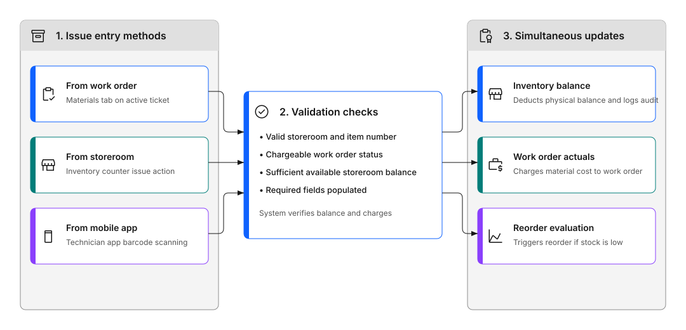

# Why can't I issue materials to a work order?

Material issues fail when required fields or relationships are missing.

## What to check first

### Storeroom, item, and quantity are valid

The system needs to know:

- **Which storeroom** the part is coming from
- **Which item** you're issuing, using the correct item number
- **How many** you're issuing, as a valid quantity

**What to do**: Verify all three pieces of information are correct and the item exists in that storeroom.

### Work order exists and is chargeable

You can only issue materials to work orders that:

- Exist in the system
- Are in a status that allows charging
- Haven't been closed or completed

**What to do**: Check the work order status. If it's closed or in a non-chargeable status, you'll need to reopen it or change the status first.

### Required fields are populated

Some organizations require additional information:

- **Bin location**: Where in the storeroom the part is stored
- **Unit of measure**: The unit you're issuing, such as each, box, or meter
- **GL account**: For cost tracking

**What to do**: Fill in all required fields. If you're not sure what's required, check with your supervisor or system administrator.

---

## Why didn't inventory update after issuing?

Material issues should trigger inventory and cost updates simultaneously. If they didn't, something went wrong.

Figure 1 illustrates the parts issue validation and update workflow:

- **1. Issue entry methods**: Work begins from an active work order, at the storeroom counter, or via the mobile app.
- **2. Validation checks**: The system checks four conditions: valid storeroom and item number, chargeable work order status, sufficient available storeroom balance, and populated required fields.
- **3. Simultaneous updates**: When all validation checks pass, the system performs three actions at the same time: deducts the physical balance from the storeroom, records actual material costs on the work order, and evaluates whether remaining stock breaches the reorder point. If any validation check fails, none of these updates occur.

Figure 1: Parts issue and material transaction workflow

### Transaction didn't complete

The issue might have failed partway through.

**What to check**:

- Look for error messages you might have missed
- Verify the transaction appears in the work order's materials list
- Check if inventory balance changed

**What to do**: If the transaction didn't complete, try issuing again. If it appears to have worked but inventory didn't update, contact your system administrator.

### Wrong storeroom or item used

If you issued from the wrong storeroom or selected the wrong item, the inventory update happened in the wrong place.

**What to do**:

1. Return the incorrectly issued material
2. Issue the correct item from the correct storeroom
3. Add notes explaining the correction

### Issue not confirmed

Some systems require confirmation after issuing.

**What to do**: Check if there's a confirmation step you need to complete, or verify the issue was saved properly.

---

## Why do users issue parts incorrectly?

Common causes of issuing errors:

### Confusion between planned vs unplanned materials

- **Planned materials**: Already listed on the work order, just need to be issued
- **Unplanned materials**: Need to be added and issued

**What to do**: Check if the material is already planned on the work order. If so, issue it directly. If not, add it first, then issue.

### Multiple ways to issue

You can issue materials from:

- The work order, which is the most common
- The inventory application
- Mobile apps

Each method works slightly differently.

**What to do**: Use the method your organization prefers, typically issuing directly from the work order.

### Missing understanding of cost tracking

When you issue materials, costs are automatically recorded against the work order.

**Why it matters**: Incorrect issues lead to:

- Wrong costs on work orders
- Inaccurate inventory balances
- Poor cost reporting

**What to do**: Always issue materials to the correct work order and verify quantities are accurate.

---

## Why are costs or usage incorrect?

Issues are often caused by:

### Issuing to the wrong work order

If you issue materials to the wrong work order, costs are charged incorrectly.

**What to do**:

1. Return the material from the wrong work order
2. Issue it to the correct work order
3. Add notes explaining the correction

### Using incorrect quantities or units

Issuing the wrong quantity or using the wrong unit of measure causes cost and inventory errors.

**What to do**:

- Double-check quantities before issuing
- Verify the unit of measure is correct
- Return excess materials if you issued too much

### Skipping planned reservations

If materials were reserved for a work order, issuing different materials can cause confusion.

**What to do**: Issue the reserved materials when possible, or update the reservation if you need to use different materials.

---

## Material issue troubleshooting checklist

Use this checklist to identify why a material transaction failed to record:

### Table 1: Material issue troubleshooting checklist

| Check | Item | What to verify |
| :--- | :--- | :--- |
| [ ] | Chargeable work order status | Work order is in an approved or in-progress status (APPR, WSCHED, or INPRG), not WAPPR, CAN, or CLOSE |
| [ ] | Active storeroom | Selected storeroom record exists and is set to ACTIVE status |
| [ ] | Inventory item record | Item is linked to the storeroom with an established inventory record |
| [ ] | Bin balance availability | Storeroom bin has sufficient quantity on hand, or the storeroom allows negative balance |
| [ ] | Unit of measure alignment | Issue unit on the transaction matches the inventory issue unit defined for the item |
| [ ] | Storeroom user authorization | User account has security authorization to issue materials from the selected storeroom |

---

## Continue building your skills

### Know what you have before you issue

Monitor stock levels so you can see what's available in each storeroom before you start a job.

[How do I track stock levels?](track-stock-levels.md)

### Fix a discrepancy

When the system and the shelf don't match, learn how to investigate and correct it.

[What happens if stock is incorrect?](stock-incorrect.md)

---

## Related topics

- [How do I issue parts to a job?](issue-parts.md)
- [What happens if stock is incorrect?](stock-incorrect.md)
- [How do I track stock levels?](track-stock-levels.md)
- [What if I can't complete a task?](../complete-work/cant-complete-task.md)
---

## Still stuck?

If this page did not answer your question:

- **Browse all Q&A:** [Get answers](../../get-answers/index.md)
- **In the product:** Click the help icon (?) in the top right
- **For a specific field:** Click the field name or press Alt+F1
