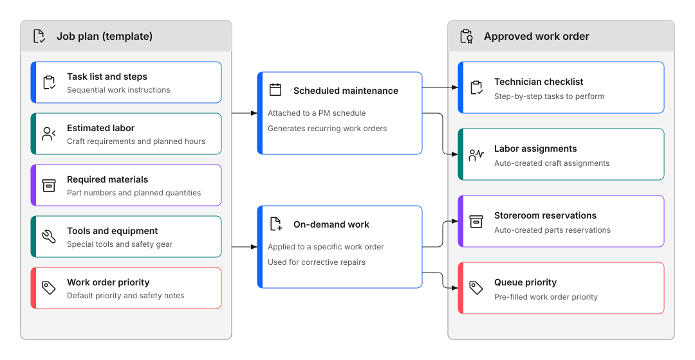

# How do I decide what work should be done?

Create job plans that list the steps, parts, and tools for common maintenance tasks. Job plans work like templates. They keep work consistent every time.

You plan the work once. Then you reuse the plan. This saves time and reduces mistakes.

Figure 1 illustrates how a job plan template flows into an approved work order:

- **Job plan template**: defines sequential task steps, estimated labor and craft hours, required materials and quantities, special tools, and default work order priority.
- **Application paths**: attached to a recurring preventive maintenance schedule or applied directly to an on-demand corrective work order.
- **Approved work order outcome**: upon approval, the system automatically populates task checklists, schedules labor assignments, generates storeroom material reservations, and applies priority ratings.

Figure 1: How job plans flow into work orders

### 💡 Tips: Best practices for job plans

**Start with common tasks**
Create plans for work you do most often.

**Keep it simple**
Use clear, short instructions.

**Add safety notes**
Include warnings for dangerous work.

**Update regularly**
Change plans based on worker feedback.

**Use for all scheduled work**
Every maintenance schedule should have a job plan.

## When to use job plans

Use job plans for:

- Tasks you do regularly, such as monthly inspections
- Work with multiple steps
- Jobs that need specific parts or tools
- Tasks where safety matters
- Scheduled maintenance

## What goes in a job plan

Include these items:

**Work description**
What you need to do and why.

**Task list**
Step-by-step instructions.

**Labor estimates**
How many people and hours you need. When this job plan is applied to a work order and the work order is approved, the system automatically creates assignment records for each labor entry. Without labor estimates, no assignments are created, so planners must add them manually every time.

**Required materials**
Parts and supplies you need. When a work order with planned materials is approved, the system automatically creates storeroom reservations. Without materials on the job plan, no reservations are made and parts may not be available when the technician arrives on site.

**Tools**
Special equipment or tools.

**Safety information**
Hazards and safety steps.

## How to create and use job plans

### Create the job plan

1. Open the Job Plans application
2. Add a clear name and description
3. List all work tasks in order
4. Add labor, materials, and tools
5. Set the **WO Priority** field. This pre-fills priority on every work order generated from this plan. Without it, work orders default to null priority and sort to the bottom of every scheduling and assignment view, and urgent work becomes invisible to planners.

### Use with scheduled maintenance

Attach job plans to your maintenance schedules. Work orders include the job plan automatically.

### Use with work orders

Add job plans to individual work orders. Technicians see all steps and materials.

### Keep plans current

Review completed work. Update job plans based on what actually happened. Add missing steps or materials.

To change a job plan that is already active, select **Revise Job Plan** from **More Actions** first. BMXAA0024E JOBTASK action ADD is not allowed

!!! warning "TODO: Add visual content"
     A video showing how to create a simple job plan would be useful here.

## Job plan verification checklist

Before activating a job plan or attaching it to preventive maintenance schedules, verify that all core planning fields, tasks, and resource estimates are complete.

| Check | Item | What to verify |
|---|---|---|
| [ ] | Task sequence | All work steps are listed in sequential order with clear instructions and estimated durations. |
| [ ] | Labor estimates and crafts | Craft, skill level, and estimated hours are specified for each task so automatic assignment records are generated upon work order approval. |
| [ ] | Material reservations | Required item numbers, direct issue items, and quantities are entered with designated storerooms so inventory reservations generate automatically. |
| [ ] | Tool requirements | Required tools and operational hour estimates are attached to tasks. |
| [ ] | Work order priority | The **WO Priority** field is set so work orders generated from this plan sort correctly in dispatch and scheduling queues. |
| [ ] | Safety precautions and hazards | Necessary safety steps, lockout or tagout precautions, and hazard warnings are documented on tasks. |
| [ ] | Status activation | The job plan status is changed to **Active** so it is available for selection on work orders, preventive maintenance records, and routes. |

## Why job plans help

**Everyone does the work the same way**
No confusion about steps or procedures.

**Work goes faster**
No time spent figuring out what to do.

**You get the correct parts**
All materials are listed upfront. Reservations are created automatically at approval, so no manual follow-up is needed.

**Training is easier**
New workers have clear instructions.

**Costs are predictable**
You know time and materials in advance.

**Assignments are created for you**
Labor entries on the job plan generate assignment records when the work order is approved. The correct people appear in the assignment queue without a planner having to add them manually.

## Continue building your skills

### Plan recurring maintenance

With job plans in place, set up schedules that generate work orders automatically instead of creating them one at a time.

[How do I plan recurring maintenance?](plan-recurring-maintenance.md)

### Schedule your team

Set up calendars and routes so work is assigned when people are available and inspections run in sequence.

[How do I schedule work?](schedule-work.md)

### Monitor performance

Track whether work is being completed on time, how much backlog your team carries, and where to intervene.

[What metrics matter?](../monitor-respond/what-metrics-matter.md)

---

## Related topics

- [How do I plan recurring maintenance?](plan-recurring-maintenance.md)
- [How do I schedule work?](schedule-work.md)
- [How do I complete a job?](../complete-work/complete-job.md)
- [What is a work order?](../../start-fast/basics/what-is-work-order.md)
