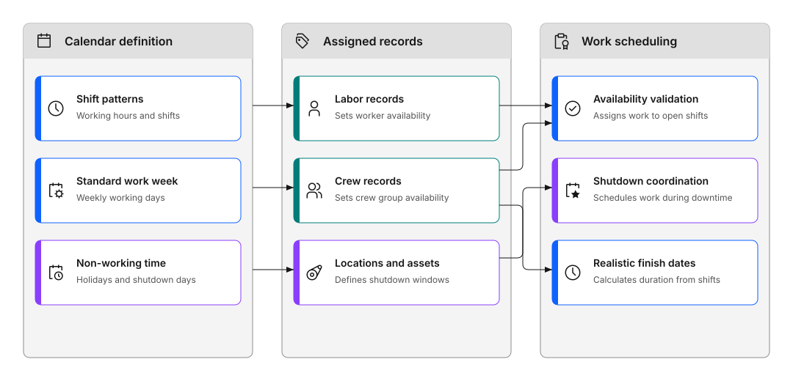
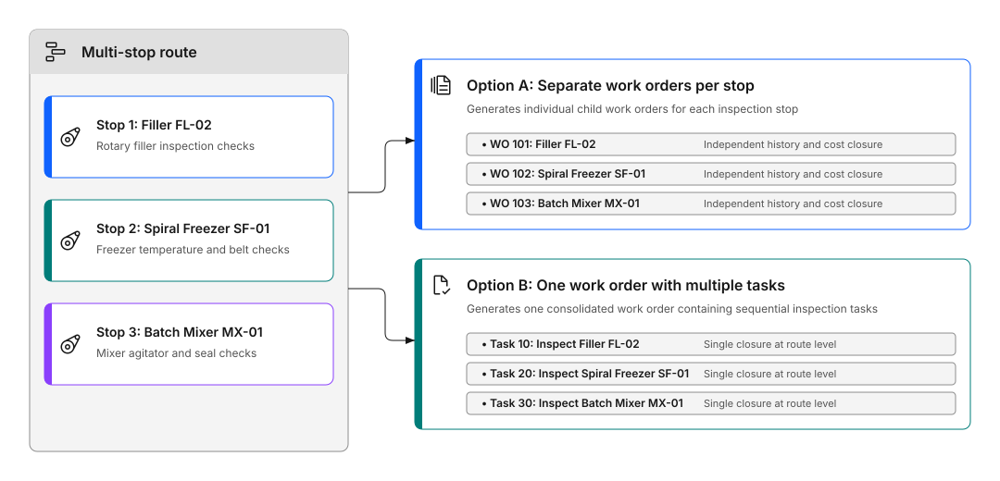

# How do I schedule work?

Use calendars to set working hours. Use routes to group inspection points. This helps you plan when work happens and organize inspections efficiently.

Calendars track when your team works. Routes let you create inspection work orders for multiple items at once.

## 💡 Tips for success

**For calendars:**

- Start simple. Match your standard work week.
- Add holidays as you go.
- Update calendars when shifts change.

**For routes:**

- Group equipment that's close together.
- Keep routes focused. Don't mix unrelated items.
- Update routes when equipment changes.
- Use clear names.

## Calendars: Set working time

Calendars show when work can happen. They include:

- Working days and hours
- Shifts, such as 7 AM to 3 PM and 3 PM to 11 PM
- Holidays and shutdowns
- Days off

Figure 1 shows how calendars connect to labor, equipment, and work scheduling across three areas:

- **Calendar definition**: establishes shift patterns for working hours, standard work weeks for working days, and non-working time for holidays and shutdowns.
- **Assigned records**: attaches calendars to labor records for individual worker availability, crew records for crew group availability, and locations or assets for shutdown windows.
- **Work scheduling**: validates worker availability against open shifts to assign target start and finish dates.

Figure 1: How calendars connect to labor, equipment, and work scheduling

### When to use calendars

Use calendars to:

- Set standard work shifts
- Track holidays and shutdowns
- Schedule work during available hours
- Assign work when people are working
- Calculate realistic finish times

### How to set up calendars

**Step 1: Create shifts**

- Define a shift pattern that sets the working days, such as Monday to Friday
- Set start and end times, such as 7:00 AM to 3:00 PM
- Enter total work hours per day

**Step 2: Create the calendar**

- Make a calendar for your organization
- Apply shifts to show the work schedule
- Mark holidays, shutdowns, and days off as non-working time

Select includes some calendars, such as a day shift and an evening shift. You can use them as they are or duplicate them to make your own.

`[SME confirmation required: Confirm which calendars Select includes and that you can duplicate them.]`

**Step 3: Assign calendars**

- Apply calendars to your team members
- Apply to locations or equipment if needed
- System uses calendars to schedule work

### Table 1: Where to assign a calendar

| Assign calendar to | Required when |
|---|---|
| Labor records | Assigning work to individuals so the system can calculate availability correctly |
| Crews | Assigning work to a crew as a group |
| Locations or assets | Only when the system needs to calculate scheduled work based on when a location or asset is available, such as for planned shutdowns |

## Routes: Group inspection points

Routes are lists of items that need regular inspection. Create one route. Generate work orders for all items at once.

Figure 2 illustrates how a multi-stop route generates work across inspection points:

- **Multi-stop route**: defines sequential stops, such as Stop 1 (`Filler FL-02`), Stop 2 (`Spiral Freezer SF-01`), and Stop 3 (`Batch Mixer MX-01`).
- **Option A (Separate work orders per stop)**: generates individual child work orders (`WO 101`, `WO 102`, `WO 103`) so each machine retains independent maintenance history and cost tracking.
- **Option B (One work order with multiple tasks)**: generates a single consolidated work order containing sequential tasks (`Task 10`, `Task 20`, `Task 30`) with unified completion at the route level.

Figure 2: How routes generate work orders across multiple inspection stops

### When to use routes

Use routes for:

- Regular inspection rounds, such as daily equipment checks
- Safety inspections at multiple locations
- Maintenance on similar equipment
- Any work that follows a set path

### How to set up routes

**Step 1: Create the route**
1. Open the Routes application
2. Add a clear name, such as "Daily Production Line Inspection"
3. List all items to inspect, called "stops"

**Step 2: Use the route**

- Add the route to a work order
- System creates work orders for each stop
- Add to a maintenance schedule for automatic use
- Choose: separate work orders or one work order with multiple tasks

### Table 2: Work order options for routes and when to use each

| Option | Use when |
|---|---|
| Separate work orders per stop | Each stop needs to be tracked, costed, and closed independently, for example daily checks on Filler FL-02, Spiral Freezer SF-01, and Batch Mixer MX-01 where each job has its own history |
| One work order with multiple tasks | All stops are part of a single job and cost tracking at the route level is sufficient |

**Step 3: Complete the work**

- Technicians follow the route
- They complete inspections at each stop
- All work tracks under the main work order

!!! warning "TODO: Add visual content"
     A video showing how to create a simple inspection route would be useful here.

---

## Continue building your skills

### Monitor performance

With scheduling in place, track whether work is being completed on time, how much backlog your team carries, and where to intervene.

[What metrics matter?](../monitor-respond/what-metrics-matter.md)

---

## Related topics

- [How do I plan recurring maintenance?](plan-recurring-maintenance.md)
- [How do I decide what work should be done?](decide-what-work.md)
- [How do I complete a job?](../complete-work/complete-job.md)
- [How do I assign the correct people?](../organize-people/assign-right-people.md)
