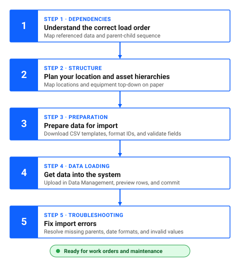

# What is the correct load order?

Import order matters. Referenced records must exist before records that use them, and parent records must exist before child records.

Figure 1 outlines the five sequential steps of the data onboarding pathway:

1. **Understand the correct load order**: review dependency rules so supporting data and parent records load first.
2. **Plan your location and asset hierarchies**: design physical places and equipment breakdown structures top-down. This is the step that is hardest to redo later.
3. **Prepare data for import**: download CSV templates from Data Management, format columns as text, and validate fields.
4. **Get data into the system**: upload files, run preview validation, and commit the import.
5. **Fix import errors**: diagnose rejected records in error logs and re-import corrected rows.

Figure 1: The five-step data onboarding pathway

!!! warning "Plan your hierarchies before you load data"
    A hierarchy that does not fit how you work still imports without errors, and it is hard to change once work history builds up. Maximo customers report that correcting a poor structure later is slow and risky. Agree your structure with your maintenance planners, supervisors, and operations team before you load anything. See [How do I plan my location hierarchy?](plan-your-location-hierarchy.md) and [How do I plan my asset hierarchy?](plan-your-asset-hierarchy.md).

## Why does load order matter?

Child records reference parent records. If the parent does not exist yet, the child import fails. Similarly, if a record references supporting data that does not exist, the import fails.

**Example**: You cannot create `Ice cream main plant > Production building > Filling line room` if `Ice cream main plant` and `Production building` do not exist.

## Recommended import order

### 1. Reference data used by locations and assets

Import supporting records before importing locations or assets that reference them.

**What to import first**:

- GL accounts
- Service addresses
- Calendars and shifts
- Failure classes
- Vendors and manufacturers
- Asset type values
- Classifications and specifications
- Addresses, including bill-to and ship-to addresses

**Why this matters**: Locations and assets reference these records. If the referenced data does not exist, the import fails.

### 2. Locations in hierarchy order

Import locations from top to bottom of the hierarchy:

1. **Top-level locations first**, such as `Ice cream main plant`
2. **Second-level locations next**, such as `Production building`
3. **Lowest-level locations last**, such as `Filling line room`

**What to check**:

- Verify the location hierarchy before importing
- Import parent locations before child locations
- Confirm that system location references use valid values
- Confirm that each child location references the correct parent

!!! tip "Import hierarchies sequentially"
    Hierarchies require sequential loading from the top down. Import parent locations first, then their children.

### 3. Assets and asset relationships

Import assets after their locations exist.

**What to check**:

- Location references are valid
- Parent assets exist, if you use asset hierarchies. Learn how to structure equipment packages in [How do I plan my asset hierarchy?](plan-your-asset-hierarchy.md).

**For asset hierarchies**:

- Import parent assets before child assets or subassemblies
- Verify that each child asset references the correct parent asset
- Verify that the parent asset exists and is at the expected location

### 4. Other records that reference locations or assets

Import other records that depend on locations and assets:

- Work orders, which reference assets and locations
- Inventory and storerooms, which reference locations

## Common hierarchy patterns

### Location hierarchies

**Correct order**:

1. Top-level location, such as `Ice cream main plant`
2. Second-level location, such as `Production building`
3. Lower-level location, such as `Filling line room`
4. Further sub-locations, if applicable

**What happens if you import in the wrong order**: Child locations fail because their parent does not exist.

**What to do**: Sort your import file so parent records come before child records.

### Asset hierarchies

If you use parent-child asset relationships:

**Correct order**:

1. Parent assets
2. Child assets or subassemblies

**What to check**:

- Parent asset IDs are correct
- Each child asset references the correct parent
- Parent assets exist at the expected location

### Parent-child relationships

**General rule**: Always import parents before children.

**What to check**:

- Parent location IDs are correct
- Hierarchy levels are properly defined
- System location references are valid

**What to do**: Verify all parent records exist before importing child records.

---

## Data onboarding roadmap

Follow these five steps in sequence to load your facility data:

### Table 1: The five steps of data onboarding and the guide for each

| Step | Action | Guide |
|---|---|---|
| 1 | **Understand load order** Review dependencies and ensure referenced records and parent locations exist first. | [What is the correct load order?](correct-load-order.md) |
| 2 | **Plan your location and asset hierarchies** Map your locations and equipment top-down on paper before creating records. This is the step that is hardest to redo later. | [How do I plan my location hierarchy?](plan-your-location-hierarchy.md) [How do I plan my asset hierarchy?](plan-your-asset-hierarchy.md) |
| 3 | **Prepare data for import** Download CSV templates from Data Management, format ID columns as text, and clean fields. | [How do I prepare data for import?](prepare-data-for-import.md) |
| 4 | **Get data into the system** Upload CSV files in Data Management, validate rows in preview mode, and commit the import. | [How do I get data into the system?](get-data-into-system.md) |
| 5 | **Fix import errors** Diagnose preview errors, correct source CSV rows, and re-import failed records. | [How do I fix import errors?](why-does-asset-import-fail.md) |

---

## Continue building your skills

### Recommended next step: Plan your hierarchies

Before preparing spreadsheet files, sketch your locations and equipment top-down to avoid orphan records and grouping errors.

1. [How do I plan my location hierarchy?](plan-your-location-hierarchy.md)
2. [How do I plan my asset hierarchy?](plan-your-asset-hierarchy.md)

### Related skills

- [How do I decide: location, asset, or spare part?](decide-location-asset-spare-part.md): Classify every facility entity, machine, and consumable wear item accurately.
- [How do I plan my asset hierarchy?](plan-your-asset-hierarchy.md): Structure equipment packages, subassemblies, and maintainable components.
- [How do I prepare data for import?](prepare-data-for-import.md): Format and clean your CSV files and prevent spreadsheet corruption.
- [How do I get data into the system?](get-data-into-system.md): Upload and preview your records in the Data Management application.
- [How do I fix import errors?](why-does-asset-import-fail.md): Troubleshoot missing parents and referenced record failures.

---

## Related topics

- [Locations](../../start-fast/basics/what-is-location.md)
- [What is an asset?](../../start-fast/basics/what-is-asset.md)
- [How do locations, assets, and work orders work together?](../../start-fast/basics/how-concepts-work-together.md)
- [Which object structure do I use for each data type?](object-structure-data-types.md)