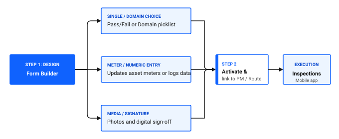

---
search:
  boost: 2
  keywords: inspection forms inspections questions checklist digital forms audit mobile rounds
---

# How do I create inspection forms?

Digital inspection forms replace paper clipboards with structured, interactive checklists on mobile devices. Technicians and inspectors use inspection forms to execute safety audits, hygiene checklists, equipment condition assessments, and routine operator rounds.

In Maximo Application Suite Select, you design forms in the Inspection Forms application. Technicians and inspectors complete them in the Inspections role-based app or directly within mobile work orders.

*Looking to verify your inspection form setup right away? [Skip to inspection form verification checklist ↓](#inspection-form-verification-checklist)*

## What you can capture on an inspection form

The Inspection Forms application gives you flexible ways to capture exact field observations. You can create questions such as:

- A pass or fail check, for example, whether the sanitary seal on Filler FL-02 is intact.
- A choice from a standard list of values, for example, lubricant condition rated as clear, cloudy, or dark.
- A meter reading that updates the asset meter, for example, discharge pressure on the cold storage compressor.
- A number that you track without updating a meter, for example, ambient warehouse temperature.
- A photo or file, for example, a photo of a scored drive shaft.
- A signature, for example, sanitation supervisor sign-off after a clean-in-place flush.

The application offers more ways to capture answers than these examples. Use them as a starting point, and explore the options when you design a question.

Figure 1 illustrates the inspection form lifecycle from initial authoring to field execution:

1. **Step 1 (Design)**: build the form using three core question types:
   - **Single or domain choice**: pass or fail checks and domain picklist selections.
   - **Meter or numeric entry**: readings that update asset meters or track standalone values.
   - **Media or signature**: photo attachments and digital sign-offs.
2. **Step 2 (Activate and link)**: activate the draft template and attach it to PM schedules, route stops, or work orders.
3. **Step 3 (Field execution)**: technicians complete the interactive checklist in the Inspections role-based app or on mobile work orders.

Figure 1: Inspection form design, configuration, and field execution lifecycle

## Step 1: Create a form template

You create and revise inspection forms in the Inspection Forms application. To open it, use the **Find navigation item** field and search for Inspection Forms.

When you design a form, you can:

- Give the form a clear, descriptive name, such as `Filler FL-02 Daily Sanitation & Mechanical Inspection`.
- Choose the purpose of the form, such as an inspection, an audit, or a round.
- Add instructions, such as safety lockout procedures or required personal protective equipment.
- Add the questions that make up your checklist.
- Mark critical questions as required, so that technicians cannot complete the form without answering them.

For a meter reading question, you also choose the meter that the answer updates, such as `DISCH_PSI`.

### 💡 Tip: Use conditional logic for failed steps

Configure conditional questions so that when a technician marks an item as a failure, the form reveals follow-up questions. For example, require a photo and an explanatory note. This guarantees complete failure documentation.

## Step 2: Configure conditional response logic

Conditional rules keep inspection checklists compact while capturing detailed evidence when problems occur. For example, you can set up a pass or fail question so that a failed answer asks the technician to take a photo of the defect and describe the observed damage.

## Step 3: Activate the form template

Inspection forms start in draft status. Activate a form before you assign it to work orders or preventive maintenance schedules.

When updates are needed later, create a revision of the active form. The existing version remains active for in-progress work until you activate the new revision.

## Step 4: Link inspection forms to maintenance workflows

Once a form is active, you can attach it to automate field checklists:

- **PM schedules:** Attach the form to a PM so that every generated work order includes the digital checklist.
- **Route stops:** Attach specific forms to individual route stops to guide technicians through multi-room plant rounds.
- **Work orders:** Add a form to a work order or to a specific task on the work order.

## Inspection form verification checklist

Use this checklist to confirm your inspection forms are configured for reliable field execution.

### Table 1: Inspection form setup checklist

| Check | Item | What to verify |
|---|---|---|
| [ ] | Clear title and instructions | Form specifies safety precautions and required tools in the header |
| [ ] | Mandatory flags configured | Critical regulatory and safety questions are marked as required |
| [ ] | Meter bindings verified | Meter reading questions connect to valid continuous or gauge meters |
| [ ] | Conditional logic tested | Marking failure options reveals required photo and description prompts |
| [ ] | Status set to Active | Form is promoted from draft to active for work order selection |
| [ ] | PM or Route associations | Recurring maintenance schedules have the approved form template attached |

## Related topics

- [How inspections work](../../start-fast/basics/how-inspections-work.md)
- [How do I plan recurring maintenance?](../plan-work/plan-recurring-maintenance.md)
- [How do I set up meters and meter groups?](set-up-meters.md)
- [How do I standardize across teams?](../../work-smarter/scale-operation/standardize-across-teams.md)
