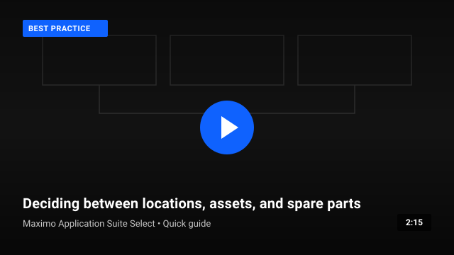
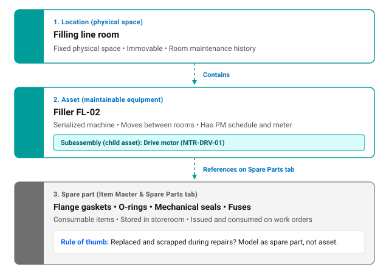
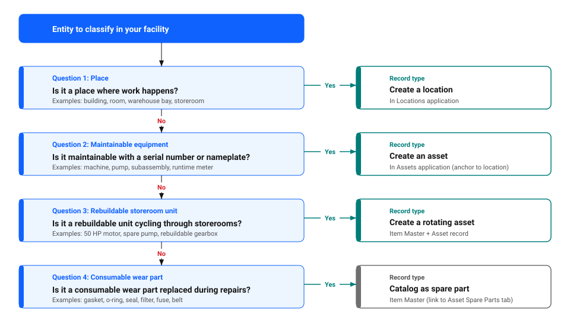
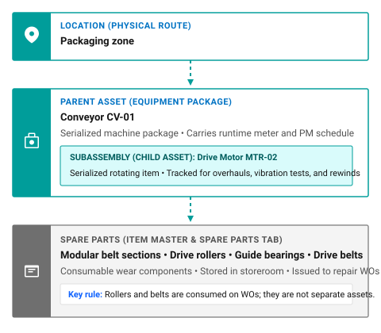
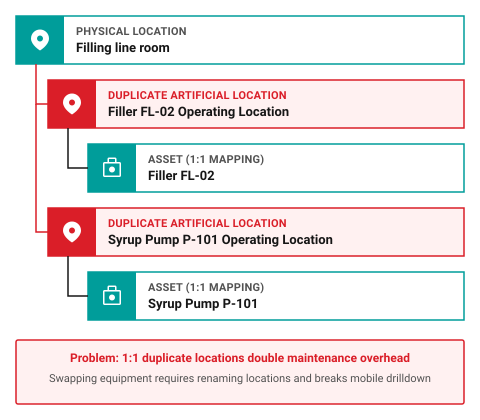
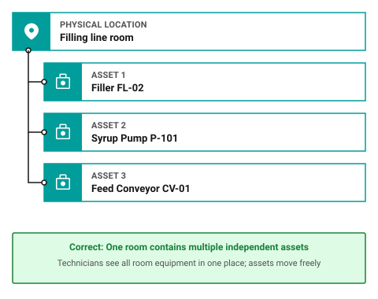

# How do I decide: location, asset, or spare part?

When setting up Maximo Application Suite Select, every physical entity in your plant or facility must be classified as one of three primary record types: a location, an asset, or a spare part.

Making the right classification before importing data ensures accurate maintenance history, simplified storeroom operations, and clean drilldown navigation in Maximo Mobile and desktop applications. Misclassifying entities leads to cluttered asset registers, broken cost roll-ups, and duplicate data entry.

As outlined in [What is the correct load order?](correct-load-order.md), locations and items are loaded before maintainable assets are established.

Video 1: Deciding between locations, assets, and spare parts (about 2 minutes). <em>[Video in production, placeholder preview for design review]</em>

## The three-way classification model

Maximo Application Suite Select uses three distinct record types to track facilities, machinery, and replacement materials.

Figure 1 illustrates the three-tier classification hierarchy:

1. **Location**: a physical place where work happens, such as `Filling line room`, which stays in place and retains room-level history.
2. **Asset**: maintainable equipment operating within the location, such as `Filler FL-02`, including serialized child subassemblies such as drive motor `MTR-DRV-01`.
3. **Spare part**: consumable replacement items cataloged in Item Master and referenced on the asset's **Spare Parts** tab, such as flange gaskets, o-rings, mechanical seals, and fuses.

Figure 1: The three-way classification model in Maximo Application Suite Select

### 1. Location: A place where work happens

A location represents a place where assets are operated, stored, or repaired. A location can be a building or room, but it can also be a section of a map grid or a telephone pole:

- **Primary purpose**: Tracks the place, accumulates its maintenance history, and provides the structure for your plant.
- **Key characteristic**: A location stays in place when the machinery in it is replaced or moved, so its history stays with the location.
- **Examples**: `Production building`, `Filling line room`, `Mixing room`, `Main storeroom`.
- **Application**: Locations application.

### 2. Asset: Maintainable equipment

An asset represents a specific piece of serialized equipment or subassembly that operates at a location:

- **Primary purpose**: Tracks the lifecycle, maintenance costs, runtime meters, failure history, and work orders for a specific machine.
- **Key characteristic**: Assets can move between locations, go into a storeroom for repair, or transfer to another line while retaining their complete work history.
- **Examples**: `Filler FL-02`, `Syrup Pump P-101`, `Drive motor MTR-01`.
- **Application**: Assets application.

### 3. Spare part: Consumable replacement item

A spare part represents a stocked or non-stocked replacement material cataloged in the Item Master:

- **Primary purpose**: Manages inventory balances in storerooms and allows parts to be issued and charged directly to work orders.
- **Key characteristic**: Spare parts are consumed or discarded during maintenance. They do not track individual serial numbers, separate runtime meters, or independent work histories.
- **Examples**: Flange gaskets, o-rings, mechanical seals, replacement filters, fuses, drive belts.
- **Applications**: Item Master, Storerooms, and the **Spare Parts** tab on asset records.

---

## The four-question decision framework

To classify any physical item or facility entity, follow these four sequential decision questions:

Figure 2 outlines the decision pathway through the four classification questions:

1. **Question 1 (Place)**: if the entity is a place where work happens, create a location in the Locations application. Otherwise, proceed to Question 2.
2. **Question 2 (Maintainable equipment)**: if it is maintainable equipment with a serial number or nameplate, create an asset in the Assets application anchored to its location. Otherwise, proceed to Question 3.
3. **Question 3 (Rebuildable storeroom unit)**: if it is a rebuildable unit cycling through storeroom inventory, create a rotating asset using Item Master and Assets. Otherwise, proceed to Question 4.
4. **Question 4 (Consumable wear part)**: if it is a consumable wear part replaced during repairs, catalog it as a spare part in Item Master and link it to the asset's Spare Parts tab.

Figure 2: The four-question classification decision framework

### Question 1: Is it a place where work happens?

Ask: *"Does this record represent a room, building, bay, outdoor area, or other place where assets are operated, stored, or repaired?"*

- If **yes**, create a **location**.
- If **no**, proceed to Question 2.

### Question 2: Is it maintainable equipment that retains its own history?

Ask: *"Does this equipment carry a unique serial number or manufacturer nameplate, undergo regular overhauls or preventive maintenance, track runtime meters, or move between locations?"*

- If **yes**, create an **asset** and anchor it to its operating location.
- If **no**, proceed to Question 3.

### Question 3: Is it a rebuildable unit that moves through storeroom inventory?

Ask: *"Is this a standard motor, pump, or gearbox that is stocked in the storeroom as inventory, issued to a machine, pulled for overhaul when it fails, and returned to stock?"*

- If **yes**, create a **rotating item** in Item Master and track the serialized unit as an **asset**.
- If **no**, proceed to Question 4.

### Question 4: Is it a consumable part replaced and discarded during servicing?

Ask: *"When this item fails, is it thrown away and replaced with a new one from the storeroom without tracking individual overhaul history?"*

- If **yes**, catalog the spare part in **Item Master** and link it to the parent asset's **Spare Parts** tab.

---

## Boundary cases: How to classify tricky items

Some physical items sit on the boundary between locations, assets, and spare parts. Use these real-world examples from the ice cream plant to guide your decisions.

### Table 1: Boundary cases for classifying tricky items

| Equipment or item | Correct record type | Why it is classified this way |
|---|---|---|
| **Conveyor line routing** | **Location** | The path through the building is a place that stays the same when the conveyor equipment changes. |
| **Conveyor drive package** | **Asset** | The motorized mechanical drive has a nameplate, PM schedule, and runtime meter. |
| **Conveyor belt and rollers** | **Spare part** | Consumable wear components issued from storerooms and replaced during repairs. |
| **50 HP rebuildable drive motor** | **Asset** | Serialized rotating equipment that undergoes shop overhauls and bearing replacements. |
| **Fractional throwaway fan motor** | **Spare part** | Inexpensive non-rebuildable unit; replaced and scrapped upon failure. |
| **Calibrated safety relief valve** | **Asset** | Requires mandatory inspection certification, calibration records, and test history. |
| **Manual isolation ball valve** | **Spare part** | Standard pipe fitting; replaced and discarded upon failure without dedicated history. |
| **Main electrical switchgear cabinet** | **Asset** | High-voltage distribution cabinet installed in an electrical room location. |
| **Cabinet power circuit breaker** | **Child asset** | Maintainable subassembly with its own trip testing and maintenance history. |
| **Cabinet fuses and terminal blocks** | **Spare part** | Consumables cataloged in Item Master and issued to electrical repair work orders. |

Figure 3: Boundary classification example for a conveyor system

In Figure 3, a conveyor line illustrates how to divide complex equipment across the three classification tiers:

- **Location**: `Packaging zone` provides the route where the conveyor operates.
- **Parent asset**: `Conveyor CV-01` is the main maintainable equipment package with its own operating history and PM schedule.
- **Child asset**: `Drive motor MTR-DRV-02` is a serialized rotating subassembly tracked for shop overhauls and rewinds.
- **Spare parts**: Wear items like modular belt sections, drive rollers, and guide bearings live on the **Spare Parts** tab and are issued directly to repair work orders.

### 💡 Tip: Using the Spare Parts tab for consumable parts

Never create asset records for wear parts like gaskets, o-rings, bearings, or filters. Instead, add these stocked items to the **Spare Parts** tab of the parent asset in the Assets application. Technicians can view the approved bill of materials directly on active work orders and reserve parts from storeroom inventory with one click.

---

## Spot the problem: test your plan

Review these common planning scenarios to test your understanding before building your records.

### Problem 1: The 1:1 Location-to-Asset trap

A maintenance planner creates a separate location record for every pump, motor, and machine in the plant, such as creating `Filler FL-02 Operating Location` to hold `Filler FL-02`.

Figure 4 illustrates the anti-pattern where artificial location records are created for individual machines, showing `Filling line room` divided into duplicate locations `Filler FL-02 Operating Location` for asset `Filler FL-02` and `Syrup Pump P-101 Operating Location` for asset `Syrup Pump P-101`.

Figure 4: Problem 1: The 1:1 location-to-asset anti-pattern

What goes wrong when equipment is replaced or when technicians navigate in Maximo Mobile?

Show the answer

Creating a 1:1 location for every asset doubles data entry, clutters navigation trees, and destroys asset mobility. When `Filler FL-02` is moved or overhauled, planners must rename or reconfigure the location record. Technicians also lose the ability to see all equipment operating inside a single room.

**What to do instead:** Create one location for the room, such as `Filling line room`, and place multiple assets directly inside that room location.

Figure 5 shows the correct structure where the single room location `Filling line room` contains three independent assets: `Filler FL-02`, `Syrup Pump P-101`, and `Feed Conveyor CV-01`.

Figure 5: Solution 1: One location containing multiple assets

### Problem 2: The over-assetization trap

To help technicians find every part during repairs, a team creates asset records for all internal o-rings, flange bolts, and fuses under `Filler FL-02`.

What happens to storeroom operations and asset drilldown trees?

Show the answer

The database becomes flooded with thousands of static records that never receive individual work orders. Asset searches become cluttered, and storeroom clerks cannot issue replacement parts through normal inventory stock balances because the items were modeled as assets instead of inventory materials.

**What to do instead:** Catalog replacement materials in the **Item Master** and link them to `Filler FL-02` through the **Spare Parts** tab. When work is performed, technicians select items from the spare parts list and charge them directly to the work order.

### Problem 3: Modeling a building or room as an asset

A data team imports `Production building` and `Cold storage` as asset records so they can attach equipment as child assets.

What happens when supervisors run facility-level cost reports?

Show the answer

Buildings and rooms are places, not maintainable equipment. Modeling places as assets breaks filtering by location in Maximo Mobile and prevents accurate roll-up of room and building maintenance costs.

**What to do instead:** Model buildings, floors, and rooms in the location hierarchy under the Locations application. Anchor equipment records into their respective operating location records. Follow the layout guidelines in [How do I plan my location hierarchy?](plan-your-location-hierarchy.md).

### Problem 4: Throwaway vs rebuildable motors

The ice cream plant uses two types of motors: large 50 HP homogenizer drive motors that cost thousands of dollars to rewind and rebuild, and small fractional horsepower exhaust fan motors that cost fifty dollars and are scrapped when they fail.

How should each motor type be classified?

Show the answer

- **50 HP Homogenizer drive motor**: Model as an **asset** using a rotating item record. It carries a unique serial number, tracks operating hours, moves between the machine, storeroom, and repair shop, and accumulates overhaul costs across its lifecycle.
- **Fractional exhaust fan motor**: Model as a **spare part** in Item Master. When a fan motor fails, a replacement is issued from the storeroom to the work order, and the failed motor is discarded.

---

## Common classification mistakes

When classifying facility records, avoid these common mistakes:

- Creating a matching location for every asset record.
- Modeling consumable wear parts, bolts, or gaskets as asset records.
- Creating asset records for rooms, buildings, or outdoor areas.
- Failing to use the Spare Parts tab for approved equipment bills of materials.
- Treating throwaway non-rebuildable items as serialized assets.

A clean classification model keeps your asset register concise, your storeroom inventory accurate, and your hierarchy trees easy to navigate.

---

## Classification decision checklist

Before loading records into Maximo Application Suite Select, verify each classification decision:

### Table 2: Classification checklist

| Check | Classification item | What to verify |
|---|---|---|
| [ ] | **Places as locations** | Buildings, rooms, and storerooms are created in the Locations application. |
| [ ] | **Maintainable machines as assets** | Equipment with serial numbers, PM schedules, or runtime meters is created in the Assets application. |
| [ ] | **One location holds multiple assets** | Rooms contain multiple assets rather than creating artificial 1:1 location records. |
| [ ] | **Consumables in Item Master** | Wear parts, gaskets, seals, and fuses are cataloged in Item Master, not the Assets application. |
| [ ] | **Spare Parts tabs populated** | Replacement parts are linked to parent assets on the Spare Parts tab for fast work order selection. |
| [ ] | **Rotating items identified** | Rebuildable motors and pumps that cycle through storerooms are configured as rotating items. |

!!! warning "TODO: Confirm with a subject matter expert"
     [SME confirmation required: Confirm whether an item can be both an asset and a location, such as an air conditioning compressor in an HVAC system, and how to describe it here. Confirm whether Rotating Items and Item Assembly Structures are fully supported in Maximo Application Suite Select data loader templates, and verify the maximum recommended spare parts per asset tab.]

---

## Continue building your skills

### Recommended next steps: Plan your hierarchies

With your classification decisions established, plan the location and equipment hierarchies for your facility.

1. [How do I plan my location hierarchy?](plan-your-location-hierarchy.md): Organize your buildings, floors, rooms, and other places into a parent-child structure.
2. [How do I plan my asset hierarchy?](plan-your-asset-hierarchy.md): Build your equipment breakdown structure and configure parent machines and subassemblies.

### Related skills

- [What is the correct load order?](correct-load-order.md): Review the sequential five-step onboarding roadmap.
- [How do I prepare data for import?](prepare-data-for-import.md): Download CSV templates and format columns for data import.
- [How do I get data into the system?](get-data-into-system.md): Learn the upload, preview, and commit workflow in Data Management.
- [How do I fix import errors?](why-does-asset-import-fail.md): Troubleshoot missing parent records or invalid fields.

---

## Related topics

- [Locations](../../start-fast/basics/what-is-location.md)
- [What is an asset?](../../start-fast/basics/what-is-asset.md)
- [How do locations, assets, and work orders work together?](../../start-fast/basics/how-concepts-work-together.md)
- [Which object structure do I use for each data type?](object-structure-data-types.md)
