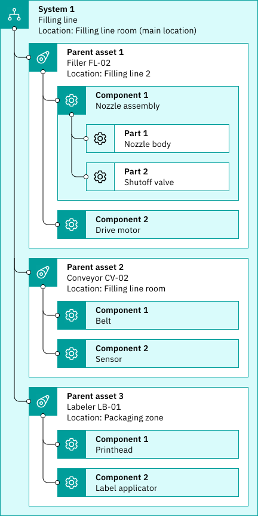
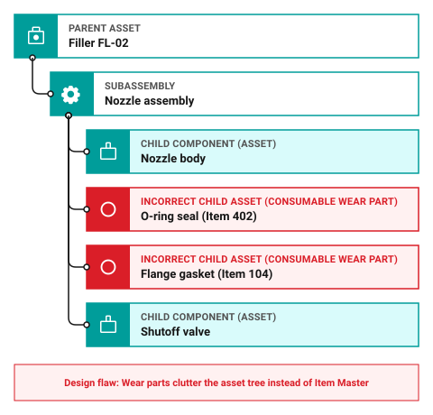
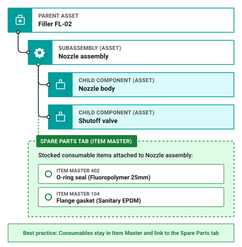
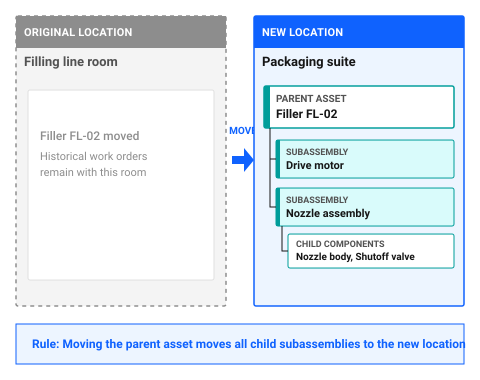
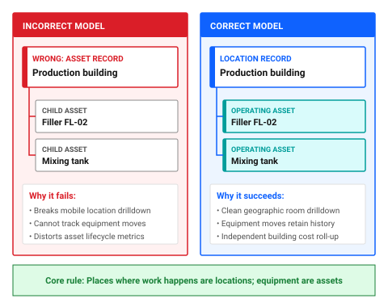

# How do I plan my asset hierarchy?

Your asset hierarchy is the equipment breakdown structure of your facility. It organizes machinery, subassemblies, and critical maintainable components into a parent-child relationship operating within your locations.

When onboarding data into Maximo Application Suite Select, planning your asset hierarchy follows the creation of your location hierarchy, as outlined in [What is the correct load order?](correct-load-order.md) and [How do I plan my location hierarchy?](plan-your-location-hierarchy.md).

*Looking to verify your asset hierarchy structure right away? [Skip to asset hierarchy planning checklist ↓](#asset-hierarchy-planning-checklist)*

Work orders, maintenance costs, failure codes, and operating history roll up from child components to parent machines. A well-designed asset hierarchy allows maintenance teams to track the lifecycle of serialized equipment, schedule overhauls at the machine or component level, and move subassemblies across the plant without losing work history. A poorly designed hierarchy clutters drilldown trees with consumable parts and leads to misallocated maintenance costs.

Video 1: Building an effective asset hierarchy (about 2 minutes). <em>[Video in production, placeholder preview for design review]</em>

## Core principles for planning your hierarchy

Before loading equipment records into the system, apply these five best practices with your maintenance planners, reliability engineers, and storeroom managers.

### 1. Distinguish maintainable equipment from consumable spare parts

The most critical decision in asset hierarchy design is separating serialized, maintainable equipment from consumable replacement parts.

Apply the **nameplate and overhaul test** to every item:

- **Asset**: A piece of equipment that carries a unique serial number or manufacturer nameplate, undergoes preventive maintenance or repair, and tracks its own cost and operating history over time. Examples include `Filler FL-02`, a drive motor, or a centrifugal pump.
- **Spare part**: A consumable or non-serialized item that is issued to a work order and replaced during maintenance. Examples include gaskets, o-rings, mechanical seals, bearings, filters, and fuses.

Creating asset records for consumable wear parts creates thousands of unnecessary records that clutter search results and navigation trees. Keep consumable wear parts in the Item Master and associate them directly with the parent asset.

### Quick test: Should this be a child asset?

Create a child asset only if one or more of the following are true:

- It is maintained independently.
- It has its own maintenance history.
- It can be replaced, rebuilt, or transferred separately.
- It needs its own inspections, meters, or work orders.

If the component is simply replaced when it fails and does not require separate tracking, it is probably a spare part rather than an asset.

### 2. Keep the hierarchy shallow: typically two to three levels

While the database supports deep nesting, most Maximo Application Suite Select organizations succeed with asset hierarchies that are no more than two to three levels deep:

**Parent machine package** → **Subassembly** → **Maintainable component**

For example, a packaging machine package contains a drive motor subassembly, which contains a gearbox component.

Do not attempt to model every bolt, bracket, or hose in the asset tree. If an item is not independently maintained, tracked with a meter, or transferred between machines as a complete unit, stop at the subassembly level.

### 💡 Tip: Managing spare parts with the Spare Parts tab

To make replacement parts easy for technicians to find without turning them into child assets, add stocked items from the Item Master to the **Spare Parts** tab of the parent asset. Technicians can view approved part numbers, verify storeroom availability, and reserve parts directly on active work orders.

### 3. Anchor every parent asset to a valid location

Every top-level parent asset must be assigned to an operating location in your location hierarchy, such as `Filling line room`.

When a parent asset is assigned to a location, child subassemblies inherit that location context automatically. When you move a parent asset to a new room or send it to the storeroom for rebuild, child components move along with the parent.

### 4. Standardize naming and import from the top down

Establish consistent, descriptive naming conventions that combine an equipment code with an operational description, such as `ASSET-FL02 / Filler FL-02` and `MTR-DRV-01 / Filler FL-02 drive motor`.

When preparing spreadsheet files for data loading:

1. **Locations first**: Ensure all operating locations exist in the system before importing assets.
2. **Top-level parent assets second**: Load main equipment packages with their location references.
3. **Child subassemblies third**: Load child records referencing their parent asset identifiers.
4. **Spare parts lists fourth**: Attach stocked item records to assets after asset records exist.

---

## What a good asset hierarchy looks like

In this sample ice cream plant equipment model, the asset hierarchy represents the filling line machinery installed inside `Filling line room`:

- **Filler FL-02** is the top-level parent asset anchored to the operating location `Filling line room`.
- **Drive motor** is a critical serialized subassembly under Filler FL-02 with its own runtime meter and overhaul schedule.
- **Nozzle assembly** is a mechanical subassembly under Filler FL-02 that receives regular rebuilds.
- **Nozzle body** and **Shutoff valve** are maintainable child components under Nozzle assembly.
- Consumable seals, o-rings, and gaskets for the nozzle assembly live on the **Spare Parts** tab from Item Master, not as child asset records.

Figure 1: Sample asset hierarchy for the Filling line system

### Why this structure works

This equipment structure delivers clean maintenance history and streamlined navigation for everyday operations:

- **Targeted work order history**: Technicians can raise a repair work order against `Drive motor` to log electrical diagnostics, or against `Filler FL-02` for general line servicing. All labor, parts, and downtime roll up to `Filler FL-02` for total cost of ownership reporting.
- **Fast drilldown navigation**: Technicians navigating in Maximo Mobile or the desktop applications find any maintainable component in two to three clicks from the main filler record.
- **Clean separation of wear parts**: Because o-rings and gaskets are cataloged on the Spare Parts tab, storeroom clerks issue parts against the work order without generating orphaned asset records.
- **Independent equipment tracking**: If the `Drive motor` is swapped out during a breakdown, the motor asset record retains its full rebuild history as it moves to the repair shop, while the replacement motor links to `Filler FL-02`.

---

## Spot the problem: test your plan

Review these common planning scenarios to test your understanding before building your equipment hierarchy.

### Problem 1: Are wear parts and consumables child assets?

Your maintenance planner wants to create child asset records under `Filler FL-02` for mechanical seals, o-rings, and flange gaskets so technicians can select them during repairs.

Figure 2 shows the over-assetized hierarchy where consumable wear parts, including o-rings, mechanical seals, and flange gaskets, are incorrectly modeled as individual child asset records underneath `Nozzle assembly`.

Figure 2: Problem 1: Over-assetized hierarchy with consumable parts modeled as child assets

What happens if you model these consumable items as child assets?

Show the answer

Creating asset records for consumables results in severe over-assetization. The asset register becomes bloated with thousands of static parts that do not undergo individual preventive maintenance or carry serial numbers. Technicians face cluttered drilldown trees, and storeroom inventory counts cannot sync properly with asset records.

**What to do instead:** Keep consumable wear parts in the Item Master and link them to the parent asset using the **Spare Parts** tab. Technicians can view the approved bill of materials, check storeroom stock, and charge items directly to work orders.

Figure 3 shows the corrected asset structure where maintainable child assets `Nozzle body` and `Shutoff valve` remain under `Nozzle assembly`, while consumable o-rings and gaskets are cataloged in Item Master and linked through the Spare Parts tab.

Figure 3: Solution 1: Correct asset hierarchy with consumable wear parts managed on the Spare Parts tab

### Problem 2: What happens when Filler FL-02 moves to a new line?

`Filler FL-02` is moved from `Filling line room` to a newly constructed packaging suite in another building.

How do child subassemblies, such as `Drive motor` and `Nozzle assembly`, handle the move?

Show the answer

When a parent asset moves to a new operating location, all child assets in its hierarchy automatically move with it to the new location. The parent-child relationship remains intact, and historical work orders remain linked to both the equipment and the previous location.

Figure 4 illustrates moving parent asset `Filler FL-02` from location `Filling line room` to location `Packaging suite`, showing how child subassemblies `Drive motor` and `Nozzle assembly` as well as child components `Nozzle body` and `Shutoff valve` automatically inherit the new location.

Figure 4: Problem 2: Child subassemblies automatically inherit parent asset relocation

**What to do instead:** Move the top-level parent asset record to the new location. The system updates the location reference across all child subassemblies in a single operation.

### Problem 3: Should a building or room be modeled as an asset?

A team member creates an asset record named `Production building` and places all equipment inside that asset record instead of creating a location record.

What goes wrong when supervisors run building maintenance reports?

Show the answer

Buildings, rooms, and areas are places, not movable equipment. Modeling rooms as assets breaks cost roll-up by location, disables filtering by location in Maximo Mobile, and prevents accurate tracking when equipment moves between rooms.

Figure 5 contrasts the incorrect model where `Production building` is created as an asset record holding `Filler FL-02` against the correct model where `Production building` is created as a location record holding asset `Filler FL-02`.

Figure 5: Problem 3: Comparison of modeling places as locations versus assets

**What to do instead:** Model buildings, floors, and rooms in the location hierarchy under the Locations application. Anchor equipment records, such as `Filler FL-02`, into their respective operating location records.

### Problem 4: In what order do you load parent and child asset records?

You are importing equipment data from a spreadsheet with rows sorted in the following order:

1. `Nozzle body`: Child component
2. `Nozzle assembly`: Subassembly
3. `Filler FL-02`: Parent machine
4. `Filling line room`: Operating location

What happens when you run the import in this sequence?

Show the answer

The import fails. `Nozzle body` fails because its parent `Nozzle assembly` does not exist yet. `Nozzle assembly` fails because `Filler FL-02` is missing. `Filler FL-02` fails because its operating location `Filling line room` has not been loaded into the database.

**What to do instead:** Sort import rows top-down:

1. `Filling line room`: Location
2. `Filler FL-02`: Top-level parent asset
3. `Drive motor`, `Nozzle assembly`: Subassemblies
4. `Nozzle body`, `Shutoff valve`: Child components

Always verify your import count against the number of rows in your source spreadsheet. Follow data formatting guidelines in [How do I prepare data for import?](prepare-data-for-import.md) and review sequencing in [What is the correct load order?](correct-load-order.md).

---

## Common planning mistakes

When designing an asset hierarchy, avoid these common mistakes:

- Creating assets for every component, no matter how small.
- Tracking spare parts as assets.
- Adding hierarchy levels that provide no maintenance or reporting value.
- Creating separate assets that will never have their own work history.
- Building a hierarchy that is difficult to navigate or maintain.

A good asset hierarchy reflects how equipment is maintained, inspected, and reported on. Focus on maintainable equipment rather than trying to model every physical component.

---

## Asset hierarchy planning checklist

Before loading your asset hierarchy into Maximo Application Suite Select, verify each planning requirement:

### Table 1: Asset hierarchy planning checklist

| Check | Planning item | What to verify |
|---|---|---|
| [ ] | **Maintainable equipment only** | Every asset record represents serialized, maintainable equipment, not consumable wear parts. |
| [ ] | **Spare parts cataloged** | Consumables, o-rings, and gaskets are organized in Item Master for use on the Spare Parts tab. |
| [ ] | **Valid operating locations** | Every top-level parent asset is assigned to an existing location record. |
| [ ] | **Shallow hierarchy depth** | The equipment structure stops at maintainable units, with most organizations using two to three levels. |
| [ ] | **Standardized naming** | Equipment identifiers and asset tags follow consistent naming conventions. |
| [ ] | **Top-down import sequence** | Spreadsheet records are ordered so parent assets and locations exist before child records load. |

!!! warning "TODO: Confirm with a subject matter expert"
     [SME confirmation required: Confirm whether the Maintain Hierarchy setting is exposed on the Asset details view in Maximo Application Suite Select, and whether Item Assembly Structures are available for template-based asset generation.]

---

## Continue building your skills

### Recommended next step: Prepare data for import

With your location and asset hierarchies planned, download CSV templates from Data Management and format your data files.

[How do I prepare data for import?](prepare-data-for-import.md)

### Related skills

- [How do I decide: location, asset, or spare part?](decide-location-asset-spare-part.md): Classify every facility entity, machine, and consumable wear item accurately.
- [What is the correct load order?](correct-load-order.md): Review the full five-step data onboarding roadmap.
- [How do I get data into the system?](get-data-into-system.md): Learn the upload, preview, and commit steps in Data Management.
- [How do I fix import errors?](why-does-asset-import-fail.md): Troubleshoot missing parent records or invalid fields.

---

## Related topics

- [What is an asset?](../../start-fast/basics/what-is-asset.md)
- [Locations](../../start-fast/basics/what-is-location.md)
- [How do I decide: location, asset, or spare part?](decide-location-asset-spare-part.md)
- [How do I plan my location hierarchy?](plan-your-location-hierarchy.md)
- [How do I manage more assets?](../../work-smarter/scale-operation/manage-more-assets.md)
- [How do I make data reliable?](../../improve-results/improve-data/make-data-reliable.md)
- [How do locations, assets, and work orders work together?](../../start-fast/basics/how-concepts-work-together.md)
- [Which object structure do I use for each data type?](object-structure-data-types.md)
