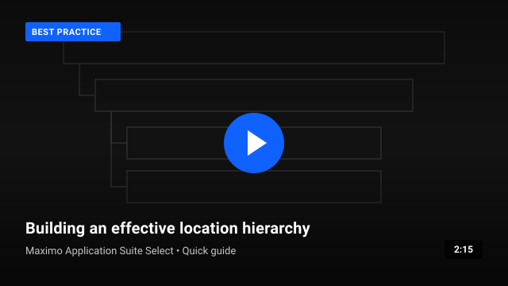
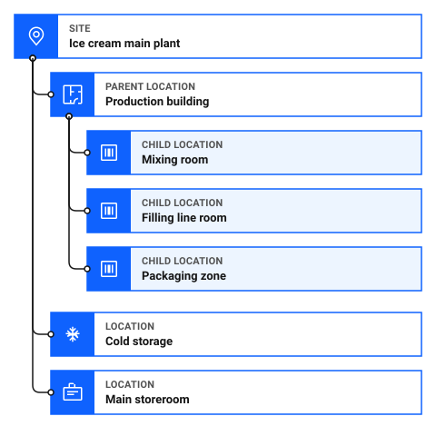
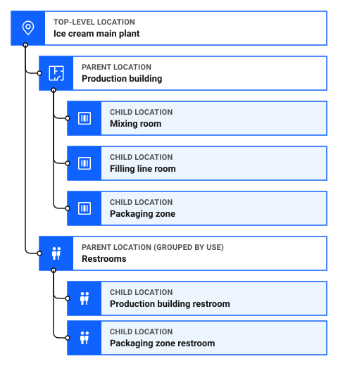
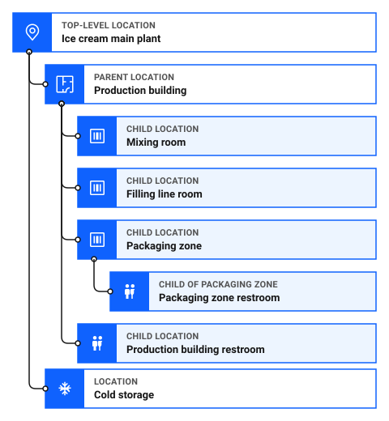
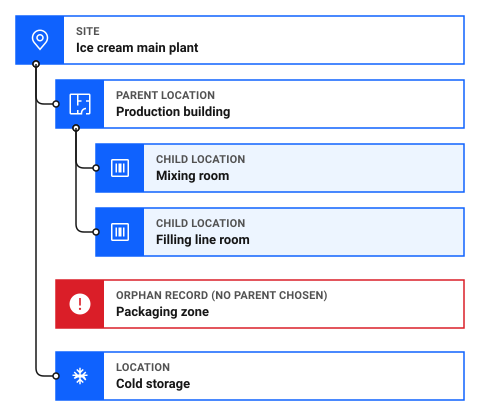
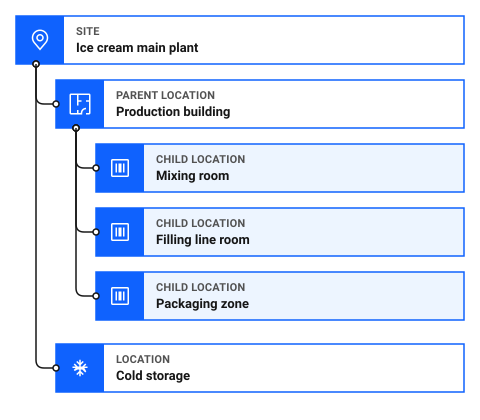

# How do I plan my location hierarchy?

Your location hierarchy is the map of the places where your assets are operated, stored, or repaired. It organizes those places into a clear parent-child structure. A place can be a building, a room, a section of a map grid, or a telephone pole.

When loading data into Maximo Application Suite Select, locations must be established before you load equipment, inventory, or work orders, as outlined in [What is the correct load order?](correct-load-order.md).

*Looking to verify your location hierarchy structure right away? [Skip to location hierarchy planning checklist ↓](#location-hierarchy-planning-checklist)*

A location hierarchy lets you find work across an entire building or drill down to a single room. How much structure you need depends on your operation. A plant with a few rooms needs far less than a site with many buildings and floors.

Video 1: Building an effective location hierarchy (about 2 minutes). <em>[Video in production, placeholder preview for design review]</em>

## Core principles for planning your hierarchy

Before loading records into the system, follow these five best practices with your maintenance planners, supervisors, and operations team.

### 1. Map your layout on paper first

Before creating records in the system, sketch the facility on paper or a whiteboard. Distinguish clearly between locations, assets, and storerooms:

- **Location**: A place where work happens or where equipment is operated, stored, or repaired, such as `Production building` or `Filling line room`. A location accumulates the long-term history of that place.
- **Asset**: Maintainable equipment operating at a location, such as `Filler FL-02` or a motor. Assets can move between locations or into a storeroom, retaining their own lifecycle history wherever they go.
- **Storeroom**: A specialized location used specifically to receive, store, and issue inventory items, such as `Main storeroom`.

Ask yourself: *"Is this a place where work occurs, or a piece of equipment that could be moved, replaced, or overhauled?"*

### 2. Choose one clear primary structure, usually based on place

The primary location hierarchy usually follows the places where work happens, for example:

**Top-level location** → **Building or area** → **Floor or zone** → **Room or position**

A location does not have to be a building with floors and rooms. It can be a section of a map grid or a telephone pole. Choose levels that fit how your operation is laid out.

When you search for work in a building, the results include the locations under it. If you group locations by what they are used for, such as all restrooms or all compressor rooms across multiple buildings under one branch, a search for `Production building` will miss any rooms placed outside that building's branch.

### Can I organize the same locations more than one way?

Yes. Maximo Application Suite Select lets you organize locations into more than one system. A system is a hierarchy of locations. The same location can belong to more than one system.

- **Primary system**: The physical layout of your operation, such as plant, building, and room. You can have only one primary system.
- **Secondary systems**: Other groupings of the same locations, based on how equipment works together, such as refrigeration, heating and cooling, or electrical.

For example, in the ice cream plant, the primary system follows the physical layout. A secondary Refrigeration system can group `Cold storage` and `Freezer Tunnel`, so a supervisor can see everything that keeps product cold in one view. The primary system is not affected, and a search for `Production building` still covers every room in that building's branch.

Keep your primary system based on place. Use secondary systems for functional views, so you do not have to change the physical layout to get them.

!!! warning "TODO: Confirm with a subject matter expert"
     [SME confirmation required: confirm whether Maximo Application Suite Select also supports network systems, and how an administrator creates a secondary system. The previous version of this page mentioned network systems.]

### 💡 Tip: Grouping by function

If you want to view locations by how equipment works together, such as everything that keeps product cold, add a secondary system instead of changing the primary hierarchy. See [Can I organize the same locations more than one way?](#can-i-organize-the-same-locations-more-than-one-way)

If you want to find locations by type, such as all restrooms or all electrical closets across a facility, use **Classifications** or location attributes.

Some organizations also define locations by function, so that history stays with the location as the assets in it are swapped. For example, an air conditioning compressor can be both an asset and a location in an HVAC system. For more about items that are both, see [How do I decide: location, asset, or spare part?](decide-location-asset-spare-part.md).

!!! warning "TODO: Confirm with a subject matter expert"
     [SME confirmation required: confirm how functional locations work in Maximo Application Suite Select, and how to describe an item that is both an asset and a location.]

### Quick test: Should this be a location?

Create a location only if all of the following are true:

- It is a place where assets are operated, stored, or repaired, or a functional position that keeps its history when equipment is swapped.
- Maintenance work might be planned, performed, or reported for it.
- It needs its own maintenance history, costs, or operational context.

If the item moves with the equipment when it is repaired, replaced, or transferred, it is probably an asset rather than a location.

### 3. Decide how deep to go: stop at the maintainable level

More levels are not always better. Extra levels make drilldown navigation slower for technicians in the field.

For every level you consider adding, ask this rule-of-thumb question:

> **"Will someone plan, assign, or report maintenance work at this specific level?"**

- If **yes**, create the location record.
- If **no**, stop at the parent level.

For example, if maintenance is scheduled for `Cold storage` as an entire room, do not create sub-locations for every individual shelf or rack. Start with only the levels you need. A small operation might need only two or three levels, and a site with many buildings and floors might need more. You can add sub-locations later as your maintenance processes mature.

### Do I need a deep hierarchy?

Not always. A hierarchy helps most when you can use it to find things, such as picking a building and drilling down to a floor or room. If your locations do not nest, a flat list is fine. For example, a series of telephone poles does not need levels above or below them. Add structure only where it helps people find or group their work.

### 4. Connect every child location to a valid parent

Except for the top-level location, every operational location in your hierarchy must have an assigned parent location.

Locations created without a parent become orphaned records. They do not appear in hierarchy drilldown navigation trees and are not included when you search for a parent facility.

### 5. Standardize naming and import from the top down

Establish consistent, descriptive naming conventions across the facility. Combine a clear code with an easily recognized name, such as `BLD-PROD / Production building` and `RM-MIX / Mixing room`.

When importing data from spreadsheets:

1. **Sort your records top-down**: Parents must exist before child records are added.
2. **Import order**: Top-level location, then parent locations, then child locations, then assets.
3. If child rows appear before their parents in an import file, the database cannot resolve the parent reference, leading to import errors and orphaned records.

---

## What a good location hierarchy looks like

In this sample ice cream plant, the structure follows the layout of the plant from the top-level location down to individual rooms:

- **Ice cream main plant** is the top-level location that all other locations sit under.
- **Production building** is a primary parent location that groups related production spaces.
- **Mixing room**, **Filling line room**, and **Packaging zone** are child locations under Production building.
- **Cold storage** and **Main storeroom** are separate operating locations directly under **Ice cream main plant**.

Figure 1: Sample location hierarchy for Ice cream main plant

### Why this structure works

This layout succeeds because it mirrors the physical layout of the plant while meeting everyday operational and reporting needs:

- **Work found by building**: Work orders assigned to `Mixing room`, `Filling line room`, or `Packaging zone` appear when you search for `Production building`. Supervisors can review work for the whole building or drill down into a single room.
- **Targeted context for technicians**: When technicians open `Filling line room` in Maximo Mobile or the desktop application, they see only the equipment, safety requirements, and open work orders relevant to that specific room, without clutter from other areas.
- **Clear separation of storerooms and production areas**: `Main storeroom` is designated as an inventory location for receiving, storing, and issuing parts. Keeping storerooms separate from operating production rooms prevents inventory transactions from mixing with equipment maintenance history.
- **Independent tracking for standalone facilities**: `Cold storage` sits directly under `Ice cream main plant` because it is a separate physical structure with its own refrigeration systems and temperature controls, allowing its costs and work to be tracked independently of the main production building.
- **Fast, shallow drilldown**: Technicians reach any room in only two navigation steps from `Ice cream main plant`. This shallow depth keeps navigation fast in the field while providing all the detail required for work management.
- **Equipment mobility**: When assets such as fillers, motors, or pumps are replaced, moved to another room, or sent for overhaul, the location hierarchy remains stable while the asset records track their own movement history.

---

## Spot the problem: test your plan

Review these common planning scenarios to test your understanding before building your own hierarchy.

### Problem 1: Which place is each restroom in?

The plant has two restrooms. In the hierarchy below, both are placed under a separate parent location named `Restrooms`.

Figure 2 illustrates the flawed functional grouping where restrooms across different areas, `Production building restroom` and `Packaging zone restroom`, are grouped together under a separate `Restrooms` parent instead of within their respective physical buildings.

Figure 2: Problem 1: Restrooms grouped by functional use instead of physical location

A supervisor searches for the work orders for `Production building` for the past quarter. What goes wrong?

Show the answer

The `Production building restroom` is omitted from the results because it sits under `Restrooms`, not under `Production building`.

The hierarchy was grouped by functional use rather than physical location.

**What to do instead:** Place each restroom under the physical area where it is located. `Production building restroom` belongs under `Production building`. `Packaging zone restroom` belongs under `Packaging zone`.

Figure 3 shows the corrected physical structure where `Production building restroom` sits directly under `Production building`, and `Packaging zone restroom` sits under `Packaging zone`.

Figure 3: Solution 1: Restrooms placed within their physical parent locations

If you need to find all restrooms across the plant, assign a common Classification or type rather than creating a functional branch in your primary location hierarchy.

### Problem 2: Where is the Packaging zone?

In the hierarchy below, `Packaging zone` was added without selecting a parent location.

Figure 4 shows an orphaned record condition where `Packaging zone` is created without a parent connection, leaving it disconnected from `Production building`.

Figure 4: Problem 2: Packaging zone created as an orphaned record without a parent

What happens when a planner opens `Production building` in the drilldown tree?

Show the answer

`Production building` displays only `Mixing room` and `Filling line room`. `Packaging zone` is missing from the tree view and from searches for the building.

Because `Packaging zone` has no parent, it exists as an orphaned record with no connection to `Production building`.

**What to do instead:** Assign `Production building` as the parent location for `Packaging zone`.

Figure 5 shows the resolved hierarchy where `Packaging zone` is properly connected to parent location `Production building`.

Figure 5: Solution 2: Packaging zone connected to Production building parent location

### Problem 3: How many levels should the plant have?

Your maintenance team wants to add sub-locations under `Cold storage` for every rack, shelf, and bin. A colleague argues that more detail is always better.

What question should you ask before creating these sub-locations?

Show the answer

Ask: **"Will anyone plan, perform, or report maintenance work at an individual shelf level?"**

If maintenance is performed on the refrigeration units, doors, and ambient room space, not individual storage shelves, stop at `Cold storage`. Adding unnecessary levels makes the hierarchy harder to navigate without providing actionable maintenance data. The right depth depends on your operation, so a small plant often needs fewer levels than a large site.

If parts or items need shelf-level tracking, that is handled through inventory bins in storerooms, not operational location records.

### Problem 4: In what order do you load location records?

You are importing location records from a spreadsheet with rows in the following sequence:

1. `Packaging zone`
2. `Mixing room`
3. `Production building`
4. `Ice cream main plant`

What happens when you run the import in this order?

Show the answer

`Packaging zone` and `Mixing room` fail to import because their parent, `Production building`, does not exist in the database yet. `Production building` then fails because `Ice cream main plant` has not been loaded yet.

**What to do instead:** Sort import rows top-down:

1. `Ice cream main plant`: Top-level location
2. `Production building`: Parent location
3. `Mixing room`, `Filling line room`, `Packaging zone`: Child locations

Always verify your import count against the number of rows in your source spreadsheet. Prepare your spreadsheet formatting by following [How do I prepare data for import?](prepare-data-for-import.md). For details on sequencing, see [What is the correct load order?](correct-load-order.md), and see [How do I fix import errors?](why-does-asset-import-fail.md) if rows fail to load.

---

## Common planning mistakes

When designing a location hierarchy, avoid these common mistakes:

- Grouping locations by function in your primary hierarchy when you need reports by building or area. Use a secondary system for functional views.
- Creating a location for every movable piece of equipment.
- Adding levels that nobody will maintain, report on, or navigate to.
- Designing only for today's facility without considering future expansion.
- Creating orphan locations that are not connected to a parent location.

A simple hierarchy that reflects the layout of your operation is easier to maintain than a highly detailed one.

---

## Location hierarchy planning checklist

Before loading your location hierarchy into Maximo Application Suite Select, verify each requirement:

### Table 1: Location hierarchy planning checklist

| Check | Planning item | What to verify |
|---|---|---|
| [ ] | **Places and positions** | Every location record represents a place where assets are operated, stored, or repaired, or a functional position, not a movable piece of equipment. |
| [ ] | **One clear primary structure** | The primary system follows one consistent structure, usually from the top-level location to building to room. Functional views use secondary systems, and groupings by type use classifications. |
| [ ] | **Valid parent connections** | Every child location connects to an existing parent location to prevent orphan records. |
| [ ] | **Maintainable depth** | The structure stops at the level where work is planned, assigned, or reported. A small operation might need only a few levels. |
| [ ] | **Standardized naming** | Location codes and identifiers follow consistent naming conventions across the hierarchy. |
| [ ] | **Top-down import sequence** | Spreadsheet rows are sorted so that parent locations exist before child records are imported. |

!!! warning "TODO: Confirm with a subject matter expert"
     [SME confirmation required: confirm that searching for work orders by a parent location includes the locations under it in Maximo Application Suite Select. The answers above use sources about Maximo Manage.]

---

## Continue building your skills

### Recommended next step: Plan your asset hierarchy

With your location hierarchy planned, organize your machinery, subassemblies, and maintainable components operating within those locations.

[How do I plan my asset hierarchy?](plan-your-asset-hierarchy.md)

### Related skills

- [How do I decide: location, asset, or spare part?](decide-location-asset-spare-part.md): Classify every facility entity, machine, and consumable wear item accurately.
- [How do I prepare data for import?](prepare-data-for-import.md): Download CSV templates and format ID columns as text.
- [How do I get data into the system?](get-data-into-system.md): Learn the upload, preview, and commit steps in Data Management.
- [How do I fix import errors?](why-does-asset-import-fail.md): Troubleshoot missing parent locations or invalid fields.
- [What is the correct load order?](correct-load-order.md): Review the full five-step data onboarding roadmap.

---

## Related topics

- [Locations](../../start-fast/basics/what-is-location.md)
- [What is an asset?](../../start-fast/basics/what-is-asset.md)
- [How do I decide: location, asset, or spare part?](decide-location-asset-spare-part.md)
- [How do I plan my asset hierarchy?](plan-your-asset-hierarchy.md)
- [Why does my data look wrong?](../../improve-results/improve-data/data-looks-wrong.md)
- [How do I make data reliable?](../../improve-results/improve-data/make-data-reliable.md)
- [How do locations, assets, and work orders work together?](../../start-fast/basics/how-concepts-work-together.md)
- [Which object structure do I use for each data type?](object-structure-data-types.md)
