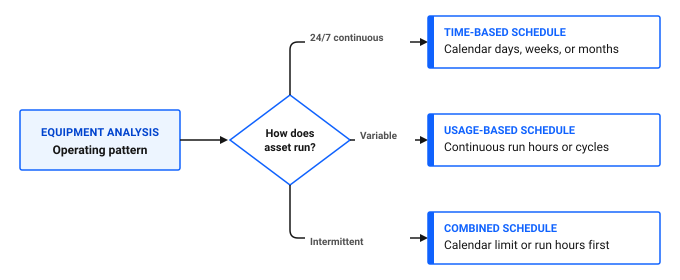
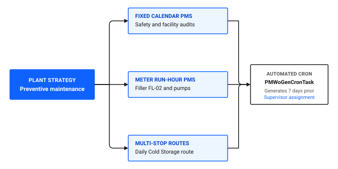

---
search:
  boost: 2
  keywords: preventive maintenance strategy plan pm fixed floating meter lead time job plans routes
---

# How do I plan my preventive maintenance strategy?

A successful preventive maintenance strategy prevents equipment breakdowns, stabilizes labor schedules, and ensures replacement parts are staged before work begins. Creating maintenance records without a strategic design leads to work order overload, missed service dates, or unnecessary teardown inspections that cause equipment defects.

Planning your preventive maintenance strategy in Maximo Application Suite Select involves selecting between time-based and usage-based frequencies, choosing fixed versus floating schedules, buffering lead times for parts staging, and organizing multi-stop routes.

*Looking to verify your PM strategy right away? [Skip to PM strategy planning checklist ↓](#pm-strategy-planning-checklist)*

## Core principles for designing a PM strategy

Before configuring schedules in the PM application, establish your maintenance strategy with your reliability engineers, planners, and operations team.

### 1. Balance time-based and usage-based triggers

Equipment operating under constant loads benefits from calendar schedules, while machinery with fluctuating production cycles requires usage-based runtime triggers.

Figure 1 outlines the decision framework for selecting maintenance frequencies based on operating patterns:

- **24/7 continuous operation**: time-based schedule using fixed calendar days, weeks, or months.
- **Variable batch production**: usage-based schedule driven by continuous run hours or cycles.
- **Intermittent seasonal operation**: combined schedule triggered by whichever threshold occurs first, calendar elapsed time or meter run hours.

Figure 1: Decision framework for preventive maintenance frequency

### Table 1: Matching equipment types to maintenance triggers

| Schedule type | How interval is calculated | Best suited for | Ice Cream Plant example |
|---|---|---|---|
| **Time-based** | Fixed calendar days, weeks, or months | Continuously running utility systems | Monthly emergency lighting and safety valve inspections |
| **Usage-based** | Cumulative continuous meter run hours or cycles | High-wear production machinery with fluctuating shift schedules | 500-hour bearing lubrication on Filler FL-02 drive motor |
| **Combined** | Elapsed calendar time or accumulated run hours, whichever occurs first | Standby machinery or seasonal backup systems | Cold Storage backup compressor serviced every 6 months or 250 run hours |

### 2. Choose fixed versus floating intervals carefully

Understanding the difference between fixed and floating schedules is one of the most critical decisions in maintenance planning:

- **Fixed schedule:** Calculates the next due date based on the **Target Start Date** of the previous work order. A monthly PM scheduled for the first of the month always generates on the first of the month, regardless of when technicians complete the physical work.
- **Floating schedule:** Calculates the next due date based on the **Actual Completion Date** of the previous work order. If a monthly PM due on January 1 is finished late on January 15, the next work order is scheduled for February 15.

### 💡 Tip: Beware of the floating PM halting trap
While a floating PM work order remains open in In Progress or Waiting on Material status, the system cannot calculate the next due date. If a technician forgets to close a floating work order, future preventive maintenance on that machine stops generating entirely without warning. Use fixed schedules for regulatory inspections and reserve floating schedules for usage-based overhauls.

### 3. Buffer work generation with realistic lead times

Lead time specifies how many days before the maintenance due date Maximo Application Suite Select generates the work order.

Set lead times based on your physical storeroom procurement cycles and shift planning routines:

- **Standard lead time: 7 to 14 days:** Gives supervisors time to verify parts availability in the storeroom, assign qualified crafts, and coordinate equipment downtime with production supervisors.
- **Zero lead time penalty:** If lead time is left at zero, work orders appear on their due date, leaving zero preparation time and causing immediate parts shortages.

---

## What a good PM strategy looks like

In our sample ice cream plant, the maintenance strategy combines calendar routines, usage-based triggers, and consolidated routes.

Figure 2 illustrates the three maintenance streams that feed into the automated generation engine:

- **Fixed calendar PMs**: recurring safety and facility audits scheduled on fixed calendar intervals.
- **Meter run-hour PMs**: usage-based servicing for production machines like `Filler FL-02` and pumps.
- **Multi-stop routes**: consolidated inspection rounds, such as the daily `Cold storage` walk-through.
- **Automated cron processing**: background tasks evaluate lead times and generate work orders 7 days in advance for supervisor assignment.

Figure 2: Architecture of an integrated plant preventive maintenance strategy

### Why this strategy works

- **Prevents over-maintenance:** Variable-speed production machinery triggers maintenance only after true operating wear, saving labor and consumable seal costs.
- **Guarantees regulatory compliance:** Hygiene, sanitation, and safety inspections run on fixed calendar dates that cannot drift over time.
- **Eliminates parts delays:** A mandatory 7-day lead time ensures replacement gaskets and food-grade lubricants are staged before technicians open equipment panels.
- **Reduces work order volume:** Low-risk walk-through checks across 45 cold storage valves are bundled into a single routed work order rather than 45 separate tickets.

---

## Spot the problem: test your plan

Review these common planning scenarios to test your strategy before creating PM records.

### Problem 1: The silent halting trap on a floating schedule

A maintenance planner creates a floating monthly preventive maintenance schedule for `Filler FL-02`. A technician completes the physical lubrication on January 10 but forgets to advance the work order status from In Progress to Completed.

What happens to scheduled maintenance for February and March?

Show the answer

No work orders are generated for February, March, or any subsequent month. Because floating schedules calculate next due dates from the completion timestamp of the previous work order, the open ticket blocks all future generation. Maintenance halts silently until someone investigates the backlog.

**What to do instead:** Use fixed schedules for recurring time-based servicing, or establish a daily supervisor dashboard triage routine to close completed work orders promptly.

### Problem 2: The premature calendar PM on idle equipment

A plant sets a fixed 30-day lubrication PM on the packaging room conveyor drive motor. Due to seasonal supply constraints, the filling line was shut down for three weeks during the month and only operated for 20 hours.

What happens when the calendar PM generates on schedule?

Show the answer

Technicians perform an unnecessary lubrication service on a machine that experienced almost zero mechanical wear. Over-lubricating bearings can blow out grease seals and introduce particulate contamination.

**What to do instead:** Switch the conveyor motor from a calendar frequency to a meter-based schedule triggered every 300 continuous operating run hours.

### Problem 3: The zero lead time material bottleneck

A planner configures quarterly pump rebuild schedules with zero days lead time. When work orders generate on the first day of the quarter, technicians immediately open the tickets and walk to the storeroom.

What happens at the storeroom counter?

Show the answer

The required mechanical seal kits are out of stock. Because the work order generated on its due date, the inventory clerk had zero advance notice to reorder parts. The work order stalls in Waiting on Material status for two weeks, turning a planned PM into an overdue compliance failure.

**What to do instead:** Configure a 14-day lead time on the PM record. When the work order generates two weeks early, the system reserves storeroom stock and alerts the inventory clerk to replenish low balances before work starts.

### Problem 4: Work order clutter from individual minor inspections

A facility creates 60 separate monthly PM records to inspect each individual fire extinguisher and emergency eyewash station across the production building.

What happens to technician productivity and supervisor assignment queues?

Show the answer

Technicians spend more time opening, logging labor on, and closing 60 individual records than performing the actual physical checks. Supervisor work queues become overwhelmed with dozens of trivial tickets.

**What to do instead:** Group all 60 inspection points into a single multi-stop **Route** attached to one monthly PM schedule. The system generates one consolidated work order with 60 sequential room stops.

---

## Common PM planning mistakes

When planning preventive maintenance schedules, avoid these frequent pitfalls:

- Creating separate standalone PMs for every minor component instead of using Master PMs and Routes.
- Setting floating schedules on compliance-critical assets where dates must not drift.
- Leaving lead time at zero, which causes parts shortages on the scheduled start date.
- Scheduling invasive teardown inspections on sealed components when non-destructive condition monitoring is more effective.
- Activating dozens of new PM schedules simultaneously on day one, which overwhelms the maintenance team with sudden work spikes.

---

## PM strategy planning checklist

Use this checklist to verify your maintenance strategy before activating schedules.

### Table 2: PM strategy verification checklist

| Check | Planning item | What to verify |
|---|---|---|
| [ ] | Schedule type alignment | Continuous machines use meter run hours; fixed facilities use calendar intervals |
| [ ] | Fixed vs floating validation | Regulatory and safety checks use fixed intervals to prevent schedule drift |
| [ ] | Lead time buffering | All PM records have a lead time of 7 to 14 days for material verification |
| [ ] | Standardized job plans linked | Every PM record references an active Job Plan with task steps and material lists |
| [ ] | Route consolidation | Minor walk-through checks are bundled into multi-stop routes |
| [ ] | Meter configuration verified | Usage-based PMs connect to continuous meters with active daily run rates |

---

## Continue building your skills

### Recommended next steps: Setup and execution

1. [How do I set up meters and meter groups?](set-up-meters.md): Configure continuous run-hour meters and rollover limits.
2. [How do I plan recurring maintenance?](../plan-work/plan-recurring-maintenance.md): Build time-based and meter-based PM records in the desktop application.
3. [How do I manage more assets?](../../work-smarter/scale-operation/manage-more-assets.md): Scale maintenance across multiple lines with Master PM templates.

---

## Related topics

- [How do I plan recurring maintenance?](../plan-work/plan-recurring-maintenance.md)
- [How do I set up meters and meter groups?](set-up-meters.md)
- [How do I manage more assets?](../../work-smarter/scale-operation/manage-more-assets.md)
- [How do I optimize performance?](../../work-smarter/insights-outcomes/optimize-performance.md)
- [What can I automate?](../../work-smarter/ai-automation/what-can-automate.md)
- [How do I reduce downtime?](../../improve-results/improve-work/reduce-downtime.md)
