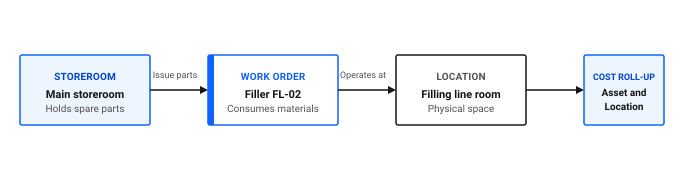
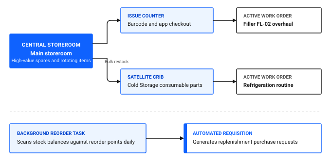

---
search:
  boost: 2
  keywords: storeroom inventory strategy item master rotating items reorder points safety stock count books
---

# How do I plan my storeroom and inventory strategy?

An effective storeroom and inventory strategy ensures critical spare parts are on hand when machines break down, prevents expensive stockouts, and eliminates excess capital tied up in slow-moving materials. Without structured storeroom management, maintenance teams suffer frequent job delays and inventory counts drift into inaccurate negative balances.

Planning your storeroom and inventory strategy in Maximo Application Suite Select involves designing physical storeroom layouts, classifying consumable versus rebuildable rotating items, establishing dynamic reorder points, and implementing regular cycle counts.

## Core principles for designing a storeroom strategy

Before cataloging items in the Item Master or creating warehouses in the Storerooms application, establish your inventory strategy with your maintenance, procurement, and warehouse teams.

### 1. Separate physical storerooms from operational locations

In Maximo Application Suite Select, a storeroom is a specialized location record designated for inventory control.

Keep storeroom records strictly distinct from operating rooms:

- **Operating location:** Where production occurs and machinery operates, such as `Filling line room`. Work orders and downtime roll up to operating locations.
- **Storeroom location:** Where items and spare parts are securely held, received, and issued, such as `Main storeroom`. Inventory transactions, stock balances, and unit costs roll up to storerooms.

Figure 1: Financial and material flow between storeroom, work order, and operating location

### 2. Distinguish consumable materials from rotating rebuildable assets

Every item stocked in inventory must be categorized as either a consumable item or a rotating item:

- **Consumable item, non-rotating:** Standard wear parts, such as flange gaskets, o-rings, drive belts, and filters. Tracked as physical stock quantities in storeroom bins. When issued, the part is consumed by the work order and discarded upon replacement.
- **Rotating item:** Expensive, rebuildable serialized equipment, such as 50 HP drive motors, sanitary pumps, and gearboxes. Tracked simultaneously as an inventory item in storerooms and as an individual asset in the Assets application. When pulled from a machine, the failed unit returns to the storeroom for repair rather than being scrapped.

### Table 1: Consumable items versus rotating items comparison

| Item classification | Tracking method | Financial impact upon issue | Repair handling | Ice Cream Plant example |
|---|---|---|---|---|
| **Consumable item** | Quantity balance in storeroom bin | Material cost charged directly to work order | Discarded and replaced with new stock | Food-grade silicone gasket kit for Filler FL-02 |
| **Rotating item** | Quantity balance plus serialized asset record | Material usage and asset location transfer recorded | Sent to rebuild shop and returned to storeroom stock | Rebuildable 50 HP homogenizer pump drive motor |

### 💡 Tip: Use the Attach to Parent Asset on Issue toggle
For rotating items that operate as subassemblies on parent machines, enable **Attach to Parent Asset on Issue** in the Item Master. When a storeroom clerk issues the replacement motor to `Filler FL-02`, Maximo Application Suite Select automatically links the new motor as a child asset to the filler in a single transaction.

### 3. Establish automated reorder points and safety stock

Automating inventory replenishment prevents emergency stockouts while avoiding over-purchasing.

Configure reorder parameters on the Inventory record for each stocked item:

- **Safety stock:** Minimum buffer held to protect against supplier shipping delays or unexpected breakdown spikes.
- **Reorder point:** Threshold that triggers reordering when the calculation `Current Balance + On Order - Reserved` drops to or below this level.
- **Economic order quantity:** Minimum cost-effective batch size to purchase from vendors.

---

## What a good storeroom strategy looks like

In our sample ice cream plant, the inventory strategy combines a secure central storeroom, satellite staging cribs, and structured rotating pools:

Figure 2: Sample storeroom topology and inventory replenishment flow

### Why this strategy works

- **Secures high-value rotating spares:** Rebuildable motors and expensive sanitary valves remain controlled in the central warehouse until officially reserved on approved work orders.
- **Minimizes technician transit time:** High-frequency consumables like sanitizing lubricants and cold-temperature seals live in an unlocked satellite cabinet near the cold storage facility.
- **Maintains 100% stock accuracy:** Storeroom staff conduct weekly cycle counts using Count Books, preventing inventory balance discrepancies before scheduled PMs run.
- **Prevents stockouts on critical lines:** Automated reorder calculations alert procurement two weeks before packaging line consumables deplete.

---

## Spot the problem: test your plan

Review these common planning scenarios to test your inventory strategy before adding items.

### Problem 1: The ghost stockout from unrecorded counter withdrawals

Technicians frequently grab mechanical seals from storeroom shelves during emergency repairs without logging an issue transaction on their work orders.

What happens when the scheduled monthly PM work order for Filler FL-02 generates two weeks later?

Show the answer

The system shows 4 seals in stock, so the work order is approved. However, when the technician arrives at the storeroom bin, the shelf is completely empty. The job stalls in Waiting on Material status, and the plant faces unexpected downtime because unrecorded withdrawals created ghost inventory.

**What to do instead:** Require all item checkouts to be recorded at the counter using the Issues and Transfers role-based app, and perform weekly cycle counts in Count Books to catch discrepancies early.

### Problem 2: Over-stocking low-cost bolts while stocking out of critical seals

A facility stocks $40,000 worth of standard hardware bolts that can be purchased locally in 2 hours, but holds zero custom mechanical seal kits for Filler FL-02 that have an 8-week supplier lead time.

What happens when Filler FL-02 suffers an unexpected seal failure?

Show the answer

The filling line is shut down for weeks waiting for international replacement shipments, costing tens of thousands of dollars in lost production, while valuable working capital sits locked up in excess hardware bolts.

**What to do instead:** Conduct an inventory criticality review. Set high safety stock and automated reorder points on long-lead critical spares, and maintain lean just-in-time minimums for locally available commercial hardware.

### Problem 3: The throwaway motor trap

A maintenance team purchases ten 50 HP drive motors for production pumps. In Item Master, the planner forgets to check the **Rotating?** box and catalogs the motors as standard consumable items.

What happens when the first motor fails and is replaced?

Show the answer

The technician issues the replacement motor as a consumable material. The old motor is removed, but because it has no serialized asset record, its lifetime overhaul history, rewind dates, and run-hour meter logs are permanently lost. The repair shop cannot track whether this specific motor has failed multiple times.

**What to do instead:** Mark rebuildable equipment as **Rotating** in the Item Master before creating inventory balances, and track the individual units as serialized assets.

### Problem 4: Creating a storeroom as an asset record

A data entry clerk creates `Main storeroom` as an asset record in the Assets application so that equipment can be linked to it.

What happens when inventory clerks attempt to receive purchase orders or issue parts?

Show the answer

Inventory applications like Inventory, Count Books, and Issues and Transfers can only store items in locations designated with the type `STOREROOM`. The system will not allow parts to be stocked inside asset records.

**What to do instead:** Create `Main storeroom` in the Locations application and set its location type to `STOREROOM`.

---

## Common storeroom planning mistakes

When planning your storerooms and inventory catalogs, avoid these frequent mistakes:

- Allowing open, unmonitored access to storeroom bins without barcode issue logging.
- Failing to mark rebuildable motors and pumps as Rotating items in Item Master.
- Setting reorder points to zero, disabling automated stock replenishment calculations.
- Neglecting to link stocked items to the Spare Parts tab of parent asset records.
- Skipping periodic cycle counts, which allows physical stock and database balances to drift.

---

## Storeroom strategy planning checklist

Use this checklist to confirm your inventory strategy is ready for operations.

### Table 2: Storeroom strategy verification checklist

| Check | Planning item | What to verify |
|---|---|---|
| [ ] | Dedicated storeroom locations | Storerooms are created in Locations with location type set to STOREROOM |
| [ ] | Rotating items classified | Rebuildable motors and pumps have the Rotating checkbox enabled in Item Master |
| [ ] | Critical spares identified | Long-lead replacement parts have defined safety stock and reorder points in Inventory |
| [ ] | Spare Parts tabs linked | Consumable gaskets and seals are linked to parent machines for fast technician lookup |
| [ ] | Barcode issue process ready | Storeroom counter staff use Issues and Transfers for rapid material checkout |
| [ ] | Cycle counting schedule set | Periodic physical inventory audits are planned using Count Books |

---

## Continue building your skills

### Recommended next steps: Setup and execution

1. [How do I decide: location, asset, or spare part?](decide-location-asset-spare-part.md): Master the four-question classification framework.
2. [How do I issue parts?](../manage-inventory/issue-parts.md): Execute fast counter checkouts using the Issues and Transfers app.
3. [How do I track stock levels?](../manage-inventory/track-stock-levels.md): Monitor minimum balances, reservations, and reorder triggers.

---

## Related topics

- [How do I decide: location, asset, or spare part?](decide-location-asset-spare-part.md)
- [How do I track stock levels?](../manage-inventory/track-stock-levels.md)
- [How do I issue parts?](../manage-inventory/issue-parts.md)
- [Why does my data look wrong?](../../improve-results/improve-data/data-looks-wrong.md)
- [How do I reduce downtime?](../../improve-results/improve-work/reduce-downtime.md)
- [How do I simplify workflows?](../../improve-results/improve-adoption/simplify-workflows.md)
