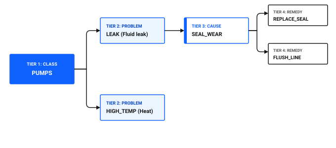
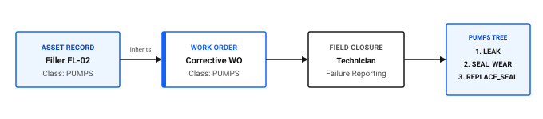

---
search:
  boost: 2
  keywords: failure codes failure class problem cause remedy hierarchy downtime root cause assets
---

# How do I set up failure codes?

Structured failure codes convert subjective technician remarks into standardized reliability data. When technicians record repairs using consistent failure codes, maintenance engineers can track defect trends, identify recurring root causes, and justify equipment redesigns or warranty claims.

In Maximo Application Suite Select, failure codes are organized into a four-tier hierarchy headed by a Failure Class, followed by Problem, Cause, and Remedy codes configured in the Failure Codes application.

Select includes some failure codes. You can use them as they are, or add your own to match your equipment.

## The four-tier failure hierarchy architecture

A failure hierarchy structures failure reporting from initial symptom down to corrective action.

Figure 1 illustrates the four-tier failure hierarchy architecture:

- **Tier 1 (Failure Class)**: broad equipment category, such as `PUMPS`.
- **Tier 2 (Problem)**: observed operational symptom, such as `LEAK` for fluid leaks or `HIGH_TEMP` for heat issues.
- **Tier 3 (Cause)**: underlying mechanical defect, such as `SEAL_WEAR`.
- **Tier 4 (Remedy)**: corrective action taken, such as `REPLACE_SEAL`.

Figure 1: Four-tier failure code hierarchy architecture

### Table 1: Four-tier failure code hierarchy with plant examples

| Level | Code type | What it describes | Ice Cream Plant example |
|---|---|---|---|
| **Level 1** | **Failure Class** | Broad equipment family or machine type | `PUMPS` (Sanitary and utility pumps) |
| **Level 2** | **Problem** | The observed failure symptom or operational defect | `LEAK` (Fluid leaking from pump casing) |
| **Level 3** | **Cause** | The underlying mechanical or operational root cause | `SEAL_WEAR` (Carbon seal face worn beyond tolerance) |
| **Level 4** | **Remedy** | The specific corrective action that resolved the failure | `REPLACE_SEAL` (Installed new food-grade mechanical seal kit) |

## Step 1: Create a failure hierarchy in Failure Codes

Failure codes and hierarchies are created at the Organization level in the Failure Codes application.

### Building a failure tree in the desktop application

1. In the **Find navigation item** field, search for Failure Codes and open it.
2. Click **New Failure Code**.
3. In the **Failure Class** field, enter a clear identifier, such as `PUMPS`.
4. In the **Description** field, enter `Sanitary and Utility Pumps Failure Class`.
5. In the **Problems** table, click **New Row** to add failure symptoms:
   - In the **Problem** field, enter `LEAK`.
   - In the **Description** field, enter `Liquid product or lubricant leak`.
6. With the `LEAK` problem row selected, go to the **Causes** table below and click **New Row**:
   - In the **Cause** field, enter `SEAL_WEAR`.
   - In the **Description** field, enter `Mechanical seal wear or face scoring`.
7. With the `SEAL_WEAR` cause row selected, go to the **Remedies** table and click **New Row**:
   - In the **Remedy** field, enter `REPLACE_SEAL`.
   - In the **Description** field, enter `Replaced mechanical seal assembly`.
8. Repeat steps 5 through 7 to add remaining problems, causes, and remedies.
9. Click **Save**.

### 💡 Tip: Reuse branches with Copy Failure Hierarchy
Many equipment types share identical mechanical failure paths. Instead of retyping problem, cause, and remedy trees for every machine class, use the **Copy Failure Hierarchy** action in the Failure Codes application to duplicate branches from existing failure classes in seconds.

## Step 2: Assign Failure Classes to assets

For technicians to select failure codes on work orders, the asset must have an assigned Failure Class.

### Linking a failure class to an asset record

1. In the **Find navigation item** field, search for Assets and open it.
2. Open the target equipment record, such as `Filler FL-02`.
3. On the main **Asset** tab, locate the **Failure Class** field.
4. Select the matching failure class, such as `FILLERS` or `ROTATING_PUMP`.
5. Click **Save**.

Figure 2 outlines the failure class inheritance and field reporting workflow:

1. **Asset record**: equipment record `Filler FL-02` holds configured failure class `PUMPS`.
2. **Work order header**: when the asset is added to a corrective work order, `PUMPS` is inherited automatically.
3. **Field closure**: during job completion, the technician accesses the Failure Reporting tab.
4. **Cascading selection**: the technician navigates the filtered `PUMPS` hierarchy to log Problem `LEAK`, Cause `SEAL_WEAR`, and Remedy `REPLACE_SEAL`.

Figure 2: Failure class inheritance and field reporting flow

## How failure codes behave on work orders

Understanding how failure codes transfer to work orders ensures smooth field reporting:

- **Automatic inheritance:** When an asset is added to a work order, its Failure Class copies automatically to the work order header.
- **Precedence rule:** If both an asset and a location are specified on a work order and each has a different failure class, the asset failure class takes precedence.
- **Mandatory reporting:** For emergency and breakdown work types, configure work order rules to require Problem, Cause, and Remedy selection before advancing status to Completed.

## Common failure code design mistakes

To maintain clean reliability analytics, avoid these common design traps:

- **Creating too many failure classes:** Keep your initial failure class list focused on 5 to 10 major equipment families, such as Pumps, Motors, Conveyors, Refrigeration, and Electrical. Avoid creating a unique failure class for every individual machine model.
- **Using vague problem descriptions:** Do not create codes named *Broken*, *Damaged*, or *Failed*. Use specific physical symptoms, such as *High Vibration*, *Overheating*, *Jammed*, or *Leaking*.
- **Omitting remedy codes:** Recording only what broke without recording which remedy succeeded prevents reliability teams from knowing which repair procedures are most effective.

## Failure code setup verification checklist

Use this checklist to confirm your failure hierarchies are ready for operational use.

### Table 2: Failure code configuration checklist

| Check | Item | What to verify |
|---|---|---|
| [ ] | Core failure classes established | Top-level classes exist for all major plant equipment families |
| [ ] | 4-tier depth completed | Each problem branch has linked cause codes and associated remedies |
| [ ] | Descriptive naming applied | Codes use clear alphanumeric identifiers with concise plain-language descriptions |
| [ ] | Asset records populated | Operating equipment records have a valid Failure Class assigned on their main tab |
| [ ] | Mobile visibility verified | Technicians can view and navigate the failure hierarchy on mobile work order cards |
| [ ] | Mandatory on corrective work | Failure reporting is required before closing emergency or unscheduled repair work orders |

## Related topics

- [What happens when an asset fails?](../manage-assets/asset-fails.md)
- [How do I reduce downtime?](../../improve-results/improve-work/reduce-downtime.md)
- [How do I make data reliable?](../../improve-results/improve-data/make-data-reliable.md)
- [How do I standardize across teams?](../../work-smarter/scale-operation/standardize-across-teams.md)
