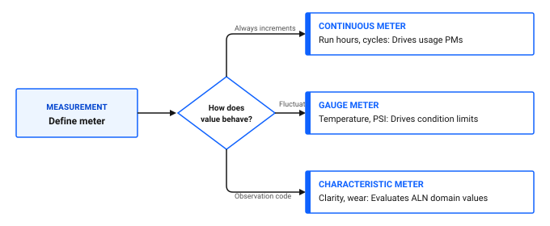
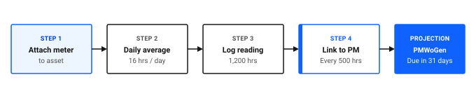

---
search:
  boost: 2
  keywords: meters meter groups continuous gauge characteristic run hours condition monitoring pm rollover
---

# How do I set up meters and meter groups?

Meters track equipment usage, operating conditions, and physical measurements. In Maximo Application Suite Select, meter readings drive automated preventive maintenance schedules based on run hours and trigger corrective work orders when readings breach safety limits. You enter meter readings manually. Select does not receive readings automatically from sensors or IoT devices.

Setting up meters involves defining meter definitions at the system level, grouping related meters into reusable templates, and attaching those meters to assets and locations.

## The three meter types in Maximo Application Suite Select

Before creating meters, select the appropriate meter type based on how the measurement behaves.

Figure 1 outlines the decision framework for selecting meter types:

- **Continuous meter**: for cumulative values that always increment, such as run hours or cycles, driving usage-based preventive maintenance.
- **Gauge meter**: for numeric values that fluctuate up and down, such as temperature or pressure, driving condition monitoring limits.
- **Characteristic meter**: for qualitative observations, such as fluid clarity or physical wear, evaluating values from an ALN domain.

Figure 1: Decision framework for selecting meter types and operational applications

### Table 1: Comparison of meter types and operational applications

| Meter type | Measurement behavior | Allowable values | Operational application | Ice Cream Plant example |
|---|---|---|---|---|
| **Continuous** | Always increments upward until hardware rollover | Positive numbers only | Drives usage-based PM generation | Run hours on the Filler FL-02 drive motor |
| **Gauge** | Fluctuates up and down | Numeric values, including negative numbers | Triggers Condition Monitoring alerts | Ambient temperature in Cold Storage Room |
| **Characteristic** | Qualitative visual or physical observations | Alphanumeric values defined in an ALN domain | Triggers Condition Monitoring alerts | Lubricant clarity rated as Clear, Cloudy, or Dark |

## Step 1: Define meters in the Meter application

Meters are created once at the system level and can then be applied across multiple assets and locations.

### Creating a meter in the desktop application

1. In the **Find navigation item** field, search for Meter and open it.
2. Click **New Meter**.
3. In the **Meter** field, enter a unique identifier, such as `RUNHOURS`.
4. In the **Description** field, enter `Operating Run Hours`.
5. In the **Meter Type** field, select `CONTINUOUS`, `GAUGE`, or `CHARACTERISTIC`.
6. Configure type-specific settings:
   - For **Continuous** meters: In the **Reading Type** field, select `ACTUAL` if workers log the total odometer reading, or `DELTA` if workers log only hours run during the shift. Enter the **Unit of Measure**, such as `HOURS`.
   - For **Gauge** meters: Enter the **Unit of Measure**, such as `CELSIUS` or `PSI`.
   - For **Characteristic** meters: In the **Domain** field, select the ALN domain containing allowable inspection values.
7. Click **Save**.

## Step 2: Bundle meters into Meter Groups

If your facility operates multiple machines that share the same set of meters, group them into a Meter Group. When you assign the group to an asset, all bundled meters attach automatically in a single step.

### Creating a meter group in the desktop application

1. In the **Find navigation item** field, search for Meter Groups and open it.
2. Click **New Meter Group**.
3. In the **Meter Group** field, enter an identifier, such as `ROTATING_PUMP`.
4. In the **Description** field, enter `Rotating Pump Standard Meter Package`.
5. Check **Apply New Meters Where Group Is Used?** so that any future meters added to this group cascade to existing assets automatically.
6. In the **Meters in Meter Group** table, click **New Row** to add individual meters:
   - In the **Meter** field, select `RUNHOURS`. In the **Sequence** field, enter `10`.
   - Click **New Row**, select `VIB_VELOCITY`, and enter `20`.
   - Click **New Row**, select `OIL_COND`, and enter `30`.
7. Click **Save**.

### 💡 Tip: Order meters by inspection sequence
Use the Sequence field in Meter Groups to arrange meters in the order a technician reads physical gauges on the machine. This layout matches field data entry on mobile devices and eliminates scrolling.

## Step 3: Attach meters to assets

Once meters and meter groups exist, attach them to equipment records on the Meters tab in the Assets application.

### Configuring an asset meter in the desktop application

1. In the **Find navigation item** field, search for Assets and open it.
2. Open the target equipment record, such as `Filler FL-02`.
3. Open the **Meters** tab.
4. If attaching a group: In the **Meter Group** field, select `ROTATING_PUMP`. All bundled meters populate the table.
5. If attaching a single meter: In the **Meters** table, click **New Row** and select the meter.
6. For **Continuous** meters, configure calculation parameters in the details section:
   - In the **Average Calculation Method** field, select `STATIC` to manually set daily consumption, or select `ALL` to let the system calculate rolling daily usage from entered readings.
   - In the **Average Units / Day** field, enter the expected daily run rate, such as `16.0` hours per day.
   - In the **Rollover Point** field, enter the physical dial limit, such as `999999`.
7. Click **Save**.

Figure 2 illustrates the continuous meter projection workflow across five stages:

1. **Attach meter to asset**: assign the continuous meter to the equipment record.
2. **Configure daily average**: establish the expected daily operating rate, such as 16 hours per day.
3. **Log meter reading**: enter cumulative runtime observations, such as 1,200 operating hours.
4. **Link to PM schedule**: define maintenance trigger intervals, such as every 500 runtime hours.
5. **Project due date**: background processes calculate when thresholds will be reached and forecast work order generation.

Figure 2: Continuous meter setup and automated preventive maintenance projection

## Step 4: Record and manage meter readings

Technicians enter readings during daily inspections, on work orders, or directly in the Assets application.

### Entering a meter reading

1. In the **Assets** application, open the equipment record.
2. In the **Select Action** menu, click **Enter Meter Readings**.
3. In the **New Reading** field for each active meter, enter the observed value.
4. If a continuous meter hardware dial rolled over past its limit, check the **Rollover** box to allow a lower numeric entry.
5. Click **OK**.

### Resetting or replacing broken meters

If a physical gauge or runtime meter fails and is replaced with a new unit:

1. Open the equipment record in the **Assets** application.
2. In the **Select Action** menu, click **Reset/Replace Meters**.
3. Select the continuous meter row.
4. In the **Last Reading** field, enter the starting value on the replacement meter.
5. If resetting overhaul counters, update **Since Last Overhaul** or **Since Last Repair** to zero.
6. Click **OK**.

## Common meter setup pitfalls

Avoid these common configuration errors that disrupt automated maintenance:

- **Missing Average Units per Day:** If this field is zero or blank on a continuous meter, background cron tasks cannot project future maintenance dates, and PM work orders will fail to generate ahead of time.
- **Using Continuous type for fluctuating values:** Never select Continuous for temperatures or pressure levels. If a temperature drops from 40 to 35 degrees, the system treats the drop as an error or rollover. Use Gauge instead.
- **Forgetting the Rollover point:** Leaving the rollover limit blank causes the system to reject readings when mechanical dials cycle from 999999 back to 0.

## Meter setup verification checklist

Use this checklist to confirm your meters are configured properly.

### Table 2: Meter setup verification checklist

| Check | Item | What to verify |
|---|---|---|
| [ ] | Proper meter type | Continuous meters are used for cumulative run hours; Gauge meters are used for fluctuating levels |
| [ ] | ALN domains on characteristics | Characteristic meters have an active ALN domain linked for picklist selections |
| [ ] | Daily run rate configured | All continuous asset meters have a positive Average Units / Day value populated |
| [ ] | Rollover point defined | Mechanical meters have their hardware maximum rollover value specified |
| [ ] | Meter group cascade toggle | Meter groups have the auto-apply toggle checked to simplify future fleet updates |
| [ ] | Condition monitoring links | Gauge meters on critical equipment are linked to active measurement points |

## Related topics

- [How do I detect issues early?](../monitor-respond/detect-issues-early.md)
- [How do I plan recurring maintenance?](../plan-work/plan-recurring-maintenance.md)
- [How do I optimize performance?](../../work-smarter/insights-outcomes/optimize-performance.md)
- [How do I decide: location, asset, or spare part?](decide-location-asset-spare-part.md)
- [How do I plan my preventive maintenance strategy?](plan-your-pm-strategy.md)
- [How do I create inspection forms?](create-inspection-forms.md)
- [How do I set up failure codes?](set-up-failure-codes.md)
