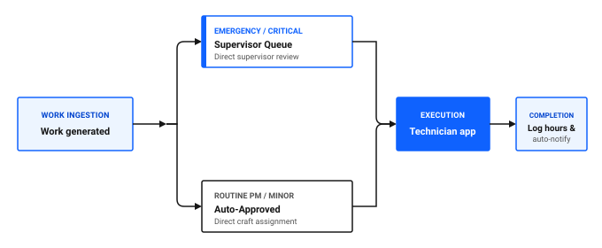

# How do I simplify workflows?

Complex maintenance workflows with unnecessary approval stages, redundant data entry, and cluttered application screens create bottlenecks that delay repairs. When a process requires ten clicks where three would suffice, staff bypass the system or delay administrative handoffs.

Simplifying workflows involves matching user roles to purpose-built apps, configuring default profile values, automating routine notifications, and removing approval hurdles for low-risk work.

## Core strategies for workflow simplification

To streamline maintenance operations across your plant, focus on four key areas:

1. **Role-based routing:** Direct field technicians and inventory clerks to streamlined role-based apps while reserving comprehensive desktop applications for planners and system administrators.
2. **Default profile values:** Configure user defaults for site and storeroom so staff do not manually populate repetitive fields on every transaction.
3. **Automated notifications:** Use Communication Templates to alert stakeholders automatically when work orders change status.
4. **Fast-track approvals:** Allow routine preventive maintenance and minor repairs below set financial thresholds to approve automatically upon creation.

### Table 1: Workflow simplification opportunities across operational areas

| Operational area | Common complexity bottleneck | Simplified approach |
|---|---|---|
| **Work execution** | Technicians opening multi-tab desktop forms on mobile devices | Use the Technician role-based app for fast card-based labor and material logging |
| **Storeroom issues** | Storeroom clerks navigating full inventory master records for daily counter issues | Use the Issues and Transfers role-based app for rapid barcode scanning and item checkout |
| **Material requests** | Field staff waiting for manual supervisor approvals on standard consumables | Pre-approve stocked gasket and lubricant requests attached to active Job Plans |
| **Status updates** | Senders phoning maintenance planners to check repair progress | Trigger automated email notifications via Communication Templates at status changes |

## Matching roles to the right applications

Maximo Application Suite Select provides both comprehensive desktop applications and focused role-based apps. Routing users to the appropriate tool reduces training overhead and accelerates data entry.

### Table 2: Application routing matrix by operational role

| Operational role | Recommended role-based app | Primary desktop application | Key daily responsibilities |
|---|---|---|---|
| **Field Technician** | Technician app | None required for daily tasks | View assigned work orders, record meter readings, log labor time, complete job steps |
| **Quality Inspector** | Inspections app | None required for daily tasks | Complete safety, hygiene, and environmental condition check sheets |
| **Inventory Clerk** | Issues and Transfers app, Inventory Counting app | Inventory, Count Books | Issue parts at the counter, transfer stock between storerooms, conduct cycle counts |
| **Maintenance Planner** | Work orders | Job Plans, PM, Routes | Build multi-step maintenance plans, schedule recurring PMs, coordinate craft routes |
| **Reliability Engineer** | Asset Manager | Assets, Condition Monitoring, Failure Codes | Manage asset registries, configure upper and lower meter limits, analyze failure trends |

Figure 1: Simplified work order routing and execution workflow

As shown in Figure 1, a simplified routing model processes maintenance work across four distinct stages:

1. **Work ingestion**: The system or a requester generates a work order.
2. **Triage and approval routing**: Work splits according to urgency:
   - **Emergency and critical work**: Routes to the supervisor queue for direct supervisor review.
   - **Routine PM and minor repairs**: Auto-approves to bypass administrative delays and routes directly to craft assignment.
3. **Execution**: Both streams converge in the Technician app, where technicians view assigned work orders and execute tasks in the field.
4. **Completion**: Technicians log labor hours, parts, and notes in the mobile interface, automatically triggering completion notifications to stakeholders.

## Configuring user profile defaults

When technicians, supervisors, or storeroom clerks create records, having the system auto-populate their home Site and default Storeroom eliminates repetitive keystrokes.

### Setting default Insert Site in the desktop application

1. In the navigation bar, click the **Profile** icon in the upper right header and select **Default Information**.
2. In the **Insert Site** field, select your active plant site, such as `PLANT01`.
3. In the **Default Storeroom** field, select your primary physical warehouse, such as `CENTRAL`.
4. Click **OK** to save your profile preferences.

Future transactions, including work orders and inventory issues, will automatically default to these locations.

### 💡 Tip: Standardize defaults across security groups
Rather than asking every technician to configure profile defaults individually, system administrators can apply default site and storeroom settings at the security group level during initial user onboarding.

## Automating status notifications

Instead of requiring maintenance planners to send manual emails to production managers when equipment repairs finish, set up automated email notifications using Communication Templates.

### Creating an automated notification template

1. In the **Find navigation item** field, search for Communication Templates and open it.
2. Click **New Communication Template**.
3. In the **Template** field, enter an identifier, such as `WO_COMPLETED_NOTIFY`.
4. In the **Applies to** field, enter `WORKORDER`.
5. In the **Subject** field, enter a clear title: `Work Order :WONUM Completed for Asset :ASSETNUM`.
6. In the **Message** body, enter standard text with substitution variables:
   `Work order :WONUM for asset :ASSETNUM at location :LOCATION has been marked complete by :CHANGEBY.`
7. In the **Recipients** tab, add the requestor role or specific supervisor distribution list.
8. In the **Select Action** menu, change status to **Active**, then click **Save**.

## Workflow simplification checklist

Use this checklist to audit and streamline your maintenance handoffs.

### Table 3: Workflow simplification checklist

| Check | Item | What to verify |
|---|---|---|
| [ ] | Role-based app adoption | Field workers and storeroom staff use role-based apps for their primary daily interactions |
| [ ] | Default profile attributes | Users have active default Site and Storeroom values configured |
| [ ] | Streamlined approval paths | Low-risk PM work orders bypass manual supervisor approval queues |
| [ ] | Communication templates | Critical status transitions trigger automated alerts to equipment owners |
| [ ] | Fast parts checkout | Storeroom counter transactions utilize barcode scanning with Issues and Transfers |
| [ ] | Dashboard work queues | Supervisors triage assignments using Work Queue cards rather than manual report exports |

## Related topics

- [Why aren't technicians using the system?](technicians-not-using.md)
- [How do I improve completion rates?](../improve-work/improve-completion-rates.md)
- [How do I act on alerts?](../../get-work-done/monitor-respond/act-on-alerts.md)
