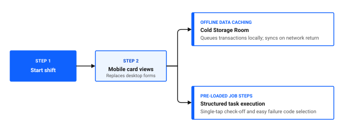

# Why aren't technicians using the system?

Low system adoption by maintenance technicians leads to delayed work order reporting, incomplete labor tracking, and missing failure records. When technicians avoid logging into the system, organizations revert to informal paper notes, spreadsheet logs, and verbal handoffs, which makes maintenance tracking unreliable.

Technicians generally bypass software not out of reluctance, but because of workflow friction: excessive required fields, confusing desktop interfaces on mobile tablets, slow network synchronization in shielded plant areas, or missing job instructions.

## Identifying adoption friction points

To resolve low adoption, diagnose where field workers encounter resistance in their daily maintenance routine.

### Table 1: Common adoption barriers and operational remedies

| Observed symptom | Root cause | Corrective action |
|---|---|---|
| **End of shift batch logging** | Work entry forms require too many clicks during active work | Deploy the Technician role-based app with streamlined card views instead of desktop forms |
| **Data loss complaints in shielded areas** | Wireless drops in refrigerated or concrete structures | Enable offline data caching in Mobile Properties so data queues locally and syncs automatically |
| **Vague work descriptions** | Free text fields with no structured checklist guidance | Attach standardized Job Plans with numbered task steps to preventive maintenance records |
| **Incomplete parts recording** | Finding storeroom item numbers is slow or difficult | Pre-load expected materials on job plans so technicians select staged items with a single tap |
| **Work orders left in progress** | Technicians forget to record stop times or final failure codes | Set up operational dashboard Work Queue cards that highlight open assignments directly to the team |

Figure 1: Streamlined mobile workflow overcoming adoption barriers

## Streamlining the user experience

Complex desktop screens designed for maintenance planners and database administrators create frustration when presented to field technicians wearing gloves or working on small screens.

### Switching from desktop forms to the Technician app

The dedicated Technician role-based app presents a clean card layout tailored to field execution. Technicians see assigned work orders, view attached equipment manuals, record meter readings, and log labor hours with minimal taps.

### 💡 Tip: Keep required fields to an absolute minimum
Audit the mandatory fields required to complete a work order. Every additional mandatory field increases the temptation for technicians to bypass the system or enter dummy placeholder data. Only enforce fields that directly drive regulatory compliance, failure tracking, or inventory reconciliation.

## Optimizing offline and mobile connectivity

In facilities like the Ice Cream Main Plant, technicians frequently work in heavily insulated areas such as the Cold Storage Room where cellular and WiFi signals cannot penetrate. If the mobile app requires constant connectivity, technicians abandon the device.

Configuring offline caching ensures technicians can view job instructions, complete inspection checklists, and record used parts without an active network connection. The device stores all transactions locally and synchronizes with the server once the technician re-enters network coverage.

### Configuring sync parameters in Mobile Properties

Adjust synchronization settings in the desktop application to prevent timeout errors and ensure responsive background syncing.

1. Go to **System Configuration > Platform Configuration > Mobile Properties**.
2. In the **Property Name** filter, search for sync timeout and batch size properties.
3. Select the property governing offline transaction batching, such as `si.offline.download.batchsize`.
4. Update the **Global Value** to an appropriate batch limit, such as 50 records, to reduce synchronization latency over intermittent wireless connections.
5. In the **Select Action** menu, click **Save Properties**.
6. Click **Live Refresh** to apply the updated properties without restarting system services.

## Engaging technicians through better job preparation

Technicians actively embrace the system when it helps them complete repairs faster rather than acting as a digital time clock. When a work order opens with exact safety procedures, equipment location details, and pre-staged parts lists, the software becomes an indispensable tool.

### Table 2: Elements of high-value work order preparation

| Preparation element | Where configured | Direct technician benefit |
|---|---|---|
| **Equipment location tags** | Location / Service Address | Shows exact plant room and floor coordinates, eliminating wasted travel time |
| **Safety hazard warnings** | Job Plans | Alerts the technician to lockout and tagout requirements before opening panels |
| **Pre-specified spare parts** | Job Plans | Lists required replacement seals and gaskets with storeroom bin numbers |
| **Technical schematics** | Asset attachments | Provides instant access to wiring diagrams and parts lists directly on mobile devices |

## Technician adoption checklist

Use this checklist to evaluate whether your software setup supports smooth field adoption.

### Table 3: Field adoption readiness checklist

| Check | Item | What to verify |
|---|---|---|
| [ ] | Role-based app deployment | Technicians access assignments through the Technician app rather than desktop screens |
| [ ] | Offline sync readiness | Devices reliably store and sync records when working in zero-signal zones like cold storage rooms |
| [ ] | Minimal required fields | Only vital fields, such as actual hours and failure codes, are mandatory at work order completion |
| [ ] | Pre-loaded job plans | Recurring preventive work orders contain numbered tasks and material lists |
| [ ] | Document attachments | Equipment manuals and safety schematics are linked to asset records and visible on mobile devices |
| [ ] | Dashboard visibility | Supervisors review active work queues daily to assist technicians with blocked jobs |

## Related topics

- [How do I simplify workflows?](simplify-workflows.md)
- [How do I improve completion rates?](../improve-work/improve-completion-rates.md)
- [How do I make data reliable?](../improve-data/make-data-reliable.md)
