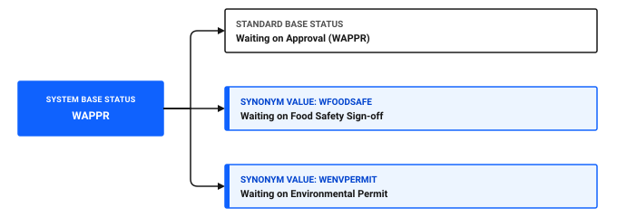
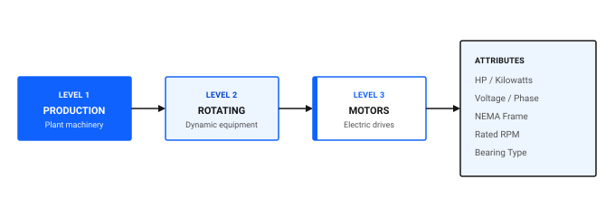

# How do I make data reliable?

Reliable data enables accurate maintenance forecasting, automated work order generation, and dependable inventory planning. When data entries contain typos, inconsistent naming conventions, or missing attributes, reports produce misleading results and scheduled maintenance fails to trigger.

To make operational data reliable across your organization, replace free text entry with controlled vocabularies, enforce mandatory fields, structure asset classifications, and conduct routine data health audits.

## Core principles of reliable data

Reliable maintenance data rests on four structural pillars:

1. **Controlled vocabularies:** Restrict data entry to defined picklists using the Domains application instead of free-form text fields.
2. **Standardized hierarchies:** Organize assets, locations, and failure records into structured parent and child relationships.
3. **Consistent attribute capture:** Apply classifications to categorize equipment specifications, such as motor horsepower or refrigeration refrigerant types.
4. **Regular validation audits:** Review data exceptions on a recurring schedule to catch orphaned records, duplicate entries, or missing rates before they impact reporting.

### Table 1: Data standardization mechanisms in Maximo Application Suite Select

| Standardization mechanism | Application | Operational purpose | Example implementation |
|---|---|---|---|
| **ALN domains** | Domains | Provides a fixed list of text values for selection fields | Standard work order priority reasons or inspection condition grades |
| **Synonym domains** | Domains | Extends internal system statuses with custom business sub-statuses | Adding `WAITING_PERMIT` under internal status `WAPPR` |
| **Numeric and range domains** | Domains | Enforces numeric validation and boundary limits | Restricting allowable temperature entries between -30 and 50 degrees Celsius |
| **Classifications** | Classifications | Applies uniform attribute templates across equipment families | Requiring voltage, frame size, and RPM attributes on all drive motors |
| **Failure hierarchies** | Failure Codes | Standardizes failure reporting across Problem, Cause, and Remedy tiers | Linking mechanical seal leak failure paths to Filler FL-02 |

## Replacing free text with Domains

Free text entry is the primary cause of data degradation in maintenance management systems. When technicians and planners type freehand notes into categorisation fields, slight variations such as *Pump Leak*, *PMP LK*, and *Leaking pump* prevent automated reporting from aggregating failure history.

### ALN domains for standard picklists

ALN alphanumeric domains present users with a controlled drop-down list. By attaching ALN domains to user-defined fields, you eliminate spelling discrepancies and enable precise filtering.

#### Creating an ALN domain in the desktop application

1. In the **Find navigation item** field, search for Domains and open it.
2. Click **Add New Domain** and select **Add New ALN Domain**.
3. In the **Domain** field, enter a unique identifier, such as `IC_FAIL_REASON`.
4. In the **Description** field, enter a descriptive title, such as `Ice Cream Plant Failure Reason Codes`.
5. In the **ALN Values** table, click **New Row** to add each allowable option:
   - In the **Value** field, enter the code, such as `BEARING_WEAR`.
   - In the **Description** field, enter the full label, such as `Mechanical bearing wear or fatigue`.
6. Repeat step 5 for all required values.
7. Click **OK**, then click **Save**.

### Synonym domains for status workflows

Synonym domains allow organizations to define business-specific terms that map directly to core system statuses. The internal system logic operates on the base status, while users interact with the familiar synonym value.

For example, if the Ice Cream plant requires a specific sub-state for work orders awaiting food safety sign-off before work starts, add a synonym value `WFOODSAFE` mapped to the system base status Waiting on Approval, `WAPPR`.

Figure 1: Synonym domain mapping to system base status

### 💡 Tip: Keep domain lists concise and mutually exclusive
Do not overload domains with dozens of overlapping choices. If a picklist exceeds fifteen options, users often pick the first available entry rather than scrolling to find the correct code. Review domain lists quarterly and deactivate obsolete values.

## Enforcing standardized classifications

Classifications ensure that all assets of the same type store identical technical specifications. Without classifications, one technician records motor power in kilowatts in the description field, while another records horsepower in the remarks section.

In the Classifications application, build an equipment hierarchy:

Figure 2: Hierarchical asset classification and specification structure

When you classify the drive motor for Filler FL-02 under `MOTORS`, Maximo Application Suite Select prompts for each defined attribute. This structured capture enables engineers to search for all 50 HP motors across the Ice Cream Main Plant when planning standardized spares.

## Establishing a data governance cadence

Data quality is not a one-time cleanup project; it requires regular monitoring. Establish a tiered audit cadence to catch anomalies early.

### Table 2: Recommended data governance schedule

| Frequency | Responsible role | Focus area | Action required |
|---|---|---|---|
| **Daily** | Maintenance Supervisor | Open Work Orders | Review newly created work orders to ensure asset, location, and work type fields are populated correctly |
| **Weekly** | Inventory Clerk | Storeroom Balances | Reconcile negative balances and investigate unrecorded material receipts |
| **Monthly** | Reliability Engineer | Failure Reporting & PM Compliance | Identify work orders closed without failure codes or completed with unlinked assets |
| **Quarterly** | System Administrator | Domains & Classifications | Audit unused domain values, archive obsolete codes, and review orphan location records |

## Data reliability checklist

Use this checklist to verify that data standards are active across your plant.

### Table 3: Data reliability verification checklist

| Check | Item | What to verify |
|---|---|---|
| [ ] | Mandatory failure codes | Work types requiring failure tracking cannot be completed without Problem, Cause, and Remedy selection |
| [ ] | Controlled picklists | Key operational fields use ALN or Synonym domains rather than free text entry |
| [ ] | Asset classification coverage | All critical production assets have an assigned classification and populated specification attributes |
| [ ] | Active meter associations | Rotating assets requiring usage-based maintenance have active continuous or gauge meters linked |
| [ ] | Location hierarchy integrity | All child locations connect to valid parent locations with no orphan records |
| [ ] | Craft and labor rates | Every active craft has standard loaded labor billing rates configured |

## Related topics

- [How do I fix data that looks wrong?](data-looks-wrong.md)
- [How do I standardize across teams?](../../work-smarter/scale-operation/standardize-across-teams.md)
- [How do I reduce equipment downtime?](../improve-work/reduce-downtime.md)
