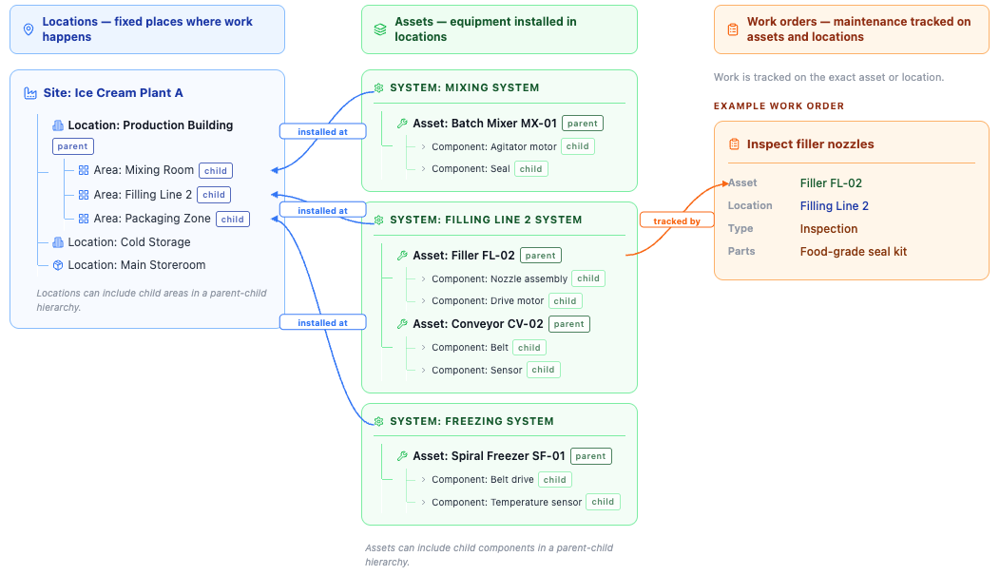

# How do locations, assets, and work orders work together?

Understanding how locations, assets, and work orders connect helps you work more efficiently in Maximo Application Suite Select.

## Example scenario

- **Site**: Ice Cream Plant A
- **Location**: Filling Line 2
- **Asset**: Filler FL-02
- **Work order**: Inspect filler nozzles
- **Type**: Inspection
- **Parts**: Food-grade seal kit

Locations, assets, and work orders each answer a different question. A location tells you where work happens. An asset tells you what equipment is maintained. A work order tells you what work was done.

In this example, Filler FL-02 is installed at Filling Line 2 in Ice Cream Plant A. The work order Inspect filler nozzles records the maintenance done on that equipment. The diagram also shows that both locations and assets can use parent-child hierarchies, which helps you organize work and track maintenance at the correct level.

## Finding information
When you need to:

- **Find equipment**: Search by asset number or location
- **See maintenance history**: Look at asset record
- **Check what work is needed**: Review work orders
- **Know where to go**: Check location details

## Organizing your work
- **By asset**: All work for specific equipment
- **By location**: All work in an area
- **By work order**: Specific job details

---

## Related topics
- [What are the basic concepts?](what-are-basic-concepts.md)
- [What is a location?](what-is-location.md)
- [What is an asset?](what-is-asset.md)
- [What is a work order?](what-is-work-order.md)
- [What can I do in my role?](../what-can-i-do/overview.md)
- [How do I complete a job?](../../get-work-done/complete-work/complete-job.md)