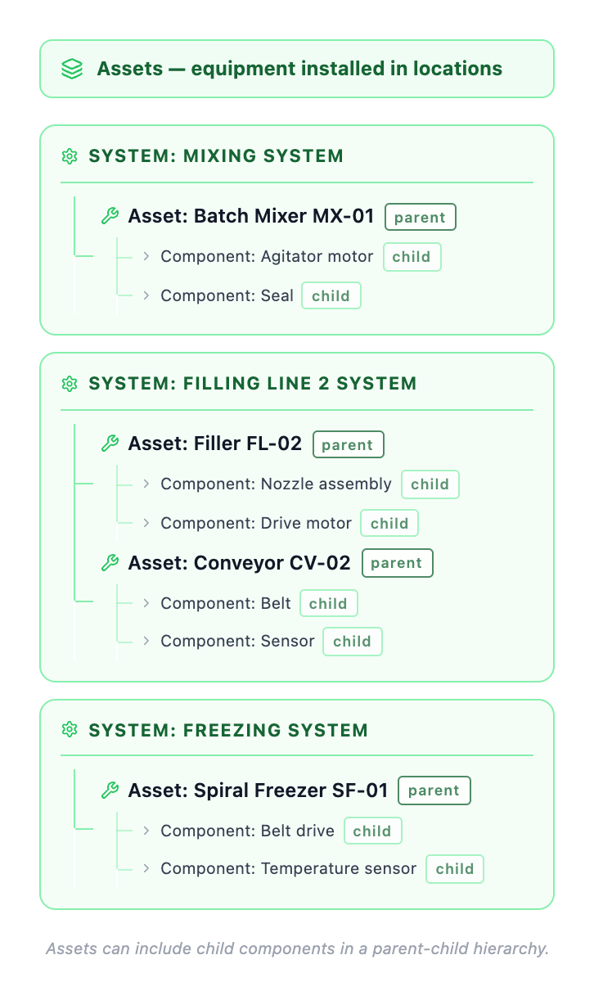

---
search:
  boost: 2
  keywords: equipment machine unit machinery infrastructure
---

# What is an asset?

An asset is any piece of equipment, machinery, or infrastructure that your organization maintains. Assets are the physical things you work on.

## Examples of assets
- **Production equipment**: Batch Mixer MX-01, Filler FL-02, Conveyor CV-02, Spiral Freezer SF-01
- **Process equipment**: Pumps, motors, compressors, heat exchangers, chillers
- **Facilities**: HVAC systems, refrigeration units, lighting systems
- **Vehicles**: Trucks, forklifts, pallet jacks
- **Storage**: Tanks, silos, cold storage units

## Why assets matter
- Track maintenance history for each piece of equipment
- Schedule preventive maintenance
- Monitor asset condition and performance
- Plan for replacements and upgrades
- Calculate total cost of ownership

## Asset hierarchy

Figure 1: Sample asset hierarchy for an ice cream manufacturer

An asset is a physical piece of equipment that you maintain. You can organize assets in a parent-child hierarchy to show how equipment is connected and to track maintenance at the correct level.

In figure 1, Batch Mixer MX-01, Filler FL-02, Conveyor CV-02, and Spiral Freezer SF-01 are parent assets. Parent assets can include child assets. For example, Batch Mixer MX-01 includes the Agitator motor and Seal.

Assets are installed in locations, which show where the equipment operates.

Using asset hierarchies has many benefits:

- Understand how equipment is related
- Track maintenance for a complete system or a specific component
- See both what the equipment is and where it is installed

Want to see how this connects to locations and work orders? See [How do locations, assets, and work orders work together?](how-concepts-work-together.md)

## Naming assets

**✓ Do**

- Use a short alphanumeric asset number
- Write a clear, specific description
- Use a consistent description format
- Identify the parent asset when relevant

**✗ Don't**

- Don't use vague descriptions such as PUMP
- Don't overload the asset number with too much detail

**Example assets**: Batch Mixer MX-01, Filler FL-02, Conveyor CV-02, Spiral Freezer SF-01.

**Example descriptions**: Filler FL-02, cone filling station; Batch Mixer MX-01, vanilla mix preparation.

---

## Related topics
- [What are the basic concepts?](what-are-basic-concepts.md)
- [What is a work order?](what-is-work-order.md)
- [What is a location?](what-is-location.md)
- [How do locations, assets, and work orders work together?](how-concepts-work-together.md)
- [How do I track asset history?](../../get-work-done/manage-assets/track-asset-history.md)
