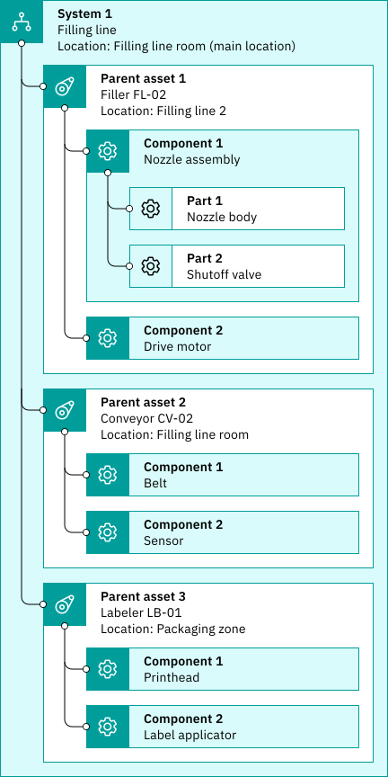

---
search:
  boost: 2
  keywords: equipment machine unit machinery infrastructure
---

# What is an asset?

An asset is any piece of equipment, machinery, or infrastructure that your organization maintains. Assets are the physical things you work on.

<video controls preload="metadata" poster="../../assets/videos/what-is-asset-poster.png" title="Video showing why asset records matter, using a conveyor in an ice cream factory">
<source src="../../assets/videos/what-is-asset.mp4" type="video/mp4">
<track kind="captions" src="../../assets/videos/what-is-asset-captions.vtt" srclang="en" label="English" default>
Your browser does not support embedded video. <a href="https://mediacenter.ibm.com/media/1_7zuhu7mp">Watch on IBM Mediacenter</a>.
</video>

Video 1: Why asset records matter, about 1 minute. <a href="https://mediacenter.ibm.com/media/1_7zuhu7mp">Watch on IBM Mediacenter</a>. <a href="#video-transcript">Read the transcript</a>.

## Examples of assets
- **Production equipment**: Filler FL-02, Conveyor CV-02, Labeler LB-01
- **Process equipment**: Pumps, motors, compressors, heat exchangers, chillers
- **Facilities**: HVAC systems, refrigeration units, lighting systems
- **Vehicles**: Trucks, forklifts, pallet jacks
- **Storage**: Tanks, silos, cold storage units

## Why assets matter
- Track maintenance history for each piece of equipment
- Schedule preventive maintenance
- Monitor asset condition and performance
- Plan for replacements and upgrades
- Calculate total cost of ownership

## Asset hierarchy

Figure 1: Sample asset hierarchy for an ice cream manufacturer

An asset is a physical piece of equipment that you maintain. You can organize assets in a parent-child hierarchy to show how equipment connects and to track maintenance at the correct operational level.

In Figure 1, the top-level system is the Filling line system, which contains three parent assets:

- **Filler FL-02**: Contains child components Drive motor and Nozzle assembly. The Nozzle assembly breaks down further into Part 1: Nozzle body and Part 2: Shutoff valve.
- **Conveyor CV-02**: Contains child components Belt and Sensor.
- **Labeler LB-01**: Contains child components Printhead and Label sensor.

Assets are installed in locations, which show where the equipment operates.

Using asset hierarchies has many benefits:

- Understand how equipment is related
- Track maintenance for a complete system or a specific component
- See both what the equipment is and where it is installed

Want to see how this connects to locations and work orders? See [How do locations, assets, and work orders work together?](how-concepts-work-together.md)

To plan your own hierarchy, see [How do I plan my asset hierarchy?](../../get-work-done/setup-control/plan-your-asset-hierarchy.md)

## Rotating and non-rotating assets

Some assets stay where they are installed. Others move between machines, storerooms, and a repair shop. The second group is called rotating assets.

A rotating asset is an interchangeable asset that you can move in and out of service as needed. You repair or refurbish it rather than replace it. Every rotating asset starts from an item in Item Master that is marked as rotating, and each unit then has its own asset record. A non-rotating asset is not created from a rotating item. It is a single record that you track where it is installed.

### Table 1: Rotating and non-rotating assets compared

| | Rotating asset | Non-rotating asset |
| :--- | :--- | :--- |
| **Where it comes from** | A rotating item in Item Master | An asset record that you create in Assets |
| **How you track it** | By its own asset number, and as a group by the shared item number | By its asset number |
| **Where it is** | On a machine, in a storeroom, or in the repair shop | Installed in a location |
| **When it fails** | You repair or refurbish it, then return it to the storeroom | You maintain it in its location |
| **Examples** | 50 HP drive motor, sanitary pump, gearbox | Filler FL-02, Conveyor CV-02, Spiral freezer SF-01 |

### Example: A drive motor that returns to stock

The Drive motor on Filler FL-02 fails. A technician installs a spare 50 HP motor from Main storeroom, and the failed motor goes to the repair shop. After the repair, the motor is moved back to Main storeroom, ready to be issued again. Because each motor has its own asset record, you can see where each one has been and what work was done on it.

A part such as a flange gasket or an o-ring is different. It is a non-rotating item. You track it by quantity in the storeroom, and it has no asset record. When a technician uses it on a work order, it is consumed.

### 💡 Tip: Ask whether you would repair it and use it again

If you would repair the unit and put it back in stock, make it a rotating item before you create inventory balances. If you would use it up and replace it with new stock, track it as a non-rotating item. For the full decision, see [How do I decide: location, asset, or spare part?](../../get-work-done/setup-control/decide-location-asset-spare-part.md)

## Naming assets

**✓ Do**

- Use a short alphanumeric asset number
- Write a clear, specific description
- Use a consistent description format
- Identify the parent asset when relevant

**✗ Don't**

- Don't use vague descriptions such as PUMP
- Don't overload the asset number with too much detail

**Example assets**: Filler FL-02, Conveyor CV-02, Labeler LB-01.

**Example descriptions**: Filler FL-02, cone filling station; Labeler LB-01, carton labeling station.

## Video transcript

The transcript for Video 1: Why asset records matter.

In a busy ice cream factory, one stopped conveyor can slow the entire production line.

The conveyor is an Asset: Equipment your team maintains.

Its asset record shows its location, maintenance history, costs, risk, and criticality.

Risk and criticality help your team prioritize work.

Accurate asset records provide the foundation for improving availability and uptime.

They bring maintenance, operating, and lifecycle costs together, helping you identify high-cost equipment and make informed repair-or-replace decisions.

You can organize assets into hierarchies. For example, a production line might include conveyors, motors, and sensors.

Asset hierarchies show how equipment is related and help you understand where maintenance work occurs within a larger system.

By maintaining accurate asset records, your team gains the information it needs to keep operations running reliably.

---

## Related topics
- [What are the basic concepts?](what-are-basic-concepts.md)
- [What is a work order?](what-is-work-order.md)
- [What is a location?](what-is-location.md)
- [How do locations, assets, and work orders work together?](how-concepts-work-together.md)
- [How do I decide: location, asset, or spare part?](../../get-work-done/setup-control/decide-location-asset-spare-part.md)
- [How do I plan my asset hierarchy?](../../get-work-done/setup-control/plan-your-asset-hierarchy.md)
- [How do I plan my storeroom and inventory strategy?](../../get-work-done/setup-control/plan-your-storeroom-strategy.md)
- [How do I track asset history?](../../get-work-done/manage-assets/track-asset-history.md)
- [How do I manage more assets?](../../work-smarter/scale-operation/manage-more-assets.md)
