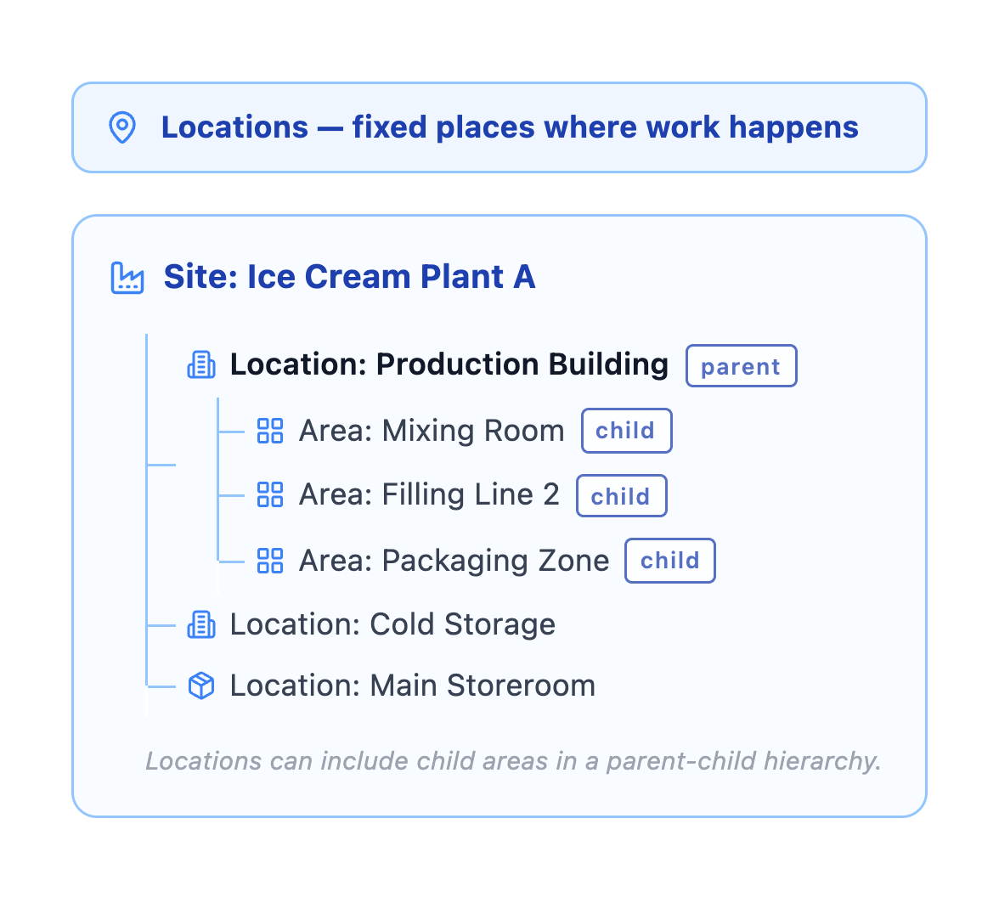

---
search:
  boost: 2
  keywords: functional location area site area place
---

# What is a location?

A location is a physical place where work is performed or assets are installed. Locations help you organize and find equipment.

## Types of locations
- **Operating locations**: Where assets are installed and running
- **Storerooms**: Where parts and materials are kept
- **Service locations**: Customer sites or service areas
- **Staging areas**: Temporary locations for work preparation

## Why locations matter
- Find equipment quickly
- Organize maintenance by area
- Assign work by location
- Track costs by facility or department
- Plan work routes efficiently
- Manage access and safety

## Location hierarchy

Figure 1: Sample location hierarchy for an ice cream manufacturer

A location is a fixed place where work happens or where assets are installed. You can organize locations in a parent-child hierarchy to show how areas in a facility are connected and to track work in the correct place.

In figure 1, Production Building is a parent location within Ice Cream Plant A. Parent locations can include child locations. For example, Production Building includes Mixing Room, Filling Line 2, and Packaging Zone. Cold Storage and Main Storeroom are separate locations in the same site.

Want to see how this connects to assets and work orders? See [How do locations, assets, and work orders work together?](how-concepts-work-together.md)

## Naming locations

**✓ Do**

- Use a unique location identifier
- Name locations so they make sense in the hierarchy
- Use location names for places, not equipment

**✗ Don't**

- Don't use the location name to represent the asset
- Don't mix place names and equipment names at the same hierarchy level without a clear reason

**Example names**: Ice Cream Plant A, Production Building, Mixing Room, Filling Line 2, Packaging Zone, Cold Storage, Main Storeroom.

## Location vs. asset
- **Location**: The place, such as Filling Line 2
- **Asset**: The equipment, such as Filler FL-02
- **Relationship**: Asset is installed at location

Some work orders are for locations, such as Clean production floor, rather than specific assets.

## Locations vs service addresses

Locations and service addresses work together but serve different purposes. A location represents an operational place. A service address provides the physical or geographic details needed to find it.

## Quick reference

### Table 1. Location terminology

| Term | What it is |
|------|------------|
| **Location** | An operational place where assets are used, stored, or repaired |
| **Service address** | The physical or geographic details needed to find that place or its associated assets |

---

### Table 2. Detailed comparison of locations vs service addresses

| Aspect | Location | Service address |
|--------|----------|-----------------|
| **Primary purpose** | Represents a place where assets are operated, stored, or repaired | Provides detailed physical or geographic information that helps people find an asset or location |
| **Role in the data model** | Supports asset tracking, work management, purchasing, and the history of asset movements and performance at particular sites | Provides another way to search for assets and locations and helps direct field crews to where work must be performed |
| **Structure** | Can belong to one or more location systems, which organize locations into logical parent-child hierarchies | Can participate in an address system that establishes address ancestry and determines how addresses apply to child records |
| **Information stored** | Can include location type, status, associated assets, parent and child locations, and an associated service address | Can include an address code, street information, coordinates, directions, landmarks, and other detailed location information |
| **Relationship to assets** | Assets can be installed at or associated with the location | One service address can represent the position of one or more assets or physical locations |
| **Use on work records** | A location can identify where work is associated operationally | When work is created for an asset or location, its service address can be copied to the service request or work order |

### Example

Consider an ice-cream manufacturing plant:

- **Location: Packaging Line 2**: This record represents the operational place where equipment is installed and work is managed. It might be a child of the Packaging Area in the primary location hierarchy.
- **Service address: Building B, south entrance, second floor, coordinates X/Y**: This record provides the physical details that help a technician find Packaging Line 2.

The service address does not replace the location. It supplements the location with address, navigation, or geographic information.

### How they work together

A location can have an associated service address.

- You can add service addresses to assets, locations, work orders, and service requests.
- When work is created for an asset or location, the service address can be copied to the work order or service request.
- If an asset or location does not have its own service address, the system can use the address of the closest ancestor in the address hierarchy.
- A service address provides an additional way to find individual assets and locations, or groups of them.

---

## Related topics
- [What are the basic concepts?](what-are-basic-concepts.md)
- [What is an asset?](what-is-asset.md)
- [What is a work order?](what-is-work-order.md)
- [How do locations, assets, and work orders work together?](how-concepts-work-together.md)

