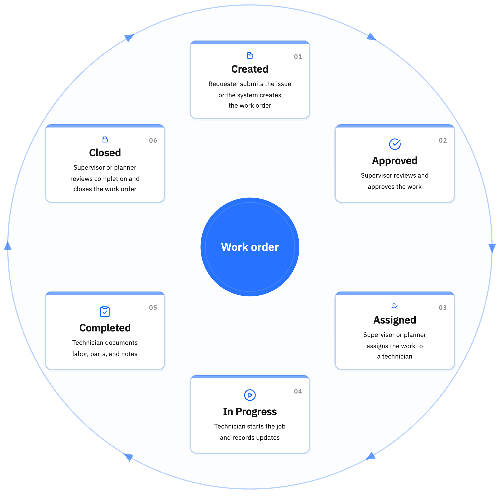

---
search:
  boost: 2
  keywords: maintenance order job ticket work request
---

# What is a work order?

A work order is a request or instruction to perform maintenance work. It's the central document that tracks everything about a maintenance job.

## Types of work orders
- **Corrective maintenance**: Fix something that broke
- **Preventive maintenance**: Scheduled routine maintenance
- **Predictive maintenance**: Work based on condition monitoring
- **Project work**: Installations, upgrades, modifications
- **Inspections**: Regular checks and assessments

## Why work orders matter
- Assign work to the correct people
- Track what work was done
- Record labor hours and costs
- Document parts used
- Maintain history of all maintenance
- Measure performance and productivity

## Work order lifecycle
1. **Created**: The work order is the working record for the job. It captures what needs to be done, where the work happens, how urgent it is, and any instructions the technician will need later.
2. **Approved**: Approval means the work can move ahead. At this point, planned items can be reserved and the planned cost and rate information for the job is recorded.
3. **Assigned**: Before work starts, check that the right person owns the job and has the schedule, instructions, parts, and tools needed to do it.
4. **In Progress**: Use this stage when physical work has actually started. Record labor, materials, services, and tools as the work happens so the record stays accurate.
5. **Completed**: Use this when the physical work is finished. The record can still need final review or closeout, and some setups can move the work order forward automatically when assignments are completed.
6. **Closed**: Closing finalizes the record. Unused item reservations are removed and the job becomes part of maintenance history.

Hover over a stage in the diagram to see its description.

<map name="lifecycle-map">
  <area shape="circle" coords="1495,400,350" alt="Created" title="This is the working record for the job. It captures what needs to be done, where the work happens, how urgent it is, and any instructions the technician will need later.">
  <area shape="circle" coords="2300,900,350" alt="Approved" title="Approval means the work can move ahead. At this point, planned items can be reserved and the planned cost and rate information for the job is recorded.">
  <area shape="circle" coords="2300,2100,350" alt="Assigned" title="Before work starts, check that the right person owns the job and has the schedule, instructions, parts, and tools needed to do it.">
  <area shape="circle" coords="1495,2600,350" alt="In Progress" title="Use this stage when physical work has actually started. Record labor, materials, services, and tools as the work happens so the record stays accurate.">
  <area shape="circle" coords="690,2100,350" alt="Completed" title="Use this when the physical work is finished. The record can still need final review or closeout, and some setups can move the work order forward automatically when assignments are completed.">
  <area shape="circle" coords="690,900,350" alt="Closed" title="Closing finalizes the record. Unused item reservations are removed and the job becomes part of maintenance history.">
</map>

*Figure 1: The lifecycle of a work order in Maximo Application Suite Select*

A work order records maintenance work. It tells you what needs to be done, where the work happens, and which asset the work applies to.

In this example, the work order Inspect filler nozzles is linked to Filler FL-02 at Filling Line 2. It also shows the work type and the parts used. This helps you track maintenance clearly and keep a useful history of the work performed.

Want to see how this connects to locations and assets? See [How do locations, assets, and work orders work together?](how-concepts-work-together.md)

## Naming work orders

**✓ Do**

- Let Maximo Application Suite Select create the work order number automatically
- Write the description as a clear, action-oriented summary

**✗ Don't**

- Don't use vague descriptions such as Broken or Need fix
- Don't treat the description and work type as the same thing

**Example names**: Inspect filler nozzles; Replace seal on Batch Mixer MX-01; Quarterly inspection, Spiral Freezer SF-01.

## Work order vs. work request
- **Work request**: Someone reports a problem or need
- **Work order**: Approved request with assigned resources

Not all requests become work orders - some may be rejected, combined, or deferred.

 Ready to work with work orders? See <a href="../../get-work-done/complete-work/complete-job.md">How do I complete a job?</a> for step-by-step guidance.
