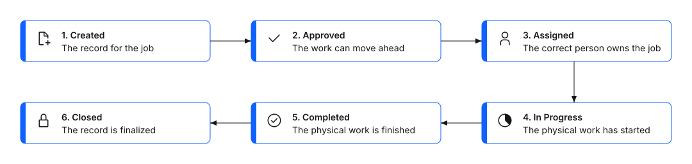

---
search:
  boost: 2
  keywords: maintenance order job ticket work request
---

# What is a work order?

A work order is a request or instruction to perform maintenance work. It's the central document that tracks everything about a maintenance job.

## Types of work orders
- **Corrective maintenance**: Fix something that broke
- **Preventive maintenance**: Scheduled routine maintenance
- **Predictive maintenance**: Work based on condition monitoring
- **Project work**: Installations, upgrades, modifications
- **Inspections**: Regular checks and assessments

## Why work orders matter
- Assign work to the correct people
- Track what work was done
- Record labor hours and costs
- Document parts used
- Maintain history of all maintenance
- Measure performance and productivity

## Work order lifecycle

A work order progresses through six sequential stages from initial creation to final historical closeout:

1. **Created**: The requester or the system creates the work order. It captures what needs to be done, where the work happens, how urgent it is, and any instructions the technician needs later.
2. **Approved**: A supervisor reviews and approves the work. Approval confirms that the job can move ahead, reserves planned items, and records planned cost and rate information.
3. **Assigned**: A supervisor or planner assigns the work to a technician. Before work starts, the planner checks that the assigned person has the schedule, instructions, parts, and tools needed.
4. **In Progress**: The technician starts the job and records updates. Labor, materials, services, and tools are recorded as physical work happens so the record stays accurate.
5. **Completed**: The technician documents labor, parts, and notes upon finishing the physical work. The record can still undergo final review or closeout.
6. **Closed**: A supervisor or planner reviews completion and closes the work order. Closing finalizes the record, removes unused item reservations, and archives the job into maintenance history.

Figure 1: The lifecycle of a work order in Maximo Application Suite Select

A work order records maintenance work. It tells you what needs to be done, where the work happens, and which asset the work applies to.

In this example, the work order Inspect filler nozzles is linked to Filler FL-02 at Filling Line 2. It also shows the work type and the parts used. This helps you track maintenance clearly and keep a useful history of the work performed.

Want to see how this connects to locations and assets? See [How do locations, assets, and work orders work together?](how-concepts-work-together.md)

## Creating a work order

You create a work order when work needs to be done. Start with a clear description of the work. Then add details such as the work type, the priority, and the asset and location. For example, you might create a work order for Inspect filler nozzles and link it to Filler FL-02.

Technicians can also create a work order from the field with the add button in the Technician app, for example when they find a problem on site.

`[SME confirmation required: Confirm the details you can add when you create a work order in Select.]`

## Naming work orders

**✓ Do**

- Let Maximo Application Suite Select create the work order number automatically
- Write the description as a clear, action-oriented summary

**✗ Don't**

- Don't use vague descriptions such as Broken or Need fix
- Don't treat the description and work type as the same thing

**Example names**: Inspect filler nozzles; Replace seal on Batch Mixer MX-01; Quarterly inspection, Spiral Freezer SF-01.

## Work order vs. work request
- **Work request**: Someone reports a problem or need
- **Work order**: Approved request with assigned resources

Not all requests become work orders. Some may be rejected, combined, or deferred.

 Ready to work with work orders? See <a href="../../get-work-done/complete-work/complete-job.html">How do I complete a job?</a> for step-by-step guidance.
