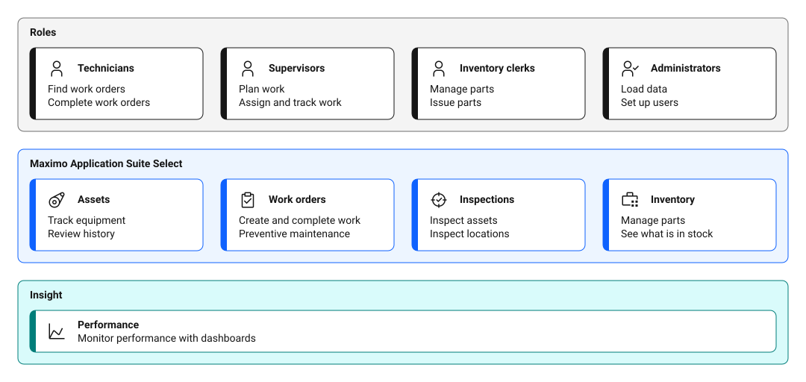

---
search:
  boost: 2
  keywords: overview introduction saas benefits purpose
---

# What is Maximo Application Suite Select?

Keep production and operations moving with Maximo Application Suite Select, the computerized maintenance management system (CMMS) that connects maintenance, inspections, asset performance, and inventory.

Maximo Application Suite Select is delivered as a Software-as-a-Service solution. With it, you can:

- Track assets
- Create and complete work orders
- Schedule preventive maintenance
- Manage parts inventory
- Monitor performance

Figure 1: How Maximo Application Suite Select connects roles, product areas, and performance monitoring

## Who is this for?

Maximo Application Suite Select is designed for lean maintenance teams in smaller to mid-sized operations. It supports maintenance teams and plant operations in industries such as:

- Light manufacturing, such as fabrication, plastics, packaging, and assembly
- Food and beverage and cold chain
- Warehousing and logistics
- Commercial facilities
- Regional or municipal utilities

Within these teams, people use the product in four roles:

### Table 1: Roles and what each role can do

| Role | What the role can do | Example |
|------|----------------------|---------|
| **Technicians** | Find and complete work orders | Complete work on Filler FL-02 |
| **Supervisors** | Plan, assign, and track maintenance work | Assign preventive maintenance for Spiral freezer SF-01 |
| **Inventory clerks** | Manage parts and supplies | Issue parts from Main storeroom |
| **Administrators** | Load data and set up users | Load users for Ice cream plant A |

To see what you can do in your role, go to [What can I do in my role?](what-can-i-do/overview.md)

### About these examples

To make onboarding easier to follow, the examples in this help center use one consistent scenario: an ice-cream manufacturing operation. You'll see the same site, locations, assets, and work, so you can focus on how the workflow fits together.

## What problems does it solve?

Maximo Application Suite Select helps you move from reactive "run-to-fail" maintenance to organized, preventive maintenance:

- **Stop losing track of work:** all work orders in one system, not scattered across spreadsheets or paper
- **Prevent equipment failures:** schedule maintenance before problems happen
- **Know what you have:** track all your assets and their maintenance history
- **Control parts inventory:** see what's in stock and what's been used
- **Make better decisions:** use data to understand what's working and what needs attention

## Take your work mobile

IBM Maximo Mobile lets technicians view assets, manage work orders, and update work from their phone or tablet, wherever work happens. To install the app and sign in, go to [Get IBM Maximo Mobile](first-task/get-maximo-mobile.md).

## What to do next

- [What can I do in my role?](what-can-i-do/overview.md)
- [What are the basic concepts?](basics/what-are-basic-concepts.md)

## Related topics

- [Get IBM Maximo Mobile](first-task/get-maximo-mobile.md)
- [Why do some terms differ from what I'm used to?](basics/why-do-terms-differ.md)
- [Get answers to common questions](../get-answers/index.md)
