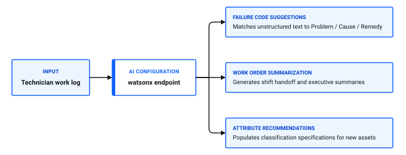

# How can AI improve maintenance?

Artificial intelligence features in maintenance management accelerate work order processing, assist with failure classification, and generate executive summaries of historical equipment performance. By extracting patterns from historical maintenance records, AI reduces manual administrative tasks and helps teams identify recurring failure modes.

In Maximo Application Suite Select, AI capabilities focus on data enrichment, intelligent classification, and automated work summaries configured through the AI Configuration application.

## AI maintenance capabilities

Integrating AI models with maintenance workflows provides several key operational improvements:

1. **Automated work order summarization:** Summarize extensive technician logs, status changes, and repair remarks into concise executive digests for shift handovers.
2. **Failure mode recommendations:** Suggest relevant Problem, Cause, and Remedy failure codes based on free-form technician text entered on work orders.
3. **Asset classification assistance:** Analyze asset specification attributes and recommend standardized classification hierarchies.
4. **Job plan step extraction:** Draft preventive maintenance checklists and material requirements by extracting steps from digital equipment manuals.

### Table 1: AI capabilities and administrative configuration in Maximo Application Suite Select

| AI capability | Operational function | Data requirements | Configuration point |
|---|---|---|---|
| **Work order summarization** | Generates concise work summaries for closed or long-running work orders | Historical work logs, actual labor hours, and technician remarks | AI Configuration |
| **Failure code suggestion** | Matches technician descriptions to the three-tier failure hierarchy | Standardized Failure Codes and historic closed work orders | AI Configuration |
| **Attribute classification** | Recommends asset classification attributes for newly registered equipment | Asset specifications, manufacturer data sheets, and Classifications | Classifications, AI Configuration |
| **Predictive threshold analysis** | Analyzes continuous meter trends to forecast when upper action limits will breach | Condition Monitoring meter history and run-hour readings | Condition Monitoring |

Figure 1: AI configuration service and maintenance workflow integration

## Configuring AI integration in Maximo Application Suite Select

System administrators configure AI model endpoints, credentials, and feature prompts in the AI Configuration application.

### Connecting an AI model provider in the desktop application

1. Go to **Integration > AI Configuration**.
2. Click **New AI Configuration**.
3. In the **Configuration Name** field, enter a unique identifier, such as `WATSONX_MAINT_AI`.
4. In the **Provider** field, select your AI service provider.
5. In the **Model Endpoint** field, specify the secure API endpoint URL.
6. Enter the authorized **API Key** or authentication secret.
7. In the **Feature Toggles** section, select the maintenance features to enable:
   - Check **Work Order Summaries** to activate automated text synthesis on closed tickets.
   - Check **Failure Classification Recommendations** to assist technicians with failure code selection.
8. Click **Test Connection** to verify endpoint availability and response latency.
9. Change the configuration status to **Active**, then click **Save**.

### 💡 Tip: Standardize historical data before enabling AI classification
AI failure recommendations depend directly on the quality of your historical records. If past work orders contain unstandardized free text, the AI model will suggest inaccurate failure paths. Enforce clean Failure Codes on new work orders to establish a dependable training baseline.

## Real-world scenario: Failure code assistance at the Ice Cream Plant

When a technician services Filler FL-02 for a mechanical seal failure, they might enter *Replaced worn seal on filler pump due to product leakage*.

Instead of requiring the technician to search through hundreds of failure code records:

1. The AI model analyzes the work text.
2. It suggests the Failure Class `PUMPS`, Problem code `LEAK`, Cause code `SEAL_WEAR`, and Remedy code `REPLACED`.
3. The technician verifies the suggestion with a single tap, ensuring failure data remains consistent for reliability reporting.

## AI configuration checklist

Use this checklist to ensure AI features are properly integrated and governed.

### Table 2: AI readiness and configuration checklist

| Check | Item | What to verify |
|---|---|---|
| [ ] | Secure model endpoint | The AI endpoint URL is configured with valid HTTPS certificates and encrypted API keys |
| [ ] | Feature toggle validation | Enabled AI capabilities match the operational workflows of your plant |
| [ ] | Active failure hierarchies | Standard Problem, Cause, and Remedy failure trees are populated in Failure Codes |
| [ ] | Role access permissions | Technicians and supervisors have security permissions to view AI-generated recommendations |
| [ ] | Audit monitoring | Administrators review AI suggestion acceptance rates quarterly to ensure accuracy |

## Related topics

- [What can I automate?](what-can-automate.md)
- [How do I make data reliable?](../../improve-results/improve-data/make-data-reliable.md)
- [How do I standardize across teams?](../scale-operation/standardize-across-teams.md)
