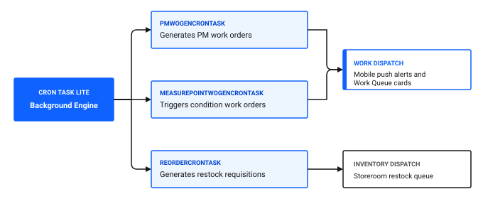

# What can I automate?

Automating routine maintenance workflows eliminates repetitive manual scheduling, ensures preventive maintenance triggers on time, and delivers instant notifications when critical equipment anomalies occur. Instead of relying on planners to generate work orders or send status updates manually, automated background tasks handle routine administration.

In Maximo Application Suite Select, automation is driven by scheduled background tasks in Cron Task lite, condition monitoring triggers, communication templates, and mobile push notifications.

## Key automation capabilities in Maximo Application Suite Select

Automation in Maximo Application Suite Select addresses four major operational maintenance areas:

1. **Preventive maintenance generation:** Automatically creates scheduled work orders ahead of due dates based on elapsed calendar time or accumulated run hours.
2. **Condition-based work triggers:** Generates corrective work orders when the gauge readings that you enter exceed defined action thresholds.
3. **Automated inventory reordering:** Flags storeroom parts that drop below their minimum reorder point and creates restock requests.
4. **Instant stakeholder alerts:** Dispatches email and push notifications when work orders are approved, delayed, or completed.

### Table 1: Automation mechanisms and operational applications

| Automation type | Primary application | How it works | Operational example |
|---|---|---|---|
| **Scheduled PM generation** | Cron Task lite, PM | Background process scans active PM schedules and generates work orders within a defined look-ahead window | Generating weekly lubrication work orders 3 days before their due date for Filler FL-02 |
| **Condition-based triggers** | Condition Monitoring, Cron Task lite | Monitors gauge readings and automatically issues corrective work orders upon action limit breaches | Generating an urgent inspection work order when drive motor bearing temperature exceeds 80 degrees Celsius |
| **Inventory reorder calculation** | Inventory, Cron Task lite | Calculates current balances against minimum thresholds and economic order quantities | Creating restock requisitions when food-grade lubricant stock drops below 5 drums |
| **Mobile push alerts** | Push Notifications Administration | Dispatches immediate notifications directly to technician mobile devices | Alerting on-call technicians to emergency breakdowns in the Cold Storage Room |

Figure 1: Automated background processing architecture in Cron Task lite

As shown in Figure 1, the Cron Task lite background engine automates maintenance scheduling and inventory replenishment across three core tasks and two operational dispatch channels:

1. **Background Engine (Cron Task lite)**: Executes automated background processing on configured schedules without manual user intervention.
2. **Automated tasks**:
   - **`PMWOGENCRONTASK`**: Evaluates active preventive maintenance intervals and automatically generates scheduled PM work orders within configured lead times.
   - **`MEASUREPOINTWOGENCRONTASK`**: Evaluates condition monitoring meter logs and triggers corrective work orders when action limits are breached.
   - **`REORDERCRONTASK`**: Scans current storeroom balances and automatically creates restock requisitions for low-stock items.
3. **Dispatch outcomes**:
   - **Work dispatch**: Routes generated PM and condition-based work orders directly to technician mobile push alerts and supervisor Work Queue cards.
   - **Inventory dispatch**: Routes generated material requisitions directly to the storeroom restock queue.

## Scheduled background tasks in Cron Task lite

Cron tasks run on configured background schedules without requiring user intervention. System administrators manage execution intervals and parameters in the desktop application.

### Table 2: Essential background tasks in Maximo Application Suite Select

| Task name | Frequency | Function |
|---|---|---|
| `PMWoGenCronTask` | Nightly | Evaluates preventive maintenance frequencies and generates open work orders |
| `MeasurePointWoGenCronTask` | Every 15 minutes | Evaluates condition monitoring meter points against defined action limits |
| `ReorderCronTask` | Daily | Analyzes storeroom balances and initiates replenishment for low-stock items |

### Configuring PM work order generation in Cron Task lite

To ensure work orders generate automatically before their maintenance due date, configure the automated generation schedule:

1. In the **Find navigation item** field, search for Cron Task Setup and open it.
2. In the **Cron Task** field, search for `PMWOGENCRONTASK`.
3. In the **Cron Task Instances** table, select the active instance for your site.
4. In the **Schedule** field, verify the execution frequency, such as running daily at 01:00 AM.
5. In the **Parameters** table, set the `LEADTIME` value to `3` to generate work orders three days ahead of target start dates.
6. Check the **Active** box to ensure the background task is running.
7. In the **Select Action** menu, click **Save Properties**, then click **Reload Request**.

### 💡 Tip: Use lead time to prevent last-minute scheduling chaos
Always configure a lead time on your PM generation cron task. Generating work orders 3 to 7 days before their scheduled date gives maintenance supervisors time to pre-assign technicians, confirm parts availability in the storeroom, and coordinate equipment downtime with production managers.

## Mobile push notifications for urgent work

When equipment breaks down unexpectedly, supervisors must alert field technicians immediately. The Push Notifications Administration application routes urgent work alerts directly to technician tablets and mobile devices.

### Enabling mobile push alerts for emergency work

1. In the **Find navigation item** field, search for Push Notifications Administration and open it.
2. Select the notification event configuration for **Emergency Work Orders**.
3. Verify that the trigger condition is mapped to work orders with Priority 1 or Emergency work types.
4. Set the recipient rule to target the assigned technician and maintenance lead for the active shift.
5. Set status to **Active** and click **Save**.

## Automation readiness checklist

Use this checklist to ensure automated processes run smoothly and reliably.

### Table 3: Automation verification checklist

| Check | Item | What to verify |
|---|---|---|
| [ ] | PM generation task active | `PMWoGenCronTask` is active and generates work orders on schedule |
| [ ] | Condition monitoring task active | `MeasurePointWoGenCronTask` executes periodically and converts breached limits into work |
| [ ] | Inventory reorder task active | `ReorderCronTask` flags low-stock items for procurement |
| [ ] | Communication templates mapped | Automated email templates are linked to key work order status changes |
| [ ] | Push notifications configured | High-priority and emergency work orders deliver instant mobile alerts |

## Related topics

- [How can AI improve maintenance?](ai-improve-maintenance.md)
- [How do I detect issues early?](../../get-work-done/monitor-respond/detect-issues-early.md)
- [How do I simplify workflows?](../../improve-results/improve-adoption/simplify-workflows.md)
