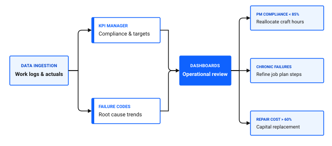

# How do I turn data into decisions?

Collecting thousands of work orders, meter logs, and parts transactions provides no operational value unless maintenance leaders can synthesize that information into strategic decisions. Without structured reporting, management reacts to emergencies rather than proactively addressing chronic failures.

Turning maintenance data into actionable decisions in Maximo Application Suite Select involves monitoring performance indicators in KPI Manager and KPI Viewer, analyzing equipment failure trends, and leveraging role-based operational dashboards.

*Looking to verify your decision analytics right away? [Skip to decision-making analytics checklist ↓](#decision-making-analytics-checklist)*

## Framework for data-driven maintenance decisions

To transition from reactive firefighting to strategic asset management, connect operational metrics directly to business outcomes.

### Table 1: Strategic maintenance decisions and supporting metrics

| Decision category | Core question to answer | Key metrics | Analytics tool |
|---|---|---|---|
| **Repair versus replace** | Has the cumulative repair cost of an asset exceeded its economic replacement value? | Total Maintenance Cost, Year-to-Date Cost vs Replacement Value | Assets, KPI Viewer |
| **PM optimization** | Are preventive maintenance routines preventing breakdowns or causing intrusive infant mortality? | PM Compliance Rate, Emergency Work Ratio, MTBF | KPI Manager, PM |
| **Staffing & craft planning** | Do we have sufficient mechanical and electrical staffing to handle the scheduled backlog? | Labor Utilization, Overdue Backlog Hours by Craft | Work Queue Manager, Supervisor Operational Dashboard |
| **Inventory stocking** | Are we holding excess capital in slow-moving stock while stocking out of critical spares? | Inventory Turnover Ratio, Stockout Incidence Rate | Inventory, Inventory Clerk Operational Dashboard |

Figure 1: Maintenance data aggregation and decision pipeline

As shown in Figure 1, operational maintenance data moves through a four-stage decision pipeline from raw logging to strategic actions:

1. **Data ingestion**: Field technicians and clerks log raw work logs, labor hours, and parts actuals.
2. **Aggregation engines**: Data feeds in parallel into two core analytical modules:
   - **KPI Manager**: Calculates compliance rates and measures performance against targets.
   - **Failure Codes**: Tracks chronic root causes and failure trends.
3. **Dashboards**: Operational dashboards aggregate these analytical streams into unified review screens.
4. **Strategic actions**: Specific performance thresholds trigger targeted operational decisions:
   - **PM Compliance below 85 percent**: Reallocate craft labor to clear maintenance backlogs.
   - **Chronic failures**: Refine job plan instructions and maintenance tasks.
   - **Repair cost exceeding 60 percent of asset value**: Initiate capital replacement planning.

## Monitoring metrics with KPI Manager and KPI Viewer

KPI Manager allows reliability managers to configure mathematical metrics, set performance targets, and define Green, Yellow, and Red alert thresholds.

### Key performance indicator benchmarks

Targeting established industry benchmarks ensures your maintenance strategy drives plant profitability.

### Table 2: Recommended operational KPI target thresholds

| Key performance indicator | Benchmark target | Warning threshold | Critical action threshold |
|---|---|---|---|
| **PM Compliance Rate with 10 percent grace rule** | Greater than 90 percent | 80 to 89 percent | Below 80 percent |
| **Emergency Work Ratio** | Below 10 percent of total labor hours | 11 to 20 percent | Above 20 percent |
| **Mean Time Between Failures, MTBF** | Increasing month-over-month | Flat | Declining trend |
| **Schedule Compliance** | Greater than 85 percent | 70 to 84 percent | Below 70 percent |

### Creating a KPI in the desktop application

1. In the **Find navigation item** field, search for KPI Manager and open it.
2. Click **New KPI**.
3. In the **KPI** field, enter a unique code, such as `KPI_PM_COMPLIANCE`.
4. In the **Description** field, enter `Preventive Maintenance Compliance Rate`.
5. In the **Calculation** field, enter the SQL select statement calculating completed PMs within allowable grace windows against total scheduled PMs.
6. In the **Target** field, enter `90.00`.
7. In the **Caution at** field, enter `85.00` to establish the yellow warning boundary.
8. In the **Alert at** field, enter `80.00` to establish the red critical boundary.
9. Click **Save**, then click **Run KPI** to calculate the initial value.

### 💡 Tip: Review KPI trends weekly rather than single-day spikes
A single day drop in PM compliance often reflects a scheduled plant-wide cleaning or minor power outage. Look for four-week rolling trends in KPI Viewer before making permanent adjustments to craft staffing or job plans.

## Real-world decision: Filler FL-02 repair versus replace analysis

At the Ice Cream Main Plant, Filler FL-02 experienced four mechanical seal failures over six months.

By analyzing the asset history:

1. **Total Maintenance Cost:** The Assets application showed $42,000 in combined parts and overtime labor over the trailing twelve months.
2. **Replacement Cost:** A new modular filling station costs $65,000.
3. **Failure Trend:** Failure Codes indicated all four breakdowns originated from drive shaft misalignment causing seal wear.

**Decision:** Rather than approving a fifth seal replacement or spending $65,000 on a complete machine replacement, engineering scheduled a targeted drive shaft realignment and bearing housing overhaul for $6,500, permanently resolving the root cause.

## Decision-making analytics checklist

Use this checklist to ensure your reporting framework supports sound management decisions.

### Table 3: Decision-making analytics verification checklist

| Check | Item | What to verify |
|---|---|---|
| [ ] | Core KPI activation | PM compliance, emergency work ratio, and backlog hours are active in KPI Manager |
| [ ] | Role dashboard deployment | Supervisors and inventory clerks review their respective Operational Dashboards daily |
| [ ] | Failure data capture | Over 90 percent of corrective work orders have Problem, Cause, and Remedy codes populated |
| [ ] | Asset cost tracking | Labor hours, storeroom parts, and contractor invoices are tracked against asset records |
| [ ] | Monthly review cadence | Reliability leaders meet monthly to review KPI trends and adjust maintenance frequencies |

## Related topics

- [How do I optimize performance?](optimize-performance.md)
- [How do I act on alerts?](../../get-work-done/monitor-respond/act-on-alerts.md)
- [How do I reduce equipment downtime?](../../improve-results/improve-work/reduce-downtime.md)
