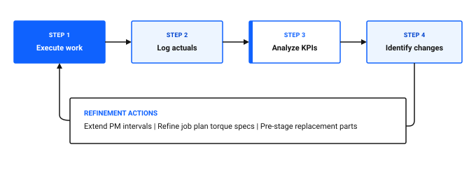

# How do I optimize performance?

Continuous maintenance optimization transforms a routine preventive maintenance program into a high-efficiency reliability strategy. Over time, maintenance programs accumulate outdated tasks, excessive inspection frequencies, and inaccurate time estimates that consume valuable craft labor without preventing breakdowns.

Optimizing maintenance performance in Maximo Application Suite Select involves conducting PM optimization reviews, fine-tuning condition monitoring limits, refining job plan labor estimates, and eliminating chronic failure modes.

## The continuous optimization cycle

Effective maintenance programs follow a closed-loop refinement cycle:

Figure 1: Continuous maintenance performance optimization cycle

As shown in Figure 1, continuous maintenance optimization operates as a closed-loop cycle across four progressive steps and an ongoing refinement loop:

1. **Step 1: Execute work**: Technicians perform preventive, corrective, and inspection tasks in the field.
2. **Step 2: Log actuals**: Technicians record accurate actual labor hours, materials used, and failure codes.
3. **Step 3: Analyze KPIs**: Reliability engineers and supervisors evaluate key performance metrics, such as PM compliance and equipment availability.
4. **Step 4: Identify changes**: The maintenance team pinpoints operational bottlenecks and formulates targeted process revisions.
5. **Refinement actions**: Adjustments such as extending PM intervals, refining job plan torque specifications, and pre-staging replacement parts feed directly back into Step 1 for ongoing execution.

### Table 1: Maintenance optimization stages and techniques

| Optimization stage | Operational focus | Data analyzed | Desired outcome |
|---|---|---|---|
| **PM frequency tuning** | Adjusting service intervals based on actual operating run hours | Continuous meter history, PM generation counts, historical failure dates | Eliminating unnecessary PMs on idle equipment |
| **Condition threshold calibration** | Setting realistic warning and action limits | Gauge meter readings, historical reading logs | Preventing alarm fatigue while ensuring early anomaly detection |
| **Job plan refinement** | Comparing estimated labor and parts against actual logged values | Work order actuals, wrench time delays, parts issue logs | Reducing job duration and eliminating missing parts delays |
| **Failure elimination** | Identifying chronic root causes across equipment families | Failure Codes Problem, Cause, and Remedy trends | Modifying operating parameters to design out recurring failures |

## Identifying candidates for PM optimization

Not all preventive maintenance tasks deliver equal value. Reviewing maintenance records often reveals tasks that can be streamlined or eliminated entirely.

### Table 2: Indicators that a PM routine requires optimization

| Observed symptom | Operational diagnosis | Optimization action |
|---|---|---|
| **Zero failures found over 20 consecutive PM cycles** | The inspection frequency is too tight or the asset operates in low-stress conditions | Extend the PM frequency interval or switch to a usage-based meter trigger |
| **Failures occur immediately after scheduled PM service** | Intrusive teardown inspections are introducing human assembly errors | Replace intrusive mechanical inspections with non-destructive condition monitoring |
| **Actual hours consistently exceed estimated hours by 50 percent** | Job plan instructions are missing setup steps or required tooling | Revise the Job Plan to reflect realistic task durations and stage specialized tools |
| **PM work orders closed without completing tasks** | Technicians face time constraints or perceive the task as non-value-added | Simplify the checklist in Inspection Forms to focus only on critical failure modes |

## Refining PM intervals in the desktop application

When an asset runs intermittently, calendar-based maintenance schedules generate premature work orders. Converting calendar PMs to meter-based schedules ensures servicing occurs only after true operating wear.

### Updating a PM schedule to usage-based triggers

1. In the **Find navigation item** field, search for PM and open it.
2. Open the preventive maintenance record for the target asset, such as `PM_FILLER02_SVC`.
3. In the **Frequency** tab, navigate to the **Meter Based Frequency** sub-tab.
4. Click **New Row** to link a continuous meter:
   - In the **Meter** field, select the run-hour meter, such as `RUNHOURS`.
   - In the **Frequency** field, enter the operating interval, such as `500` hours.
5. In the **Estimated Run Hours per Day** field, enter expected operating rates to calculate projected due dates.
6. In the **Time Based Frequency** tab, clear the fixed calendar interval if the schedule should rely solely on operating hours.
7. Click **Save**.

### 💡 Tip: Eliminate invasive PMs on sealed components
Avoid scheduled tear-down inspections on sealed gearboxes, bearings, and hydraulic assemblies unless mandated by regulatory codes. Opening sealed housings introduces particulate contamination and moisture. Use oil condition monitoring and vibration analysis to dictate rebuilds.

## Calibrating Condition Monitoring limits

Condition monitoring thresholds that are set too tight cause alarm fatigue, leading supervisors to ignore alerts. Thresholds set too loose fail to generate corrective work orders before catastrophic failure.

### Adjusting Action Limits in Condition Monitoring

1. In the **Find navigation item** field, search for Condition Monitoring and open it.
2. Open the point record, such as `CP_FILLER02_MOTOR_VIB`.
3. In the **Action Limits** table, review historical readings captured on recent work orders.
4. Update the **Upper Action Limit** to reflect the true ISO vibration velocity ceiling.
5. Verify that the **Job Plan** attached to the action limit contains specific diagnostic procedures.
6. Click **Save**.

## Performance optimization checklist

Use this checklist to ensure your maintenance optimization processes are active and effective.

### Table 3: Performance optimization verification checklist

| Check | Item | What to verify |
|---|---|---|
| [ ] | Usage-based PM conversion | High-duty rotating machinery uses meter run-hour triggers rather than arbitrary calendar dates |
| [ ] | Non-invasive inspection adoption | Teardown inspections are replaced with condition monitoring where technically feasible |
| [ ] | Job plan labor accuracy | Estimated craft hours on job plans match actual logged labor within 15 percent variance |
| [ ] | Condition limit calibration | Action limits in Condition Monitoring reflect manufacturer tolerances without false alarms |
| [ ] | Failure review cadence | Engineering conducts quarterly reviews of chronic Problem and Cause codes |

## Related topics

- [How do I turn data into decisions?](data-into-decisions.md)
- [How do I detect issues early?](../../get-work-done/monitor-respond/detect-issues-early.md)
- [How do I reduce equipment downtime?](../../improve-results/improve-work/reduce-downtime.md)
