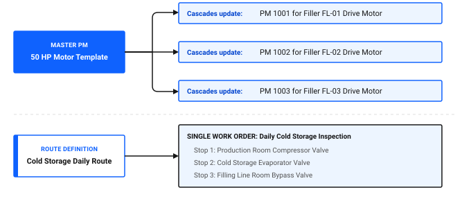

# How do I manage more assets?

As manufacturing plants expand and new production lines are commissioned, maintenance teams must manage hundreds of additional pieces of equipment. Trying to manage growing asset registries using individual, disconnected preventive maintenance records creates administrative overload and leads to missed service intervals.

Scaling maintenance operations efficiently in Maximo Application Suite Select relies on Master PM templates, multi-asset Routes, parent and child equipment hierarchies, and bulk data onboarding via Data Management.

*Looking to verify your scaling readiness right away? [Skip to scaling verification checklist ↓](#scaling-verification-checklist)*

## Core tools for scaling asset management

To scale equipment coverage without increasing administrative headcount, use four core features:

1. **Master PM templates:** Maintain a single master maintenance schedule that automatically updates individual PM records across hundreds of identical machines.
2. **Multi-stop routes:** Combine repetitive inspections across multiple assets or locations into a single consolidated work order.
3. **Asset hierarchies:** Organize equipment into parent and child relationships to track sub-assemblies and roll up total cost of ownership.
4. **Data Management tool:** Bulk load newly commissioned assets, locations, and initial meter configurations using validated spreadsheet templates.

### Table 1: Scaling mechanisms and operational applications

| Scaling mechanism | Application | Operational function | Plant scaling example |
|---|---|---|---|
| **Master PM** | Master PM | Centralizes maintenance intervals, job plans, and seasonal triggers across equipment models | Managing identical 500-hour service schedules for 30 homogenizer pumps |
| **Routes** | Routes | Bundles multiple physical assets or locations into a single sequential work order | Inspecting 45 cold storage temperature valves on a single daily shift route |
| **Parent-child trees** | Assets | Establishes sub-assembly structures for components that move between machines | Tracking drive motors and gearboxes installed on Filler FL-02 |
| **Bulk onboarding** | Data Management | Ingests large asset registries with classifications and specifications in batches | Commissioning 200 new assets for the Ice Cream Plant expansion |

Figure 1: Operational scaling through Master PMs and multi-stop routes

As shown in Figure 1, operational scaling relies on two complementary consolidation mechanisms:

- **Master PM cascading**: A single master template, such as the 50 HP Motor Template, links to and automatically updates individual maintenance schedules across the plant, including PM 1001 for Filler FL-01 Drive Motor, PM 1002 for Filler FL-02 Drive Motor, and PM 1003 for Filler FL-03 Drive Motor.
- **Route consolidation**: A single route definition, such as the Cold Storage Daily Route, bundles multiple physical inspections into one unified work order with sequential stops, covering Stop 1: Production Room Compressor Valve, Stop 2: Cold Storage Evaporator Valve, and Stop 3: Filling Line Room Bypass Valve.

## Standardizing schedules with Master PMs

When your facility operates dozens of identical assets, such as motors, pumps, or conveyors, creating separate PM schedules for each machine causes maintenance drift. If the manufacturer updates the recommended lubrication interval, updating each PM manually is time-consuming and error-prone.

A Master PM establishes the master frequency and attached Job Plan. When you modify the Master PM, Maximo Application Suite Select cascades the update to all linked individual asset PM records.

### Creating a Master PM in the desktop application

1. In the **Find navigation item** field, search for Master PM and open it.
2. Click **New Master PM**.
3. In the **Master PM** field, enter a unique identifier, such as `MPM_50HP_MOTOR`.
4. In the **Description** field, enter `Standard 50 HP Motor Quarterly Service`.
5. In the **Frequency** tab, set the maintenance interval, such as every 90 days or every 1,500 run hours.
6. In the **Job Plan** field, select the standardized maintenance procedure.
7. In the **Select Action** menu, click **Create Associated PMs** to link existing equipment records that match this equipment model.
8. Click **Save**.

## Consolidating repetitive tasks with Routes

Creating individual work orders for every light fixture, fire extinguisher, or conveyor bearing generates overwhelming work order volume that clutters technician task lists.

The Routes application groups multiple assets or locations into a single route. When Maximo Application Suite Select generates work from a routed PM, it creates one parent work order with child tasks or multiple entries on the Multi Asset and Location table.

### Table 2: Comparing individual PMs versus routed maintenance

| Metric | Individual PM approach | Routed maintenance approach |
|---|---|---|
| **Work order volume** | 50 separate work orders generated weekly | 1 consolidated work order with 50 asset stops |
| **Technician time logging** | Technician opens and closes 50 individual records | Technician logs time once on the parent route work order |
| **Scheduling overhead** | Supervisor assigns 50 distinct work orders | Supervisor assigns 1 route work order to the shift team |
| **Audit trail** | Fragmented across dozens of disconnected records | Consolidated in one chronological route history |

### Creating an asset route in the desktop application

1. In the **Find navigation item** field, search for Routes and open it.
2. Click **New Route**.
3. In the **Route** field, enter an identifier, such as `RT_COLD_INSPECT`.
4. In the **Description** field, enter `Cold Storage Daily Temperature and Valve Inspection`.
5. In the **Route Stops** table, click **New Row** to add equipment locations in sequential walking order:
   - In the **Location** field, enter `COLD_ROOM_A`.
   - In the **Asset** field, enter the specific refrigeration valve or sensor.
6. Repeat step 5 for all remaining stops along the inspection path.
7. Click **Save**.

### 💡 Tip: Order route stops by physical layout
When building routes, list stops in the exact physical sequence a technician walks through the facility. Sequencing stops by floor and room eliminates backtrack travel time and ensures inspectors do not overlook remote equipment.

## Scaling verification checklist

Use this checklist to ensure your asset management practices are optimized for scale.

### Table 3: Asset scaling verification checklist

| Check | Item | What to verify |
|---|---|---|
| [ ] | Master PM adoption | Standard equipment types are linked to Master PMs rather than standalone PM records |
| [ ] | Route consolidation | Minor recurring inspections and lubrication tasks are grouped into multi-stop routes |
| [ ] | Asset hierarchy depth | Complex machinery like Filler FL-02 is broken down into sub-assemblies for accurate failure tracking |
| [ ] | Uniform classifications | All assets within the same equipment family share identical specification attributes |
| [ ] | Bulk onboarding validation | Newly imported assets pass data validation before activation |

## Related topics

- [How do I standardize across teams?](standardize-across-teams.md)
- [How do I make data reliable?](../../improve-results/improve-data/make-data-reliable.md)
- [How do I turn data into decisions?](../insights-outcomes/data-into-decisions.md)
