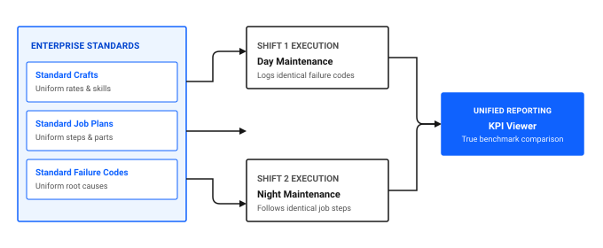

# How do I standardize across teams?

When different maintenance shifts or plant areas follow disparate procedures, equipment reliability varies widely. One shift might lubricate pump bearings using detailed manufacturer steps while another applies grease without cleaning grease fittings or checking seals.

Standardizing maintenance across teams ensures uniform safety compliance, predictable job durations, consistent failure analysis, and accurate labor cost tracking. In Maximo Application Suite Select, standardization is achieved through shared Job Plans, uniform Craft definitions, standardized Failure Codes, and structured Inspection Forms.

## Core standardization pillars in Maximo Application Suite Select

To establish consistent operational practices across all shifts and plant zones, standardize four primary elements:

1. **Standard Job Plans:** Provide unambiguous, numbered task instructions, safety lockout requirements, estimated labor hours, and required spare parts.
2. **Uniform Craft and Labor structures:** Define enterprise-wide craft codes, skill levels, and hourly billing rates.
3. **Structured Failure Hierarchies:** Enforce a common three-tier Problem, Cause, and Remedy taxonomy across all equipment classes.
4. **Digital Inspection Forms:** Replace informal walk-through checklists with version-controlled inspection templates.

### Table 1: Cross-team standardization pillars in Maximo Application Suite Select

| Standardization pillar | Application | Operational purpose | Cross-team benefit |
|---|---|---|---|
| **Standard procedures** | Job Plans | Specifies exact mechanical steps and required tools | Eliminates variation between day, night, and weekend shift execution |
| **Craft definitions** | Crafts | Standardizes skill levels, certifications, and loaded hourly rates | Ensures accurate labor cost estimation across departments |
| **Failure classification** | Failure Codes | Defines uniform Problem, Cause, and Remedy failure paths | Enables plant-wide reliability engineering and root cause comparison |
| **Digital inspections** | Inspection Forms | Standardizes quality, sanitation, and safety audit sheets | Guarantees compliance records match regulatory audit requirements |

Figure 1: Cross-shift standardization structure and unified reporting

## Creating standardized Job Plans

A well-constructed Job Plan removes guesswork for technicians. When a work order generates for Filler FL-02, the attached job plan details exact torque specifications, required seal replacement kits, and food safety sanitation steps.

### Creating a Job Plan in the desktop application

1. In the **Find navigation item** field, search for Job Plans and open it.
2. Click **New Job Plan**.
3. In the **Job Plan** field, enter an identifier, such as `JP_FILLER_SEAL_SVC`.
4. In the **Description** field, enter `Filler FL-02 Mechanical Seal Service and Inspection`.
5. In the **Tasks** table, click **New Row** to add numbered operational steps:
   - Task 10: Isolate power and apply lockout and tagout locks to main disconnect.
   - Task 20: Drain product lines and flush pump housing with clean water.
   - Task 30: Remove mechanical seal housing and inspect drive shaft for pitting.
   - Task 40: Install new food-grade mechanical seal kit and torque bolts to 25 Nm.
   - Task 50: Remove lockout tags, restore power, and conduct 15-minute leak check.
6. In the **Labor** tab, add required craft hours, such as 2 hours of Mechanical Technician, `MECH`.
7. In the **Materials** tab, specify required storeroom items, such as the replacement seal kit and food-grade lubricant.
8. In the **Select Action** menu, change status to **Active**, then click **Save**.

### 💡 Tip: Version job plans rather than overwriting active procedures
When updating standard operating procedures, use the Revision feature in Job Plans. Revising a job plan preserves historical records on completed work orders while ensuring new work orders automatically adopt the latest approved safety standards.

## Configuring uniform Crafts and Labor rates

Standardizing craft codes ensures that work plans accurately predict job costs regardless of which specific technician is assigned.

### Table 2: Example craft hierarchy for manufacturing facilities

| Craft code | Description | Skill levels | Standard hourly rate |
|---|---|---|---|
| `MECH` | Mechanical Technician | Apprentice, Journeyman, Master | $45.00 - $65.00 |
| `ELEC` | Electrical Technician | Journeyman, Master | $55.00 - $75.00 |
| `HVAC` | Refrigeration Specialist | Journeyman, Master | $60.00 - $80.00 |
| `LUBE` | Lubrication Technician | Standard | $35.00 - $45.00 |

### Creating a Craft in the desktop application

1. In the **Find navigation item** field, search for Crafts and open it.
2. Click **New Craft**.
3. In the **Craft** field, enter the code, such as `MECH`.
4. In the **Description** field, enter `Mechanical Maintenance Technician`.
5. In the **Standard Rate** field, enter the default loaded hourly labor cost.
6. In the **Skill Levels** table, click **New Row** to define progression levels, such as `JOURNEY` and `MASTER`.
7. Change status to **Active** and click **Save**.

## Cross-team standardization checklist

Use this checklist to ensure all maintenance teams operate under unified standards.

### Table 3: Cross-team standardization verification checklist

| Check | Item | What to verify |
|---|---|---|
| [ ] | Universal job plan coverage | Recurring preventive maintenance work orders have active, standardized Job Plans linked |
| [ ] | Craft rate accuracy | All active crafts have current loaded hourly rates populated in Crafts |
| [ ] | Standard failure codes | Technicians across all shifts select from the identical Problem, Cause, and Remedy tree |
| [ ] | Digital inspection templates | Paper check sheets are replaced with active digital forms in Inspection Forms |
| [ ] | Shift calendar synchronization | Team working hours and on-call schedules are updated in Calendar |

## Related topics

- [How do I manage more assets?](manage-more-assets.md)
- [How do I make data reliable?](../../improve-results/improve-data/make-data-reliable.md)
- [How do I turn data into decisions?](../insights-outcomes/data-into-decisions.md)
